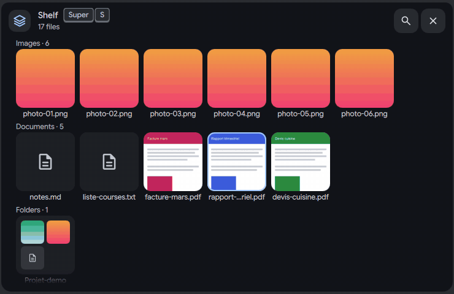
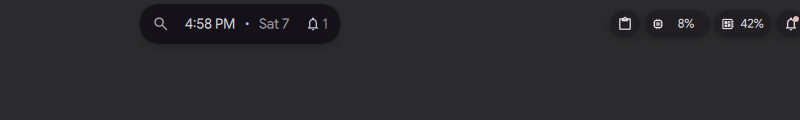
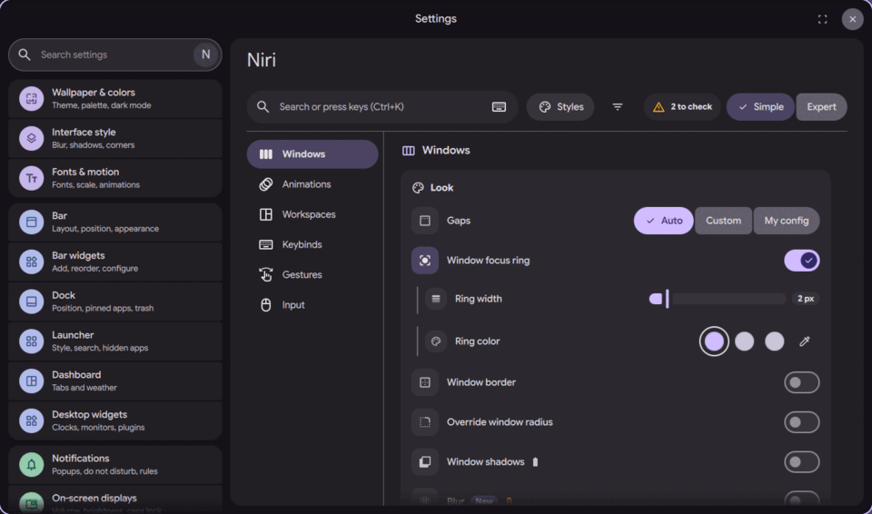

# DankIsland: everything I built for DMS

DankIsland is the island widget of DankMaterialShell (DMS). These pages describe each feature I added to it, in pull requests (now closed) or in prototypes, and the niri settings page, with links to the code.
Each page starts with its best screenshot or GIF and one sentence. Then it says what you see, how to try it on its branch, why, how it is built and its known limits, and ends with all its pictures.

## At a glance

| | |
|---|---|
|  |  |
| **[Shelf](docs/etagere-find.md)**: drop files on the island, type to find one, Space to preview it | **[Bubble card](docs/bulles-card.md)**: a notification arrives, its card opens, then tidies |
|  |  |
| **[Charge face](docs/faces-a-charge-face.md)**: plugging in opens a small sea at the battery level | **[Custom bubbles](docs/api-custom-bubbles.md)**: a plugin draws its own bubble and card, a script adds an image |
|  |  |
| **[USB drive](docs/faces-b-usb-drive.md)**: open or safely eject a plugged drive | **[niri page](docs/niri-page-shell.md)**: niri's windows, workspaces, shortcuts and input in DMS Settings |

## For plugins and scripts

Plugins and scripts can show what they want in the island: an activity drawn by the shell or by the plugin, a bubble and a card row drawn by the plugin, and for scripts an image, a theme accent and up to 3 lines of text. Start with [the activities API](docs/socle-activities-api.md), [scripts over IPC](docs/socle-activities-ipc.md) and [Plugins and scripts draw their own bubbles](docs/api-custom-bubbles.md).

## Foundation

| Feature | In one sentence | Status | Page | Code |
|---|---|---|---|---|
| Island kit: motion rules and widgets | A small kit of island widgets (buttons, app and notice icons, a liquid meter, alert rings) and the shared motion rules they all use, so every island face moves and looks the same. | in [PR #4180](https://github.com/duxlabs-dev/dux-shell/pull/4180) (closed) | [socle-kit-widgets](docs/socle-kit-widgets.md) | [IslandKit.js](https://github.com/lung595/DankMaterialShell/blob/island/1-kit/quickshell/Common/IslandKit.js) |
| Spring frame cadence (120 steps a second) | The springs of the bar, the dock and the island take at most 120 steps a second, even on a 240 Hz screen, and the motion looks the same. | in [PR #4180](https://github.com/duxlabs-dev/dux-shell/pull/4180) (closed) | [socle-spring-frame-cadence](docs/socle-spring-frame-cadence.md) | [FrameCadence.js](https://github.com/lung595/DankMaterialShell/blob/island/1-kit/quickshell/Common/FrameCadence.js) |
| Readable warning colour in light mode | In light mode the stock orange warning colour becomes a dark brown that can be read on light surfaces, while the warning toast keeps its orange ground. | in [PR #4180](https://github.com/duxlabs-dev/dux-shell/pull/4180) (closed) | [socle-light-warning-tone](docs/socle-light-warning-tone.md) | [Theme.qml](https://github.com/lung595/DankMaterialShell/blob/island/1-kit/quickshell/Common/Theme.qml) |
| Island activities API for plugins | Plugins can show an activity in the island (an alert, a live activity or a short glance), update it and end it, with one fixed order for who takes the island. | in [PR #4181](https://github.com/duxlabs-dev/dux-shell/pull/4181) (closed) | [socle-activities-api](docs/socle-activities-api.md) | [IslandActivities.js](https://github.com/lung595/DankMaterialShell/blob/island/2-api/quickshell/Common/IslandActivities.js) |
| Scripts on the island over IPC | A shell script can show an activity on the island with `dms ipc call island activity`, update it, end it, and read which button the user pressed. | in [PR #4181](https://github.com/duxlabs-dev/dux-shell/pull/4181) (closed) | [socle-activities-ipc](docs/socle-activities-ipc.md) | [DIsland.qml](https://github.com/lung595/DankMaterialShell/blob/island/2-api/quickshell/Modules/DIsland/DIsland.qml) |
| Plugins and scripts draw their own bubbles | Plugins can now draw their own bubble and card beside the island, and scripts can show an image, a theme accent and three lines of text, so both show what they want. | new commit on island/3-bubbles and island-prototype, not in a PR | [api-custom-bubbles](docs/api-custom-bubbles.md) | [IslandBubbles.qml](https://github.com/lung595/DankMaterialShell/blob/island/3-bubbles/quickshell/Modules/DIsland/IslandBubbles.qml) |
| Loading indicator with your own shapes (dux-qml-common) | The Material 3 Expressive loading indicator of dux-qml-common can now draw the caller's own shapes, and the caller can drive its morph and angle by hand. | in [PR #42](https://github.com/duxlabs-dev/dux-qml-common/pull/42) of dux-qml-common (closed) | [socle-loading-indicator](docs/socle-loading-indicator.md) | [DLoadingIndicator.qml](https://github.com/lung595/dux-qml-common/blob/island/common/DCommon/Widgets/DLoadingIndicator.qml) |

## Bubbles

| Feature | In one sentence | Status | Page | Code |
|---|---|---|---|---|
| Arrival of infos | When a notification or a short info arrives, the island swells on a spring into a short card with its icon, title, text and buttons, then folds back to the clock. | in [PR #4182](https://github.com/duxlabs-dev/dux-shell/pull/4182) (closed) | [bulles-arrival](docs/bulles-arrival.md) | [IslandArrivalState.qml](https://github.com/lung595/DankMaterialShell/blob/island/3-bubbles/quickshell/Modules/DIsland/IslandArrivalState.qml) |
| Wings and displaced bubbles | What the island cannot show right now waits beside it in a small bubble, machine things on one side and apps on the other, and comes back with a click. | in [PR #4182](https://github.com/duxlabs-dev/dux-shell/pull/4182) (closed) | [bulles-wings](docs/bulles-wings.md) | [IslandBarHost.qml](https://github.com/lung595/DankMaterialShell/blob/island/3-bubbles/quickshell/Modules/DIsland/IslandBarHost.qml) |
| Bubble card | Rest the pointer on a bubble and a card opens under the island with what waits behind it, one page per info. | in [PR #4182](https://github.com/duxlabs-dev/dux-shell/pull/4182) (closed) | [bulles-card](docs/bulles-card.md) | [IslandBubbles.qml](https://github.com/lung595/DankMaterialShell/blob/island/3-bubbles/quickshell/Modules/DIsland/IslandBubbles.qml) |
| Tiles beside the launcher | When the launcher opens, each bubble beside the island turns into a tall tile next to the launcher, and folds back when the launcher closes. | in [PR #4182](https://github.com/duxlabs-dev/dux-shell/pull/4182) (closed) | [bulles-tiles](docs/bulles-tiles.md) | [IslandBubbles.qml](https://github.com/lung595/DankMaterialShell/blob/island/3-bubbles/quickshell/Modules/DIsland/IslandBubbles.qml) |
| Notifications as island activities | Notification popups become island activities: a short card on arrival, a compact face, and an open face with the body, the action buttons and an inline reply. | in [PR #4182](https://github.com/duxlabs-dev/dux-shell/pull/4182) (closed) | [bulles-notifications](docs/bulles-notifications.md) | [IslandNotificationSource.qml](https://github.com/lung595/DankMaterialShell/blob/island/3-bubbles/quickshell/Modules/DIsland/IslandNotificationSource.qml) |
| Plugin activities and system faces | A plugin can show its own activities in the island, keep a small permanent bubble beside it, and draw a system face such as the volume in place of the shell's. | in [PR #4182](https://github.com/duxlabs-dev/dux-shell/pull/4182) (closed) | [bulles-plugins](docs/bulles-plugins.md) | [IslandActivityComponent.qml](https://github.com/lung595/DankMaterialShell/blob/island/3-bubbles/quickshell/Modules/Plugins/IslandActivityComponent.qml) |
| Bubble and arrival settings | Three new settings cards, "Plugins", "Bubbles" and "Arrival of info", decide what goes into a bubble, how bubbles look and move, and how a new info arrives. | in [PR #4182](https://github.com/duxlabs-dev/dux-shell/pull/4182) (closed) | [bulles-settings](docs/bulles-settings.md) | [SettingsSpec.js](https://github.com/lung595/DankMaterialShell/blob/island/3-bubbles/quickshell/Common/settings/SettingsSpec.js) |

## Island faces

| Feature | In one sentence | Status | Page | Code |
|---|---|---|---|---|
| Island weather alert | The island warns 15 minutes before rain, hail, snow, storm, fog or heat starts, with the weather drawn over it and a small chart of the next two hours. | working prototype | [faces-a-weather-alert](docs/faces-a-weather-alert.md) | [IslandWeather.js](https://github.com/lung595/DankMaterialShell/blob/island-prototype/quickshell/Common/IslandWeather.js) |
| Island call bubble | While an app is in a call, a bubble shows its icon and how long the call lasts, and its card mutes the app's microphone or sound without touching the system ones. | working prototype | [faces-a-call](docs/faces-a-call.md) | [IslandCall.js](https://github.com/lung595/DankMaterialShell/blob/island-prototype/quickshell/Common/IslandCall.js) |
| Island camera bubble | While an app uses the camera, a bubble shows that app's logo with a green dot, and its card names the app and can bring its window forward. | working prototype | [faces-a-camera](docs/faces-a-camera.md) | [IslandCamera.js](https://github.com/lung595/DankMaterialShell/blob/island-prototype/quickshell/Common/IslandCamera.js) |
| Island copy bubble | Each copy shows a short "Copied!" bubble with the type of what was copied, and its card shows the first line or the file name, with secrets masked. | working prototype | [faces-a-copy](docs/faces-a-copy.md) | [IslandCopy.js](https://github.com/lung595/DankMaterialShell/blob/island-prototype/quickshell/Common/IslandCopy.js) |
| Password manager copies: wipe and island bubble | When a password manager copies a secret, a bubble shows a ring that empties over 30 seconds, then the clipboard is wiped; the secret itself is never shown. | working prototype | [faces-a-password-copy](docs/faces-a-password-copy.md) | [secret.go](https://github.com/lung595/DankMaterialShell/blob/island-prototype/core/internal/server/clipboard/secret.go) |
| Island network bubbles: VPN dropped, incoming SSH, open Wi-Fi | The island tells you when a VPN drops, when someone opens an SSH session on this machine, or when you join an open Wi-Fi, and offers the fix in one click. | working prototype | [faces-a-network](docs/faces-a-network.md) | [IslandVpn.js](https://github.com/lung595/DankMaterialShell/blob/island-prototype/quickshell/Common/IslandVpn.js) |
| Island system faces and level bubbles | Volume, brightness, microphone, Caps Lock, power profile, battery, network, Do Not Disturb and audio output changes each get a face in the island, or a bubble when it is busy. | working prototype | [faces-a-system-faces](docs/faces-a-system-faces.md) | [IslandSystemSource.qml](https://github.com/lung595/DankMaterialShell/blob/island-prototype/quickshell/Modules/DIsland/IslandSystemSource.qml) |
| Island charge bubble and card | After you plug in, a "charge" bubble stays a few seconds, and its card draws the charging power since the plug, with time left, full at, health and the power profile. | working prototype | [faces-a-charge-bubble](docs/faces-a-charge-bubble.md) | [IslandCharge.js](https://github.com/lung595/DankMaterialShell/blob/island-prototype/quickshell/Common/IslandCharge.js) |
| Island charge face (sea and odometer) | Plugging in opens a charge face: a small sea at the battery level that moves with the power, the level on rolling digits, the watts and the time left. | working prototype | [faces-a-charge-face](docs/faces-a-charge-face.md) | [BubbleChargeFace.qml](https://github.com/lung595/DankMaterialShell/blob/island-prototype/quickshell/Modules/DIsland/Cards/BubbleChargeFace.qml) |
| Island keep awake bubble | While an app keeps the session awake, a bubble shows a cup with an infinity sign, and its card lists the apps with a Release button for each. | working prototype | [faces-a-keep-awake](docs/faces-a-keep-awake.md) | [IslandKeepAwake.js](https://github.com/lung595/DankMaterialShell/blob/island-prototype/quickshell/Common/IslandKeepAwake.js) |
| Island eye break | An optional reminder that asks you to look far away for a few seconds every 20 minutes, in the island or in a bubble, never over a fullscreen window or a call. | working prototype | [faces-a-eye-break](docs/faces-a-eye-break.md) | [EyeBreakService.qml](https://github.com/lung595/DankMaterialShell/blob/island-prototype/quickshell/Services/EyeBreakService.qml) |
| One-time code (2FA) | A one-time code from a notification shows in the island with its digits hidden until you hover it, and Copy puts it in the clipboard for 30 seconds only. | working prototype | [faces-b-code-2fa](docs/faces-b-code-2fa.md) | [IslandCode2fa.js](https://github.com/lung595/DankMaterialShell/blob/island-prototype/quickshell/Common/IslandCode2fa.js) |
| Authentication requests (polkit) in the island | A request for administrator rights (polkit) shows in the island, with a password field or a fingerprint or face scan, instead of a separate dialog. | working prototype | [faces-b-polkit-auth](docs/faces-b-polkit-auth.md) | [IslandAuthSource.qml](https://github.com/lung595/DankMaterialShell/blob/island-prototype/quickshell/Modules/DIsland/IslandAuthSource.qml) |
| Island over fullscreen windows | When a request needs an answer, the island lifts itself over fullscreen windows, then goes back to its layer when the request ends. | working prototype | [faces-b-overlay-layer](docs/faces-b-overlay-layer.md) | [IslandLayer.js](https://github.com/lung595/DankMaterialShell/blob/island-prototype/quickshell/Common/IslandLayer.js) |
| Downloads, received files and progress | A finished browser download, a file received from another device, or any notification with a progress value shows in the island, with Show and Open. | working prototype | [faces-b-downloads](docs/faces-b-downloads.md) | [DownloadService.qml](https://github.com/lung595/DankMaterialShell/blob/island-prototype/quickshell/Services/DownloadService.qml) |
| Transfers (copies, archives, torrents, downloads) | One bubble shows every file transfer at once (copies, archives, torrents, downloads), with the total progress, the time left, and a card to pause or cancel each one. | working prototype | [faces-b-transfers](docs/faces-b-transfers.md) | [handlers.go](https://github.com/lung595/DankMaterialShell/blob/island-prototype/core/internal/server/transfers/handlers.go) |
| Low disk space bubble and disk explorer | When a disk has less than 10 % free, a bubble says so, and its card shows what takes the space as a treemap, rings or a list, with Trash, Open and Shelf actions. | working prototype | [faces-b-disk-space](docs/faces-b-disk-space.md) | [DiskSpaceService.qml](https://github.com/lung595/DankMaterialShell/blob/island-prototype/quickshell/Services/DiskSpaceService.qml) |
| USB drive bubble | A plugged USB drive gets a bubble with its name and free space, and its card opens or safely ejects it. | working prototype | [faces-b-usb-drive](docs/faces-b-usb-drive.md) | [IslandUsb.js](https://github.com/lung595/DankMaterialShell/blob/island-prototype/quickshell/Common/IslandUsb.js) |
| Printing bubble | While a document prints, a bubble shows the printer and the document with Cancel, and it turns orange with Resume and Cancel when the printer has a problem. | working prototype | [faces-b-print](docs/faces-b-print.md) | [IslandPrint.js](https://github.com/lung595/DankMaterialShell/blob/island-prototype/quickshell/Common/IslandPrint.js) |
| New screen plugged in | When you plug in a new monitor under niri, a bubble offers Extend, Duplicate or Only this one, with Undo, and can remember the choice for that monitor. | working prototype | [faces-b-screen-layout](docs/faces-b-screen-layout.md) | [IslandScreen.js](https://github.com/lung595/DankMaterialShell/blob/island-prototype/quickshell/Common/IslandScreen.js) |
| Low battery of mice, keyboards and other devices | When a wireless mouse, keyboard, gamepad or headset goes under 15 %, and again under 5 %, a bubble shows the device and its level, and another one when it starts charging. | working prototype | [faces-b-peripheral-battery](docs/faces-b-peripheral-battery.md) | [IslandPeriph.js](https://github.com/lung595/DankMaterialShell/blob/island-prototype/quickshell/Common/IslandPeriph.js) |
| Trash bubble with Undo | When a file goes to the trash, from DMS, a file manager or a terminal, the island shows its name with an Undo button while a ring drains. | working prototype | [faces-b-trash-undo](docs/faces-b-trash-undo.md) | [IslandTrash.js](https://github.com/lung595/DankMaterialShell/blob/island-prototype/quickshell/Common/IslandTrash.js) |
| App events: crash, reopen and urgent window | The island tells you when a desktop app crashes (with the end of its log and Relaunch), offers to reopen a background app whose last window you closed, and shows urgent windows. | working prototype | [faces-b-app-events](docs/faces-b-app-events.md) | [AppCrashService.qml](https://github.com/lung595/DankMaterialShell/blob/island-prototype/quickshell/Services/AppCrashService.qml) |

## Shelf and settings

| Feature | In one sentence | Status | Page | Code |
|---|---|---|---|---|
| Shelf: drop files and keep them | Drag a file onto the island and let go: the shelf keeps a link to it, so you can drop it into another app later. | working prototype | [etagere-drop-and-keep](docs/etagere-drop-and-keep.md) | [IslandShelfDrop.qml](https://github.com/lung595/DankMaterialShell/blob/island-prototype/quickshell/Modules/DIsland/IslandShelfDrop.qml) |
| Shelf: find a file | The shelf sorts its files into rows by kind with real previews, and you find one by just typing its name. | working prototype | [etagere-find](docs/etagere-find.md) | [IslandShelf.js](https://github.com/lung595/DankMaterialShell/blob/island-prototype/quickshell/Common/IslandShelf.js) |
| Shelf: open and preview a file | Space on a file of the shelf previews it inside the card (images, video, sound, PDF, Office, Markdown, code, archives, folders), and Enter opens it in its app. | working prototype | [etagere-open-preview](docs/etagere-open-preview.md) | [IslandShelfSource.qml](https://github.com/lung595/DankMaterialShell/blob/island-prototype/quickshell/Modules/DIsland/IslandShelfSource.qml) |
| Shelf: send, move, act on and remove files | From the shelf you drag files into any app, copy, convert, move, send to a phone or remove them, and every move or removal can be undone with Ctrl+Z. | working prototype | [etagere-send-remove](docs/etagere-send-remove.md) | [island-shelf.sh](https://github.com/lung595/DankMaterialShell/blob/island-prototype/quickshell/scripts/island-shelf.sh) |
| Shelf: cloud folders and drop zones | Drop a file on the shelf's Cloud zone and it is copied into one of your synced folders; DMS itself never talks to the network. | working prototype | [etagere-cloud](docs/etagere-cloud.md) | [SettingsSpec.js](https://github.com/lung595/DankMaterialShell/blob/island-prototype/quickshell/Common/settings/SettingsSpec.js) |
| Shelf: shortcut, keyboard and launcher | Super+S opens the shelf and the whole shelf works from the keyboard; press ? for the list of keys. | working prototype | [etagere-keyboard](docs/etagere-keyboard.md) | [DIsland.qml](https://github.com/lung595/DankMaterialShell/blob/island-prototype/quickshell/Modules/DIsland/DIsland.qml) |
| Island settings page (mock-up) | A mock-up of one "Island" entry in Settings that gathers every island setting into eleven pages, with a full Shelf page and a table of all 41 bubbles. | mock-up | [etagere-settings-mockup](docs/etagere-settings-mockup.md) | [SettingsTabs.qml](https://github.com/lung595/DankMaterialShell/blob/island-settings-mockup/quickshell/Common/SettingsTabs.qml) |

## niri settings page

The maintainers asked to pause PR #4063 and to talk with the team first, before more work on it.

| Feature | In one sentence | Status | Page | Code |
|---|---|---|---|---|
| niri settings page: shell and layout | A "Niri" tab in DMS Settings that sets niri's windows, animations, workspaces, shortcuts, gestures and input from one page, with search, presets and a Simple or Expert mode. | in open [PR #4063](https://github.com/duxlabs-dev/dux-shell/pull/4063) | [niri-page-shell](docs/niri-page-shell.md) | [NiriTab.qml](https://github.com/lung595/DankMaterialShell/blob/page-niri-pr/quickshell/Modules/Settings/NiriTab.qml) |
| niri settings page: safe config writing | Every change on the niri page is written as KDL to its own file, checked by niri before it is saved, and brought back if niri fails to reload. | in open [PR #4063](https://github.com/duxlabs-dev/dux-shell/pull/4063) | [niri-safe-config-writing](docs/niri-safe-config-writing.md) | [store.go](https://github.com/lung595/DankMaterialShell/blob/page-niri-pr/core/internal/niriconf/store.go) |
| niri settings page: KDL drawer | In Expert mode, a drawer shows the KDL the page writes for the current section and lets you add your own lines, with a diff and a check by niri before saving. | in open [PR #4063](https://github.com/duxlabs-dev/dux-shell/pull/4063) | [niri-kdl-drawer](docs/niri-kdl-drawer.md) | [NiriKdlDrawer.qml](https://github.com/lung595/DankMaterialShell/blob/page-niri-pr/quickshell/Modules/Settings/Niri/Drawer/NiriKdlDrawer.qml) |
| niri settings page: health popover and config doctor | A "Health" pill on the niri page checks the config files niri reads and lists what is wrong, such as a key bound twice or a missing include, with a fix and Undo where one exists. | in open [PR #4063](https://github.com/duxlabs-dev/dux-shell/pull/4063) | [niri-health-doctor](docs/niri-health-doctor.md) | [doctor.go](https://github.com/lung595/DankMaterialShell/blob/page-niri-pr/core/internal/niriconf/doctor.go) |
| niri settings page: Styles (presets and profiles) | A "Styles" button applies a whole look in one click (Compact, niri default, Comfortable, Focus) and saves, exports or imports your own. | in open [PR #4063](https://github.com/duxlabs-dev/dux-shell/pull/4063) | [niri-styles](docs/niri-styles.md) | [NiriStylesPopup.qml](https://github.com/lung595/DankMaterialShell/blob/page-niri-pr/quickshell/Modules/Settings/Niri/Shell/NiriStylesPopup.qml) |
| niri settings page: shared rows and the "Keep this change?" banner | Every niri setting is the same kind of row, with an icon, a tip, a "Modified" dot and Reset, and risky changes ask "Keep this change?" before they stay. | in open [PR #4063](https://github.com/duxlabs-dev/dux-shell/pull/4063) | [niri-row-controls](docs/niri-row-controls.md) | [NiriRow.qml](https://github.com/lung595/DankMaterialShell/blob/page-niri-pr/quickshell/Modules/Settings/Niri/Components/NiriRow.qml) |
| niri settings page: search by words or by keys | One search bar finds niri settings by plain words ("more space" finds Gaps) and shortcuts by pressing the keys themselves. | in open [PR #4063](https://github.com/duxlabs-dev/dux-shell/pull/4063) | [niri-search](docs/niri-search.md) | [search.js](https://github.com/lung595/DankMaterialShell/blob/page-niri-pr/quickshell/Common/niri/search.js) |
| niri settings page: window look (gaps, ring, border, corners, shadow, blur) | The Look card sets how niri draws windows: gaps, focus ring, border, corners, shadows and blur, with colours from the DMS theme. | in open [PR #4063](https://github.com/duxlabs-dev/dux-shell/pull/4063) | [niri-windows-look](docs/niri-windows-look.md) | [LookCard.qml](https://github.com/lung595/DankMaterialShell/blob/page-niri-pr/quickshell/Modules/Settings/Niri/Sections/Windows/LookCard.qml) |
| niri settings page: columns, overview and Alt-Tab | The Columns card sets how niri lays out columns (centering, new column width, preset widths), the overview zoom and the Alt-Tab switcher. | in open [PR #4063](https://github.com/duxlabs-dev/dux-shell/pull/4063) | [niri-windows-columns](docs/niri-windows-columns.md) | [ColumnsCard.qml](https://github.com/lung595/DankMaterialShell/blob/page-niri-pr/quickshell/Modules/Settings/Niri/Sections/Windows/ColumnsCard.qml) |
| niri settings page: Super+R fills the remaining space | An option makes Super+R first stretch the focused column over the remaining width, then go back, then walk the preset widths. | in open [PR #4063](https://github.com/duxlabs-dev/dux-shell/pull/4063) | [niri-super-r-cycle](docs/niri-super-r-cycle.md) | [NiriColumnCycle.qml](https://github.com/lung595/DankMaterialShell/blob/page-niri-pr/quickshell/Services/NiriColumnCycle.qml) |
| niri settings page: window rules | Make a niri window rule by clicking a window: its app ID and title are filled in, and a live count says how many open windows the rule matches. | in open [PR #4063](https://github.com/duxlabs-dev/dux-shell/pull/4063) | [niri-window-rules](docs/niri-window-rules.md) | [RulesCard.qml](https://github.com/lung595/DankMaterialShell/blob/page-niri-pr/quickshell/Modules/Settings/Niri/Sections/Windows/RulesCard.qml) |
| niri settings page: animations | Turn niri's animations on or off, slow them down, give them one style, or fine tune each of the 11 with a live preview. | in open [PR #4063](https://github.com/duxlabs-dev/dux-shell/pull/4063) | [niri-animations](docs/niri-animations.md) | [AnimationsSection.qml](https://github.com/lung595/DankMaterialShell/blob/page-niri-pr/quickshell/Modules/Settings/Niri/Sections/AnimationsSection.qml) |
| niri settings page: workspaces board, names and bulk actions | A live board of niri's workspaces, one lane each with a chip per window: drag a chip to move the window, name workspaces, and move or close many windows at once. | in open [PR #4063](https://github.com/duxlabs-dev/dux-shell/pull/4063) | [niri-workspaces-board](docs/niri-workspaces-board.md) | [BoardCard.qml](https://github.com/lung595/DankMaterialShell/blob/page-niri-pr/quickshell/Modules/Settings/Niri/Sections/Workspaces/BoardCard.qml) |
| niri settings page: close a whole workspace | A new shortcut, Super+Delete, closes every window of the focused workspace, and asks first when there are many. | in open [PR #4063](https://github.com/duxlabs-dev/dux-shell/pull/4063) | [niri-close-workspace](docs/niri-close-workspace.md) | [NiriWorkspaceActions.qml](https://github.com/lung595/DankMaterialShell/blob/page-niri-pr/quickshell/Services/NiriWorkspaceActions.qml) |
| niri settings page: session and startup environment | Reopen chosen programs at login, each on its own workspace and screen, and set environment variables for the session. | in open [PR #4063](https://github.com/duxlabs-dev/dux-shell/pull/4063) | [niri-session-startup](docs/niri-session-startup.md) | [SessionCard.qml](https://github.com/lung595/DankMaterialShell/blob/page-niri-pr/quickshell/Modules/Settings/Niri/Sections/Workspaces/SessionCard.qml) |
| niri settings page: drawn keyboard for shortcuts | Shortcuts are shown on a drawn keyboard in your layout, coloured by category; hold Super to see what each key does. | in open [PR #4063](https://github.com/duxlabs-dev/dux-shell/pull/4063) | [niri-keybinds-keyboard](docs/niri-keybinds-keyboard.md) | [KeyboardCard.qml](https://github.com/lung595/DankMaterialShell/blob/page-niri-pr/quickshell/Modules/Settings/Niri/Sections/Keybinds/KeyboardCard.qml) |
| niri settings page: shortcut list, guided add, packs and export | Next to the drawn keyboard, a list of the shortcuts of a key or category, with Test, Edit and Delete, a guided "New shortcut", ready-made packs and export. | in open [PR #4063](https://github.com/duxlabs-dev/dux-shell/pull/4063) | [niri-keybinds-list](docs/niri-keybinds-list.md) | [BindsPane.qml](https://github.com/lung595/DankMaterialShell/blob/page-niri-pr/quickshell/Modules/Settings/Niri/Sections/Keybinds/BindsPane.qml) |
| niri settings page: add the missing default binds | Add the DMS default shortcuts that are still free to your niri config in one action, checked by niri first and with Undo. | in open [PR #4063](https://github.com/duxlabs-dev/dux-shell/pull/4063) | [niri-default-binds](docs/niri-default-binds.md) | [niri_defaults.go](https://github.com/lung595/DankMaterialShell/blob/page-niri-pr/core/internal/keybinds/providers/niri_defaults.go) |
| niri settings page: input (keyboard, touchpad, mouse, cursor) | Keyboard layouts and repeat, touchpad, mouse and cursor settings for niri, with picture tiles and a countdown that brings back the old layout if the new one locks you out. | in open [PR #4063](https://github.com/duxlabs-dev/dux-shell/pull/4063) | [niri-input](docs/niri-input.md) | [InputKeyboardCard.qml](https://github.com/lung595/DankMaterialShell/blob/page-niri-pr/quickshell/Modules/Settings/Niri/Sections/Input/InputKeyboardCard.qml) |
| niri settings page: gestures | The Gestures section lists niri's touchpad, mouse and touchscreen gestures and plays each one on a drawn desktop when you hover it. | in open [PR #4063](https://github.com/duxlabs-dev/dux-shell/pull/4063) | [niri-gestures](docs/niri-gestures.md) | [GesturesSection.qml](https://github.com/lung595/DankMaterialShell/blob/page-niri-pr/quickshell/Modules/Settings/Niri/Sections/GesturesSection.qml) |
| niri settings page: hot corners | Pick what each screen corner does (Overview, Notifications, Launcher, Control Center, Screenshot or nothing) by clicking it on a drawn screen. | in open [PR #4063](https://github.com/duxlabs-dev/dux-shell/pull/4063) | [niri-hot-corners](docs/niri-hot-corners.md) | [CornersCard.qml](https://github.com/lung595/DankMaterialShell/blob/page-niri-pr/quickshell/Modules/Settings/Niri/Sections/Gestures/CornersCard.qml) |
| niri settings page: Advanced section | An Expert-only section for four risky settings (the Mod key, the power button, X11 apps and debug options), each guarded by a 15 second "Keep this change?" timer. | in open [PR #4063](https://github.com/duxlabs-dev/dux-shell/pull/4063) | [niri-advanced](docs/niri-advanced.md) | [AdvancedSection.qml](https://github.com/lung595/DankMaterialShell/blob/page-niri-pr/quickshell/Modules/Settings/Niri/Sections/AdvancedSection.qml) |
| niri settings page: logo on the Super key | On the drawn keyboard, the Super key shows a small logo: a gear on a Framework laptop, a parody four-tile logo elsewhere. | in open [PR #4063](https://github.com/duxlabs-dev/dux-shell/pull/4063) | [niri-super-key-logo](docs/niri-super-key-logo.md) | [SuperKeyLogo.qml](https://github.com/lung595/DankMaterialShell/blob/page-niri-pr/quickshell/Modules/Settings/Niri/Keys/SuperKeyLogo.qml) |
| niri settings page: one place for each setting, and ways to reach the page | Under niri, old Settings tabs that the niri page replaces are hidden, and "Set in niri" rows take you to the right section of the niri page. | in open [PR #4063](https://github.com/duxlabs-dev/dux-shell/pull/4063) | [niri-settings-links](docs/niri-settings-links.md) | [SettingsNiriLink.qml](https://github.com/lung595/DankMaterialShell/blob/page-niri-pr/quickshell/Modules/Settings/Widgets/SettingsNiriLink.qml) |

## Reference branches

- [island/1-kit](https://github.com/lung595/DankMaterialShell/tree/island/1-kit): The code of PR #4180, with the island kit (motion rules, spring frame cadence, widgets) and the readable warning colour in light mode.
- [island/2-api](https://github.com/lung595/DankMaterialShell/tree/island/2-api): The code of PR #4181, with the island activities API for plugins and the IPC calls for scripts.
- [island/3-bubbles](https://github.com/lung595/DankMaterialShell/tree/island/3-bubbles): The code of PR #4182, with the arrival of infos, wings and bubbles, the bubble card, tiles, notifications, plugin activities and their settings, plus a newer commit that lets plugins draw their own bubble and card and gives scripts an image.
- [island-prototype](https://github.com/lung595/DankMaterialShell/tree/island-prototype): The whole island as a working prototype, not in a PR, with every island face, the shelf, and the same plugin and script extension.
- [island-settings-mockup](https://github.com/lung595/DankMaterialShell/tree/island-settings-mockup): The island settings page mock-up, not in a PR.
- [page-niri-pr](https://github.com/lung595/DankMaterialShell/tree/page-niri-pr): The code of PR #4063, with the niri settings page.
- [dux-qml-common island/common](https://github.com/lung595/dux-qml-common/tree/island/common): The code of PR #42 of dux-qml-common, with the loading indicator that takes the caller's own shapes.

