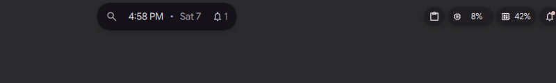
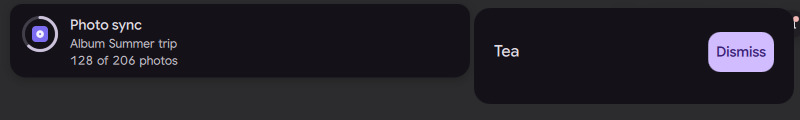
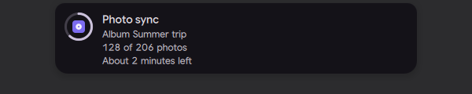

# Plugins and scripts draw their own bubbles

Status: new commit [0423d9c](https://github.com/lung595/DankMaterialShell/commit/0423d9c835baa724b9c7c5960078f7492ceff149) on [`island/3-bubbles`](https://github.com/lung595/DankMaterialShell/tree/island/3-bubbles), ported to [`island-prototype`](https://github.com/lung595/DankMaterialShell/tree/island-prototype) in [5b4b0f1](https://github.com/lung595/DankMaterialShell/commit/5b4b0f12eab702ccc70db793679bfb13d25df79f); not in a PR



*A script's alert with an image pushes the example plugin's activity aside: it waits in a bubble the plugin draws, its card row is drawn by the plugin too, then it gets the island back*

In one sentence: Plugins can now draw their own bubble and card beside the island, and scripts can show an image, a theme accent and three lines of text, so both show what they want.

## What it does

- A plugin's activity that waits beside the island (another activity took the island) shows the bubble the plugin draws itself (`bubbleContent`), and the plugin's own row in that bubble's hover card (`cardContent`). Without them, the shell draws its standard bubble from the data, as before.
- The plugin sets their sizes with `bubbleLength` and `cardHeight`, from 0 to 240 px. 0 keeps the shell's size, and they are never smaller than the shell's.
- Buttons in `cardContent` take their own clicks. Elsewhere on the row, left and right click keep their role.
- A plugin's small permanent bubble (`setPermanent`) takes a `bubbleContent` too: the plugin draws the face in place of the icon. Only a QML `Component` is accepted.
- A script gets a richer face, still without any QML: `image` (an icon of the theme, or the absolute path of a local picture) shown in place of the icon on the ring, the sheet, the bubble and the card row; `accent`, one of the theme's roles; and `text` on up to 3 lines (all of them on the open sheet, the first one in the closed face and the card row). An image alone is enough content.
- A bad image or accent is refused with an answer: `ISLAND_ACTIVITY_BAD_IMAGE` (a URL, `file://`, `data:`, an `image://` provider, a device such as `/dev/zero`, an unknown icon) or `ISLAND_ACTIVITY_BAD_ACCENT` (a raw colour such as `#ff0000`).

## Try it

- Check out `island/3-bubbles`, use a bar in the Island layout, copy `quickshell/PLUGINS/IslandActivityExample` into `~/.config/dms/plugins/` and turn it on in Settings, Plugins.
- Run `dms ipc call islandActivityExample request live`, then push it aside with a script's alert: `dms ipc call island activity sync alert '{"title":"Photo sync","image":"drive-harddisk","text":"Album Summer trip\n128 of 206 photos"}'`. "Tea" now waits in the bubble the plugin draws. Hover it for the plugin's card row with its Dismiss button.
- `dms ipc call islandActivityExample permanentDrawn left` pins a permanent bubble with a face the plugin draws.
- Give a script an image that is not allowed, for example `"image":"https://example.com/a.png"`: the call prints `ISLAND_ACTIVITY_BAD_IMAGE`.

## Why

- Plugins could already draw their activity inside the island, but once another activity pushed them aside they fell back to the shell's standard bubble. Now a plugin's look stays its own in the bubble and in the card too.
- A script talks to the shell over `dms ipc`, so its data is checked at a trust boundary. It gets a richer data model (an image, a theme accent, 3 lines), never QML code.
- An image is a theme icon or a local file only: no network request and no device read.

## How it is built

- Plugin side: [`IslandActivityComponent.qml`](https://github.com/lung595/DankMaterialShell/blob/island/3-bubbles/quickshell/Modules/Plugins/IslandActivityComponent.qml) gains `bubbleContent`, `cardContent`, `bubbleLength` and `cardHeight`.
- [`IslandBubbles.qml`](https://github.com/lung595/DankMaterialShell/blob/island/3-bubbles/quickshell/Modules/DIsland/IslandBubbles.qml) makes one plugin surface (`PluginSurface`) for each bubble it shows, and one more for the card page when that page shows another activity, with `token`, `kind`, `activityData` and `interrupted: true`. A surface is loaded only while it is seen: the bubble visible, the card open.
- [`IslandPermanent.qml`](https://github.com/lung595/DankMaterialShell/blob/island/3-bubbles/quickshell/Modules/DIsland/IslandPermanent.qml) loads the drawn face of the permanent bubble. [`IslandBarHost.qml`](https://github.com/lung595/DankMaterialShell/blob/island/3-bubbles/quickshell/Modules/DIsland/IslandBarHost.qml) passes `pluginId` and `image` into each bubble entry, and sizes the sheet for its lines.
- Script side: [`IslandActivityInput.js`](https://github.com/lung595/DankMaterialShell/blob/island/3-bubbles/quickshell/Common/IslandActivityInput.js) checks the data (`scriptImage`, `scriptData`, `readyFace`). An image is a theme icon that `Quickshell.hasThemeIcon` knows, or an absolute path of at most 2048 characters with no control character, ending in `.png`, `.jpg`, `.jpeg`, `.svg`, `.webp`, `.gif` or `.bmp`. The data stays a JSON object of 16384 characters at most.
- The shell faces show the image and the lines: `ReadyActivityRing.qml`, `ReadyActivityCompact.qml` and `ReadyActivityExpanded.qml` in `Modules/DIsland/Activities/`.
- Example plugin: [`ExampleIsland.qml`](https://github.com/lung595/DankMaterialShell/blob/island/3-bubbles/quickshell/PLUGINS/IslandActivityExample/ExampleIsland.qml) draws its bubble and card row, [`ExampleDaemon.qml`](https://github.com/lung595/DankMaterialShell/blob/island/3-bubbles/quickshell/PLUGINS/IslandActivityExample/ExampleDaemon.qml) adds `permanentDrawn`.
- Docs: [`PLUGINS/README.md`](https://github.com/lung595/DankMaterialShell/blob/island/3-bubbles/quickshell/PLUGINS/README.md) has the table of properties, the permanent bubble, and a new section "Island Activities from Scripts" with the fields, the refusals and the IPC answers.
- Tests: [`island-activity-input.test.mjs`](https://github.com/lung595/DankMaterialShell/blob/island/3-bubbles/quickshell/tests/island-activity-input.test.mjs) and [`island-permanent.test.mjs`](https://github.com/lung595/DankMaterialShell/blob/island/3-bubbles/quickshell/tests/island-permanent.test.mjs). On `island-prototype` the same cases are in [`island-activities.test.mjs`](https://github.com/lung595/DankMaterialShell/blob/island-prototype/quickshell/tests/island-activities.test.mjs) and [`island-permanent.test.mjs`](https://github.com/lung595/DankMaterialShell/blob/island-prototype/quickshell/tests/island-permanent.test.mjs).
- A plugin, in short:

```qml
IslandActivityComponent {
    id: root
    bubbleLength: 112      // 0 keeps the shell's size
    cardHeight: 64
    bubbleContent: Item {
        StyledText { anchors.centerIn: parent; text: root.activityData.label }
    }
    cardContent: Item {
        IslandButton { anchors.right: parent.right; text: "Dismiss"; onClicked: root.dismiss() }
    }
}
```

- A script, in short:

```bash
tok=$(dms ipc call island activity sync live '{"title":"Photo sync","image":"/tmp/album.png","accent":"tertiary","text":"Album Summer trip\n128 of 206 photos\nAbout 2 minutes left"}')
dms ipc call island activityEnd "$tok"
dms ipc call island activity sync live '{"title":"Photo sync","image":"https://example.com/a.png"}'   # ISLAND_ACTIVITY_BAD_IMAGE
```

## Known limits

- The image file is not read when the call comes: a read there could block the shell on a special or very large file. Only its form is checked (an absolute path with a picture extension). A file that cannot be read shows the icon instead.
- Only an absolute path is accepted, not `file://`.
- A real click on the button of the plugin's card was not tried on the test bench, where synthetic input is not reliable. The card was opened with `dms ipc call island bubble card`.
- The bubble surfaces get no `screen`, `edge` or `islandRect`. On a vertical bar there is no card, and the bubble keeps its square size.
- The title of a script's sheet can still wrap on 3 lines while the height counts one, as before this change. The same goes for a notification detail on several lines in a card row.
- There is no QML render test (AGENTS.md keeps tests away from `Modules/`). The rendering was checked on the test bench.
- On `island-prototype`, the plugin's card and the 3-line sheet were not seen on the bench: the prototype has no IPC to open the card of an app bubble, and `island open activity` opens the home view there.
- Screenshots in the dark theme only.

## Images

A script's alert with an image pushes the example plugin's activity aside: it waits in a bubble the plugin draws, its card row is drawn by the plugin too, then it gets the island back.


Left, a script's alert with its own image holds the island. Right, the card drawn by the plugin for its waiting activity: Tea and a Dismiss button.



The open sheet of a script's activity: its image, its title and three lines of text.


