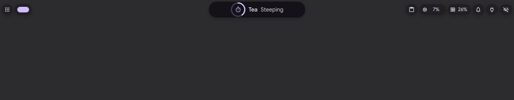
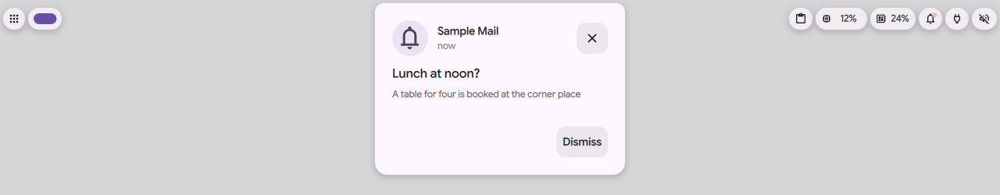

# Arrival of infos

Status: in [PR #4182](https://github.com/duxlabs-dev/dux-shell/pull/4182) (closed)

## What it does

- When an info arrives (a notification, a brief info such as caps lock or a volume change, a call), the island swells on a spring into a short card with the icon, the title, the text and buttons (Dismiss, and the notification's own action if it has one). Then the card folds to the compact face, and the clock comes back.
- Several infos in a burst become pages of the same short card, with page dots and a countdown dot.
- The wheel or the touchpad turns the pages, and so does a swipe sideways. "Scroll through infos" in Settings turns the wheel on or off, and a second option reverses its direction.
- A pull toward the screen edge puts everything away. A pull away from the edge, or a click on the short card, opens the notification whole: the full card with the app, the time, the title, the text and Dismiss. A click on the compact face brings the short card back.
- Three tiers set how long the arrival stays and how strongly it bounces and takes colour: brief, normal (a notification) and important (a call, a critical alert).
- Three styles: `bc` (step and bounce, with the card, the default), `c` (the bounce only) and `a` (one quiet breath).

## Why

- Before, a notification showed only a compact face (app and title) and a new one replaced the current one. There was no way to read the text or go back to the previous one inside the island.
- The author wants one place to look: an info grows where it is, and the same gestures work everywhere in the island.
- A bubble should not stay longer than needed. When an info leaves the island for its bubble, the bubble lives its full time from that moment.

## How it is built

- Every motion is a spring or a curve started by an event, using the kit's `beat()` cadence. With reduced motion on, the card and the pager settle at once.
- State of the burst, the pages and the countdown: [IslandArrivalState.qml](https://github.com/lung595/DankMaterialShell/blob/island/3-bubbles/quickshell/Modules/DIsland/IslandArrivalState.qml) (`arrive`, `step`, `tidy`, signal `released`). It is owned by the island controller, so that code stays out of `IslandController`.
- Pure logic (tiers, pulse, growth, burst, pager, countdown): [IslandArrival.js](https://github.com/lung595/DankMaterialShell/blob/island/3-bubbles/quickshell/Common/IslandArrival.js). Gestures and the keyboard actions: [IslandArrivalGestures.js](https://github.com/lung595/DankMaterialShell/blob/island/3-bubbles/quickshell/Common/IslandArrivalGestures.js).
- The card and its pages: [ArrivalCard.qml](https://github.com/lung595/DankMaterialShell/blob/island/3-bubbles/quickshell/Modules/DIsland/Activities/ArrivalCard.qml), [ArrivalPage.qml](https://github.com/lung595/DankMaterialShell/blob/island/3-bubbles/quickshell/Modules/DIsland/Activities/ArrivalPage.qml), and the page dots in [IslandPager.qml](https://github.com/lung595/DankMaterialShell/blob/island/3-bubbles/quickshell/Modules/DIsland/Kit/IslandPager.qml).
- The notification source feeds the burst: [IslandNotificationSource.qml](https://github.com/lung595/DankMaterialShell/blob/island/3-bubbles/quickshell/Modules/DIsland/IslandNotificationSource.qml).
- Settings (five keys): `islandArrivalStyle`, `islandArrivalBounce`, `islandArrivalTint`, `islandArrivalWheel`, `islandArrivalWheelInverted`, in [SettingsSpec.js](https://github.com/lung595/DankMaterialShell/blob/island/3-bubbles/quickshell/Common/settings/SettingsSpec.js). The card "Arrival of info" is [IslandArrivalCard.qml](https://github.com/lung595/DankMaterialShell/blob/island/3-bubbles/quickshell/Modules/Settings/Widgets/IslandArrivalCard.qml).
- IPC on the `island` target: `arrival open` (the full card), `arrival next`, `arrival prev`, `arrival tidy`. They answer `DANK_ISLAND_ARRIVAL_UNAVAILABLE: ACTION` when there is nothing to act on, for example when the clock is already back.
- Tests: [island-arrival.test.mjs](https://github.com/lung595/DankMaterialShell/blob/island/3-bubbles/quickshell/tests/island-arrival.test.mjs) and [island-arrival-gestures.test.mjs](https://github.com/lung595/DankMaterialShell/blob/island/3-bubbles/quickshell/tests/island-arrival-gestures.test.mjs).

## Known limits

- The hover, click, wheel and swipe gestures were not tried with a real pointer. The test instance had no pointer, so the scenes were driven by IPC.
- The action button of a notification in its arrival card has no IPC call of its own. From the keyboard, the action is in the notification center.
- The close button of the arrival card has a target of about 42 by 48 px, and the pager zone covers about 6 px of it.
- The burst costs more CPU than the base: a little over 2 % of the machine (2.06 % to 2.25 % on the test instance), above the 2 % rule of the author's notes. It was kept on purpose.
- `arrival` reads the action name through the prototype chain, so a name like `valueOf` throws instead of answering "unknown action". Only a local caller of `dms ipc` can send it.
- The arrival style `bc` is on by default, so a notification now arrives with the new motion.

## Images

