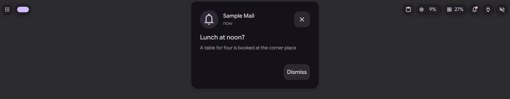
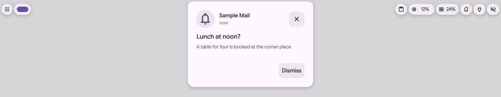

# Bubble card

Status: in [PR #4182](https://github.com/duxlabs-dev/dux-shell/pull/4182) (closed)

*A notification arrives and its card opens, then tidies*

In one sentence: Rest the pointer on a bubble and a card opens under the island with what waits behind it, one page per info.

## What it does

- Rest the pointer on a bubble for 220 ms and it opens a card that lists what waits behind it.
- When several infos wait on a bubble, the card has page dots, and the wheel turns the pages (if "Scroll through infos" is on).
- The shape under an app's logo takes the tone that contrasts most with the logo, so a white logo is not lost on the light theme.
- Settings (card "Bubbles"): the shape style (filled, or tone on tone), the shape tone (from the theme or from a colour scheme of the wallpaper), the corners (like the island, or round), an optional outline with its width, opacity and colour, and how much the bubbles lean, stretch and bounce.
- IPC: `bubble card NAME` holds the card open on that bubble's page, a second call lets it go. It prints `DANK_ISLAND_BUBBLE_CARD: NAME`, a tab and the screen name. It answers `DANK_ISLAND_BUBBLE_UNAVAILABLE: NAME` when no wing shows the bubble, or on a vertical bar, which opens no card.

## Try it

- Check out `island/3-bubbles`, use a bar in the Island layout, and make a bubble wait in a wing (see [the wings page](bulles-wings.md)).
- Rest the pointer on the bubble for a moment: the card opens. With several infos, the wheel turns its pages.
- Without a pointer: `dms ipc call island bubble card machine` holds the card of the machine bubble open, a second call lets it go.
- Change the shape, the corners and the outline in Settings, card "Bubbles".

## Why

- The author wants the same gesture to give the same result on both sides: on a bubble, hover or click makes the bubble grow into a card, so the user always knows where to look.
- Every bubble, from the core or from a plugin, gets the same card, played by the wing.
- Before, a waiting bubble could not be read without bringing it into the island.

## How it is built

- The card is drawn inside the wing of [IslandBubbles.qml](https://github.com/lung595/DankMaterialShell/blob/island/3-bubbles/quickshell/Modules/DIsland/IslandBubbles.qml): `hoverDwell` (220 ms), `cardFace` (one row, made as the card opens), `retargetCard`, and an [IslandPager.qml](https://github.com/lung595/DankMaterialShell/blob/island/3-bubbles/quickshell/Modules/DIsland/Kit/IslandPager.qml) for the other pages.
- The rule for when a card opens is the pure function `cardOpen` in [IslandKit.js](https://github.com/lung595/DankMaterialShell/blob/island/3-bubbles/quickshell/Common/IslandKit.js).
- The shape colour under a logo: the "Under an app's logo" code in `IslandBubbles.qml`. Black and white are the last resort, one of them reads at 4.5:1 on any opaque ground.
- Settings card: [IslandBubblesCard.qml](https://github.com/lung595/DankMaterialShell/blob/island/3-bubbles/quickshell/Modules/Settings/Widgets/IslandBubblesCard.qml). Keys: `islandBubbleMotion`, `islandBubbleDialStyle`, `islandBubbleCorners`, `islandBubbleShapeStyle`, `islandBubbleShapeTone`, `islandBubbleOutline`, `islandBubbleOutlineWidth`, `islandBubbleOutlineOpacity`, `islandBubbleOutlineColor` in [SettingsSpec.js](https://github.com/lung595/DankMaterialShell/blob/island/3-bubbles/quickshell/Common/settings/SettingsSpec.js).
- The card has a plain row layout. The card shared by every bubble type in the author's notes (a base file `BubbleCardBase`) is not in this branch.

## Known limits

- The hover card was not played on a real pointer: the test instance has no pointer. Only the IPC `bubble card` was played.

## Images

A notification arrives and its card opens, then tidies.

The open card under the island, dark theme.

The same card, light theme.

