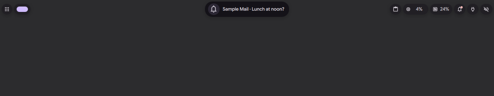
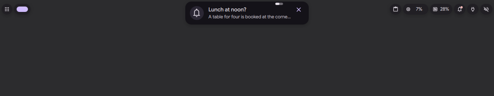
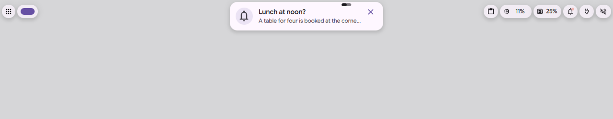

# Notifications as island activities

Status: in [PR #4182](https://github.com/duxlabs-dev/dux-shell/pull/4182) (closed)

*The notification arrives as a card, folds, then the clock comes back, dark*

In one sentence: Notification popups become island activities: a short card on arrival, a compact face, and an open face with the body, the action buttons and an inline reply.

## What it does

- A notification popup is adopted by the island when the island is not open, or already shows a notification. It gets a compact face (icon, summary), a short card on arrival, and an open face (body, action buttons, an inline reply when the server offers it).
- A critical notification (a call) also goes over an open face, but never over the launcher.
- Otherwise the popup is held beside the island as a bubble until it is clicked, dismissed or gone. A click brings it into the island with its card. A right click closes it.
- A ringing call keeps its rocking icon, even when the compact face is made again.
- A notification that only repeats a bubble does not take the island. In this branch, only the battery is known: a notice from `dms`, `upower` or a power app that talks about the battery is not shown next to the battery bubble. Alerts always pass.
- Do Not Disturb hides what is not let through on the apps side.

## Try it

- Check out `island/3-bubbles`, use a bar in the Island layout, and send a notification: `notify-send "Anna" "Are you coming tonight?"`. It arrives as a short card, then folds to its compact face.
- Send one while the island is open, for example on the launcher: it waits as a bubble. Click it to bring it in, right click to close it.
- `dms ipc call island status` lists the held notification as `notification:ID`, and `dms ipc call island bubble open notification:ID` brings it in.

## Why

- Before, the island kept one notification at a time: a new one replaced the current one, and with the launcher open a notification had nowhere to go.
- The author wants a notification to be handled like any other activity: it can wait in a wing, come back, and be read and handled in the island.
- The same info should never be shown twice.

## How it is built

- IPC: the held notification shows in `island status` as `notification:ID`, and `bubble open notification:ID` brings it in.
- The source: [IslandNotificationSource.qml](https://github.com/lung595/DankMaterialShell/blob/island/3-bubbles/quickshell/Modules/DIsland/IslandNotificationSource.qml). It follows the notification service, then `adopt`, `admits`, `setHeld`, `bringIn` and `dismissHeld`. It feeds the arrival burst with `arrive` (see the arrival page).
- Faces: [NotificationCompact.qml](https://github.com/lung595/DankMaterialShell/blob/island/3-bubbles/quickshell/Modules/DIsland/Activities/NotificationCompact.qml), [NotificationExpanded.qml](https://github.com/lung595/DankMaterialShell/blob/island/3-bubbles/quickshell/Modules/DIsland/Activities/NotificationExpanded.qml) and [NotificationCenterExpanded.qml](https://github.com/lung595/DankMaterialShell/blob/island/3-bubbles/quickshell/Modules/DIsland/Activities/NotificationCenterExpanded.qml).
- The echo filter: [IslandEcho.js](https://github.com/lung595/DankMaterialShell/blob/island/3-bubbles/quickshell/Common/IslandEcho.js), called from [IslandBarHost.qml](https://github.com/lung595/DankMaterialShell/blob/island/3-bubbles/quickshell/Modules/DIsland/IslandBarHost.qml) (`withoutEchoes`). Test: [island-echo.test.mjs](https://github.com/lung595/DankMaterialShell/blob/island/3-bubbles/quickshell/tests/island-echo.test.mjs).
- Whether a notification may take the island is asked to the controller (`canRequestNotification`, `requestNotification`) in [IslandController.qml](https://github.com/lung595/DankMaterialShell/blob/island/3-bubbles/quickshell/Modules/DIsland/IslandController.qml).

## Known limits

- The echo filter finds the battery by its words (`batter`), in English only. The same notice in another language shows next to the battery bubble.
- In privacy mode, an image attached to a notification (it may be a remote one) is still loaded, according to the security check in the author's notes.
- The action button of a notification has no IPC call: from the keyboard, the action is in the notification center.
- The author's notes mention echoes for copy, trash, wifi, download, USB and print. They are not in this branch.
- Clicks were not tried with a real pointer.

## Images

The notification arrives as a card, folds, then the clock comes back, dark.

Before, dark: the compact face only.

After, dark: a short card with title and text.

After, light: a short card with title and text.

