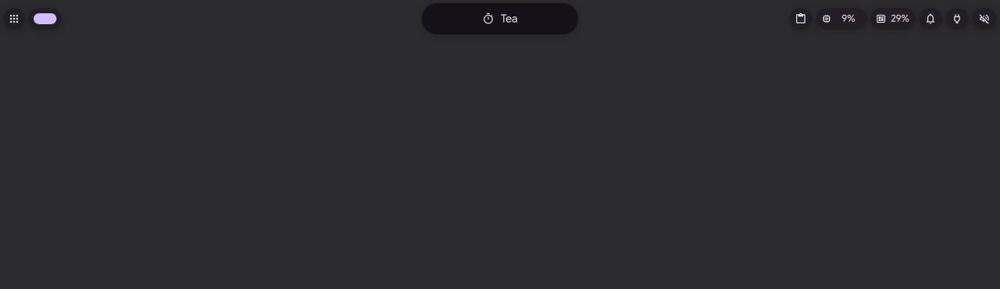
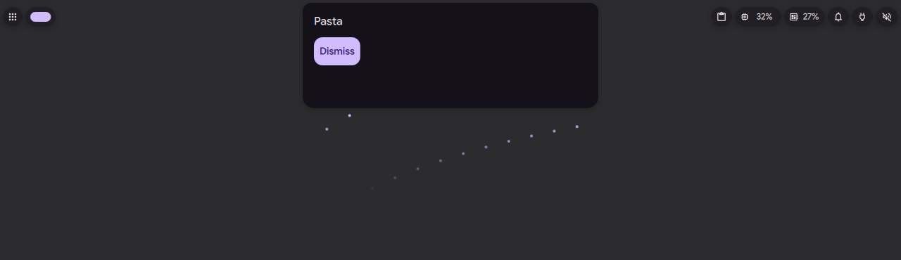
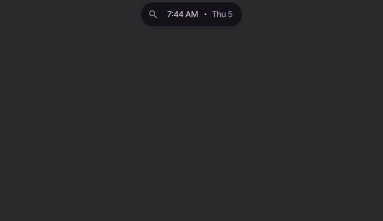
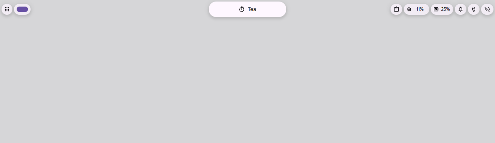

# Plugin activities and system faces

Status: in [PR #4182](https://github.com/duxlabs-dev/dux-shell/pull/4182) (closed)

## What it does

- A plugin with the `island` capability declares an `island` component. The island loads it to draw the plugin's activity (an alert, a live activity or a glance). The data follows the plugin's `update()` calls.
- A plugin can declare an `islandSystem` component. It draws a system face of the island (the manifest lists which, for example `volume` and `idleinhibitor`) in place of the shell's own face.
- A plugin can keep one small permanent bubble beside the island, on a horizontal bar (`IslandActivityService.setPermanent`). While the plugin sets `receiving` (a file dragged over it), the bubble swells into a normal one.
- When an alert of one plugin takes the island, the activity of another plugin waits as a bubble. It can be brought back with a click or with `bubble open TOKEN`.
- Settings card "Plugins": per plugin, whether it may show activities in the island, and which plugin draws each system face.
- An example plugin, `IslandActivityExample`, has IPC calls `request alert`, `request live`, `request glance`, `release`, `permanent left|right|off`, `drag on|off` and `state`.

## Why

- Before this, a plugin had nowhere to keep a small bubble beside the island, and no base type, doc or example for drawing its own island faces.
- The author wants one mechanism "for the island as for plugins": a plugin never draws its own bubble. It asks the service for an entry, and the bubble follows the same rules as a core one (side, rank, durations, faces, sizes).
- A bubble of a plugin takes the same way back into the island as a notification.

## How it is built

- Base types for plugin authors: [IslandActivityComponent.qml](https://github.com/lung595/DankMaterialShell/blob/island/3-bubbles/quickshell/Modules/Plugins/IslandActivityComponent.qml) and [IslandSystemFaceComponent.qml](https://github.com/lung595/DankMaterialShell/blob/island/3-bubbles/quickshell/Modules/Plugins/IslandSystemFaceComponent.qml).
- The service: [IslandActivityService.qml](https://github.com/lung595/DankMaterialShell/blob/island/3-bubbles/quickshell/Services/IslandActivityService.qml) (`setPermanent`, `permanentOn`, `waitingFor`, `holdsApp`, `markShown`, `markInterrupted`).
- The permanent bubble: [IslandPermanent.qml](https://github.com/lung595/DankMaterialShell/blob/island/3-bubbles/quickshell/Modules/DIsland/IslandPermanent.qml). Test: [island-permanent.test.mjs](https://github.com/lung595/DankMaterialShell/blob/island/3-bubbles/quickshell/tests/island-permanent.test.mjs).
- The island host loads the plugin components: [IslandBarHost.qml](https://github.com/lung595/DankMaterialShell/blob/island/3-bubbles/quickshell/Modules/DIsland/IslandBarHost.qml).
- Settings card: [IslandPluginsCard.qml](https://github.com/lung595/DankMaterialShell/blob/island/3-bubbles/quickshell/Modules/Settings/Widgets/IslandPluginsCard.qml). It sets `islandPluginsBlocked` and `islandSystemFaces`, which come with the API layer of the island. Test: [island-plugin-settings.test.mjs](https://github.com/lung595/DankMaterialShell/blob/island/3-bubbles/quickshell/tests/island-plugin-settings.test.mjs).
- Docs and schema: [README.md](https://github.com/lung595/DankMaterialShell/blob/island/3-bubbles/quickshell/PLUGINS/README.md) (section on island activities) and [plugin-schema.json](https://github.com/lung595/DankMaterialShell/blob/island/3-bubbles/quickshell/PLUGINS/plugin-schema.json) (`island.systemFaces`, `island.notifyApp`, `components.island`, `components.islandSystem`).
- The example: [plugin.json](https://github.com/lung595/DankMaterialShell/blob/island/3-bubbles/quickshell/PLUGINS/IslandActivityExample/plugin.json), [ExampleDaemon.qml](https://github.com/lung595/DankMaterialShell/blob/island/3-bubbles/quickshell/PLUGINS/IslandActivityExample/ExampleDaemon.qml), [ExampleIsland.qml](https://github.com/lung595/DankMaterialShell/blob/island/3-bubbles/quickshell/PLUGINS/IslandActivityExample/ExampleIsland.qml) and [ExampleSystemFace.qml](https://github.com/lung595/DankMaterialShell/blob/island/3-bubbles/quickshell/PLUGINS/IslandActivityExample/ExampleSystemFace.qml).

## Known limits

- A permanent bubble shows on horizontal bars only.
- The system face drawn by a plugin was never seen on screen (the test instance had no sound or media to set).
- A fault was found and fixed late: a plugin sheet brought in by the user could keep a click-outside hold when another plugin's alert took its place. `begin()` in `IslandPluginActivity.qml` now clears it. No automated test covers it, only probes on a test instance.

## Images

