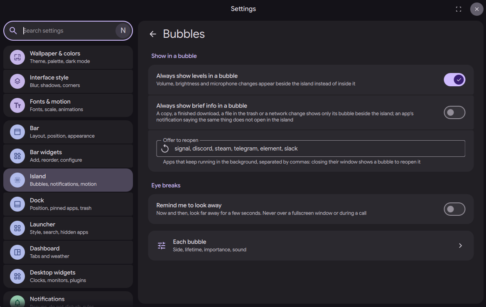
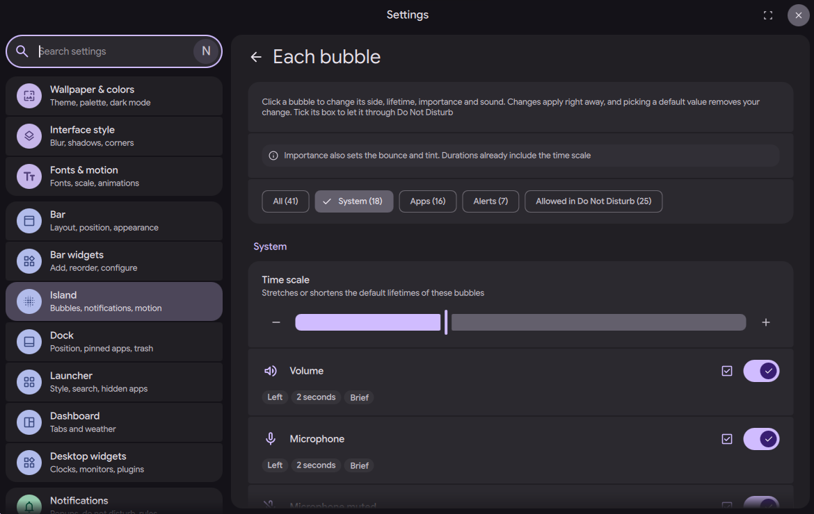

# Bubble and arrival settings

Status: in [PR #4182](https://github.com/duxlabs-dev/dux-shell/pull/4182) (closed)

*The same switches on the Bubbles page of the settings mock-up: levels, brief info, apps to reopen, eye breaks*

In one sentence: Three new settings cards, "Plugins", "Bubbles" and "Arrival of info", decide what goes into a bubble, how bubbles look and move, and how a new info arrives.

## What it does

- Three new cards in the island settings: "Plugins", "Bubbles" and "Arrival of info". They show in the Bar settings (island layout), the Dot settings and the island widget options.
- "Bubbles": levels in a bubble (volume, brightness, microphone), brief infos in a bubble (caps lock, power profile, idle inhibitor), how much the bubbles move, the dial style while a level is set (wave or lean), the launcher transition (jelly, liquid or pivot), the corners, the shape under an app's logo, and an optional outline.
- "Arrival of info": the arrival style, the bounce and the colour for each tier (brief, normal, important), the wheel over the cards, and the wheel direction.
- With the defaults, volume, brightness and brief infos stay in the island as before. The only change by default is that a notification arrives with the new motion (style `bc`).
- No existing setting changes.

## Try it

- Check out `island/3-bubbles` and open the settings of a bar in the Island layout, the Dot settings, or the options of the island widget. The three cards are there.
- Turn on "Always show levels in a bubble", then change the volume: it shows in a bubble beside the island instead of inside it.
- In "Arrival of info", pick the style `a` (one quiet breath), then send a notification to compare it with the default `bc`.

## Why

- The author wants the look and the motion of bubbles and arrival to be set by the user in the settings, not fixed in the code.
- The levels and brief infos stay in the island by default, so the new bubbles do not change a setup that does not ask for them.

## How it is built

- Seventeen new keys in `settings.json`, defined in [SettingsSpec.js](https://github.com/lung595/DankMaterialShell/blob/island/3-bubbles/quickshell/Common/settings/SettingsSpec.js) and [SettingsData.qml](https://github.com/lung595/DankMaterialShell/blob/island/3-bubbles/quickshell/Common/SettingsData.qml).
- Arrival: `islandArrivalStyle` (`bc`), `islandArrivalBounce` (`light, light, medium`), `islandArrivalTint` (`light, normal, strong`), `islandArrivalWheel` (`true`), `islandArrivalWheelInverted` (`false`).
- Bubbles: `islandLevelBubbles` (`false`), `islandBriefBubbles` (`false`), `islandBubbleMotion` (`80`, from 0 to 150), `islandBubbleDialStyle` (`wave`), `islandBubbleLauncherTransition` (`liquid`), `islandBubbleCorners` (`island`), `islandBubbleShapeStyle` (`flat`), `islandBubbleShapeTone` (`theme`), `islandBubbleOutline` (`false`), `islandBubbleOutlineWidth` (`1`, to 4), `islandBubbleOutlineOpacity` (`100`, from 10), `islandBubbleOutlineColor` (`type`).
- The cards: [IslandBubblesCard.qml](https://github.com/lung595/DankMaterialShell/blob/island/3-bubbles/quickshell/Modules/Settings/Widgets/IslandBubblesCard.qml), [IslandArrivalCard.qml](https://github.com/lung595/DankMaterialShell/blob/island/3-bubbles/quickshell/Modules/Settings/Widgets/IslandArrivalCard.qml) and [IslandPluginsCard.qml](https://github.com/lung595/DankMaterialShell/blob/island/3-bubbles/quickshell/Modules/Settings/Widgets/IslandPluginsCard.qml), placed in [IslandOptions.qml](https://github.com/lung595/DankMaterialShell/blob/island/3-bubbles/quickshell/Modules/Settings/BarWidgetOptions/IslandOptions.qml), [DBarTab.qml](https://github.com/lung595/DankMaterialShell/blob/island/3-bubbles/quickshell/Modules/Settings/DBarTab.qml) and [DDotTab.qml](https://github.com/lung595/DankMaterialShell/blob/island/3-bubbles/quickshell/Modules/Settings/DDotTab.qml).
- The "Plugins" card adds no key: it sets `islandPluginsBlocked` and `islandSystemFaces` of the API layer.

## Known limits

- With a 1.4 font scale in a 720 px window, the title of a tier in the "Arrival of info" card is cut, and hides the tier's name.
- The settings pages were not played on the test instance, according to the PR notes ("Not shown: the settings pages"). The settings search index is up to date.
- The settings files `SettingsData.qml` and `SettingsSpec.js` grew by about 30 and 50 lines.

## Images

The same switches on the Bubbles page of the settings mock-up: levels, brief info, apps to reopen, eye breaks.

The Each bubble page of the settings mock-up: a filter and one row per bubble.

