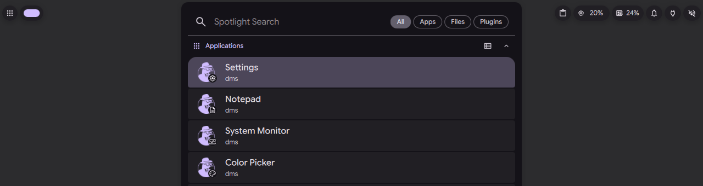
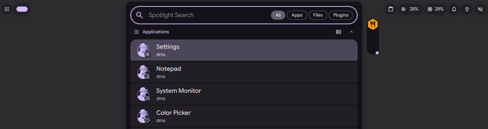
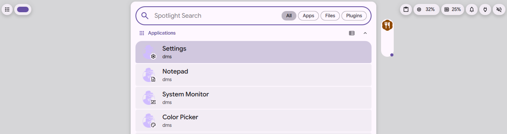
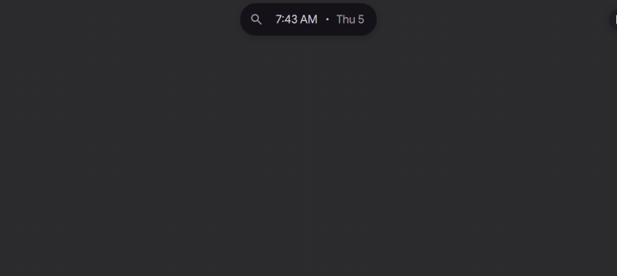

# Tiles beside the launcher

Status: in [PR #4182](https://github.com/duxlabs-dev/dux-shell/pull/4182) (closed)

## What it does

- When the launcher opens, the island goes down under it and each wing bubble becomes a vertical tile beside the launcher, with its icon at the top.
- The bubble reaches its tile in about 0.45 s. When the launcher closes, the tile folds back into the wing.
- Three motions, chosen in Settings (Bubbles, launcher transition): Liquid (the default), Jelly and Pivot.
- With several bubbles waiting on the apps side, a left click on the tile opens or closes its list. With one bubble, the click brings it into the island.
- A card opens on hover for any standing tile, on both sides.

## Why

- When the launcher is open, the island is busy and has nowhere to show a bubble. The tile gives the bubble a place beside the launcher.
- The author wants every bubble to make the same motion as the volume bubble, picked by one common setting.
- The 0.45 s is the shortest motion that still reads, according to the author's notes.

## How it is built

- IPC: `bubble tile NAME` is the left click on the tile. `island open launcher` and `island close` open and close the launcher.
- The tile section of [IslandBubbles.qml](https://github.com/lung595/DankMaterialShell/blob/island/3-bubbles/quickshell/Modules/DIsland/IslandBubbles.qml) reads `launcherTransition` and loads one of three files through `chosenTile`.
- [TileTransition.qml](https://github.com/lung595/DankMaterialShell/blob/island/3-bubbles/quickshell/Modules/DIsland/TileTransition.qml) is the base (a simple morph). The variants are [TileLiquid.qml](https://github.com/lung595/DankMaterialShell/blob/island/3-bubbles/quickshell/Modules/DIsland/TileLiquid.qml), [TileJelly.qml](https://github.com/lung595/DankMaterialShell/blob/island/3-bubbles/quickshell/Modules/DIsland/TileJelly.qml) and [TilePivot.qml](https://github.com/lung595/DankMaterialShell/blob/island/3-bubbles/quickshell/Modules/DIsland/TilePivot.qml).
- Liquid: the pill splits into a head and a tail, the thread between them thins (the area is kept), then breaks, and a bridge grows. The geometry and physics are pure code in [IslandLiquidSplit.js](https://github.com/lung595/DankMaterialShell/blob/island/3-bubbles/quickshell/Common/IslandLiquidSplit.js) and [IslandLiquidPose.js](https://github.com/lung595/DankMaterialShell/blob/island/3-bubbles/quickshell/Common/IslandLiquidPose.js).
- Two shaders: [liquid_split.frag](https://github.com/lung595/DankMaterialShell/blob/island/3-bubbles/quickshell/Shaders/frag/liquid_split.frag) for the liquid tile and [goo.frag](https://github.com/lung595/DankMaterialShell/blob/island/3-bubbles/quickshell/Shaders/frag/goo.frag) for a wing fusing into the island. Their compiled `.qsb` files are in `quickshell/Shaders/qsb/`.
- The liquid dial on the kit side: [IslandLiquid.qml](https://github.com/lung595/DankMaterialShell/blob/island/3-bubbles/quickshell/Modules/DIsland/Kit/IslandLiquid.qml). The tiles run on the kit's timer clock, which runs only while they move.
- Setting: `islandBubbleLauncherTransition` (`jelly`, `liquid`, `pivot`) in [SettingsSpec.js](https://github.com/lung595/DankMaterialShell/blob/island/3-bubbles/quickshell/Common/settings/SettingsSpec.js).
- Test: [island-liquid.test.mjs](https://github.com/lung595/DankMaterialShell/blob/island/3-bubbles/quickshell/tests/island-liquid.test.mjs).

## Known limits

- The tile is the most expensive part: on the test instance, about 1.7 % of the machine on average and 1.9 % in the biggest second, and the compositor cost was higher with the tile than without. The test instance used software rendering.
- JS allocations per frame in the tile were not brought to 0, and were not measured on the last commit.
- The compiled `.qsb` of `liquid_split.frag` was not compared with its source in the author's notes.
- A real pointer was not tried (clicks and hover on the tile).
- On the test instance, the launcher showed only the DMS apps, because the other apps of the machine were hidden.

## Images

