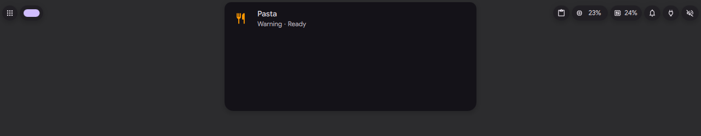
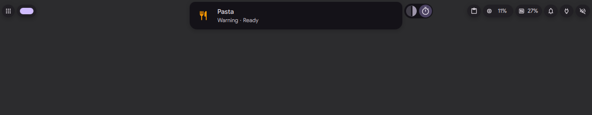
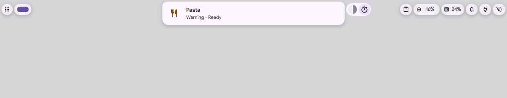

# Wings and displaced bubbles

Status: in [PR #4182](https://github.com/duxlabs-dev/dux-shell/pull/4182) (closed)

## What it does

- The island has two wings. The leading wing is the machine side (volume, brightness, battery, and so on). The trailing wing is the apps side.
- A thing the island cannot show now waits in a wing as a small pill (a bubble). Examples: an activity pushed aside by an alert, a notification popup the island could not take, music while a plugin holds the island. On the machine side the newest comes first. On the apps side, higher rank first (critical, alert, notification, others), then newest.
- A click on a bubble brings it into the island. A right click puts it away and ends its activity. The wheel on a level bubble (volume, brightness) sets the level.
- A machine bubble keeps an auto-hide bar out while it shows, so the change is seen. Bubbles show on the focused screen only, and not while the session is locked.
- Do Not Disturb filters the apps side. The same info is never shown twice: a battery notification does not show next to the battery bubble.
- With the "Always show levels in a bubble" setting, volume, brightness and microphone changes go to a bubble instead of the island.

## Why

- Before, the island showed one thing at a time. A timer ("Tea") running in the island was dropped when an alert ("Pasta") took it, and nothing said it was still running.
- The author wants one mechanism for every bubble, from the core and from plugins: entry, exit, replacement and the card are played by the wing, never by the bubble itself.
- One bubble is shown per side, never two stacked. Others wait behind it. The author did not want a pile.
- Each side has its own width: a long bubble on one side must not stretch the one on the other side.

## How it is built

- IPC on the `island` target: `status` lists the bubbles (`bubbles.machine` and `bubbles.apps`), `bubble open NAME` is a click, `bubble dismiss NAME` is a right click. A name that does not exist answers `DANK_ISLAND_BUBBLE_UNKNOWN: NAME`.
- Each island has one host, [IslandBarHost.qml](https://github.com/lung595/DankMaterialShell/blob/island/3-bubbles/quickshell/Modules/DIsland/IslandBarHost.qml). It owns the sources and builds `bubbleList`, with `bringBubble`, `dismissBubble`, `holdBubble`, `wheelBubble` and `pressBubble`. `withoutEchoes` removes a bubble that only repeats another face.
- Sorting into sides and ranks: `bubbleSides`, `bubbleRank` in [IslandActivities.js](https://github.com/lung595/DankMaterialShell/blob/island/3-bubbles/quickshell/Common/IslandActivities.js).
- Drawing, the `Wing` component (one per side), entry and exit springs: [IslandBubbles.qml](https://github.com/lung595/DankMaterialShell/blob/island/3-bubbles/quickshell/Modules/DIsland/IslandBubbles.qml). It is made with the first bubble and let go 30 s after the last one, by [DIslandSurface.qml](https://github.com/lung595/DankMaterialShell/blob/island/3-bubbles/quickshell/Modules/DIsland/DIslandSurface.qml). With no bubble it adds nothing to the start of the shell.
- The machine side: [IslandSystemSource.qml](https://github.com/lung595/DankMaterialShell/blob/island/3-bubbles/quickshell/Modules/DIsland/IslandSystemSource.qml) and [IslandController.qml](https://github.com/lung595/DankMaterialShell/blob/island/3-bubbles/quickshell/Modules/DIsland/IslandController.qml) (`machineBubbleKind`, `showMachineBubble`). Media while a plugin holds the island: [IslandMediaSource.qml](https://github.com/lung595/DankMaterialShell/blob/island/3-bubbles/quickshell/Modules/DIsland/IslandMediaSource.qml).
- Plugin and script activities that wait: `waitingFor` in [IslandActivityService.qml](https://github.com/lung595/DankMaterialShell/blob/island/3-bubbles/quickshell/Services/IslandActivityService.qml).
- IPC: [DIsland.qml](https://github.com/lung595/DankMaterialShell/blob/island/3-bubbles/quickshell/Modules/DIsland/DIsland.qml) and [IslandBubbleIpc.js](https://github.com/lung595/DankMaterialShell/blob/island/3-bubbles/quickshell/Common/IslandBubbleIpc.js). Test: [island-bubble-ipc.test.mjs](https://github.com/lung595/DankMaterialShell/blob/island/3-bubbles/quickshell/tests/island-bubble-ipc.test.mjs).
- At rest the bubbles draw nothing (0 frames per second). With reduced motion they settle at once.

## Known limits

- Hover, click, wheel and swipe were not tried with a real pointer. Two screens, and the docked, free and overflow layouts, were not tried.
- The wake of a free island at rest by a machine bubble was not played. The auto-hide bar was.
- The volume change with the level setting on was not played (the test instance has no sound).
- No test covers `holdsHost` for the machine bubble, because the repo rules do not let a test load QML from `Modules`.
- A notification that only repeats the battery bubble is found by its words, in English only.
- Memory: about +31 MiB stay after the bubbles left, with no growth of their own.
- Code size: `IslandBubbles.qml` is about 2100 lines and the host files grew a lot. The author kept it as the whole engine of the bubbles.

## Images

