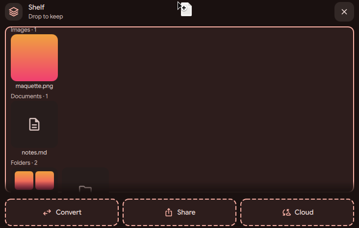
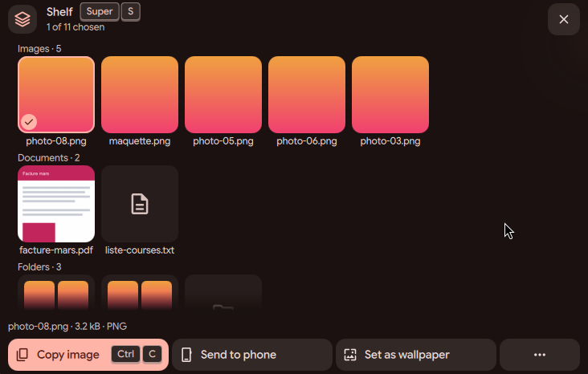
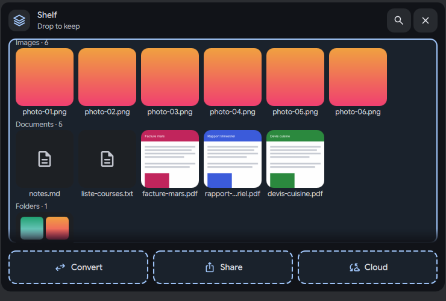
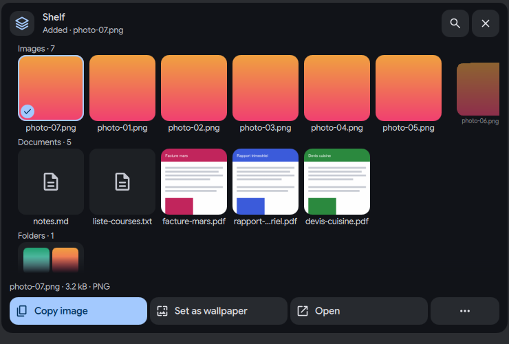

# Shelf: drop files and keep them

Status: working prototype

*A file dragged onto the island: the card shows its drop zones, release keeps the file*

In one sentence: Drag a file onto the island and let go: the shelf keeps a link to it, so you can drop it into another app later.

## What it does

- Drag a file over the island and let go: the file goes on the shelf. The shelf card opens, shows the new file at the top and says "Added".
- The same drop works on the shelf bubble (the small round button the shelf becomes when the card is closed). The bubble lights up and the card opens for a moment to show what was kept.
- You can also paste files with Ctrl+V, or use "Add files..." (Ctrl+O) to pick files in a file picker.
- The shelf keeps links to the real files, never copies. The list is saved in the DMS session data and survives a restart.
- A file that is already on the shelf is not added twice. The shelf says "Already on the shelf" and moves it to the top. A file that was deleted from the disk is removed from the shelf when the card opens or when you press on it, with a message.
- While you drag, the card header says what will happen: "Drop to keep", "Into <shelf folder>" or "Move into <folder>" (see the "send and remove" page for moving).

## Try it

- Check out `island-prototype` and use a bar in the Island layout.
- Drag a file from a file manager over the island and let go: the shelf card opens with the file at the top and says "Added".
- Or press Super+S to open the shelf, then Ctrl+V to paste copied files, or Ctrl+O to pick files.

## Why

- The owner wanted the shelf to be easy and to need as few clicks as possible: one drag to keep a file.
- Links instead of copies mean the shelf never fills the disk and never holds an old version of a file.
- A drop on the island or on its bubble must always work, so the bubble accepts the drop too (before, a folded bubble ignored it).

## How it is built

- The drop area is [`IslandShelfDrop.qml`](https://github.com/lung595/DankMaterialShell/blob/island-prototype/quickshell/Modules/DIsland/IslandShelfDrop.qml). It reaches past the island to the screen edge, so a drag does not have to be exact.
- The list, the checks for missing files and the messages live in [`IslandShelfSource.qml`](https://github.com/lung595/DankMaterialShell/blob/island-prototype/quickshell/Modules/DIsland/IslandShelfSource.qml). The pure logic (what a drop accepts, `place`, duplicates, messages) is in [`IslandShelf.js`](https://github.com/lung595/DankMaterialShell/blob/island-prototype/quickshell/Common/IslandShelf.js), with tests in [`island-shelf-depot.test.mjs`](https://github.com/lung595/DankMaterialShell/blob/island-prototype/quickshell/tests/island-shelf-depot.test.mjs).
- The card is [`BubbleCardShelf.qml`](https://github.com/lung595/DankMaterialShell/blob/island-prototype/quickshell/Modules/DIsland/Cards/BubbleCardShelf.qml). The shelf shown inside the island is [`IslandShelfActivity.qml`](https://github.com/lung595/DankMaterialShell/blob/island-prototype/quickshell/Modules/DIsland/IslandShelfActivity.qml).
- The list is stored in the `islandShelf` session key. Pasting copied files goes through the DMS clipboard service in [`manager.go`](https://github.com/lung595/DankMaterialShell/blob/island-prototype/core/internal/server/clipboard/manager.go).
- A drop is taken as a link when the source offers it, otherwise as a copy, never as a move.

## Known limits

- After you open the card with the keyboard, the first drag that follows is lost: the layer that closes the card on outside clicks takes the first press. A fix needs a different keyboard model for the whole island.
- Holding Ctrl while you drop a file is only seen when the card has the keyboard. A drag that comes from another app keeps the keyboard in that app.
- Copy by Ctrl was tested with the script only, not with a real drag.
- The picker, the right-click menu and the drop were tested on a bench without a screen. They were not tested on a real screen by the author.
- `BubbleCardShelf.qml` is about 3700 lines. Splitting it into smaller files was planned and not done.

## Images

A file dragged onto the island: the card shows its drop zones, release keeps the file.

Drag a file over the shelf, over a folder, then it is kept.

Dragging a file onto the open card: Drop to keep and three drop zones.

The dropped file is kept and chosen, with its actions below.

While dragging: "Drop to keep" and the Convert, Share and Cloud zones.

The dropped file is kept, chosen, with its actions below.

