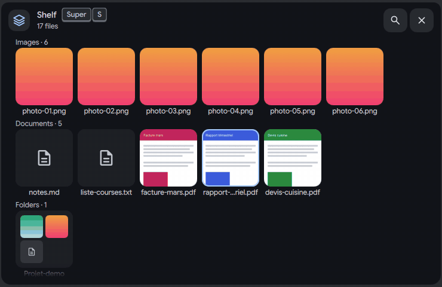
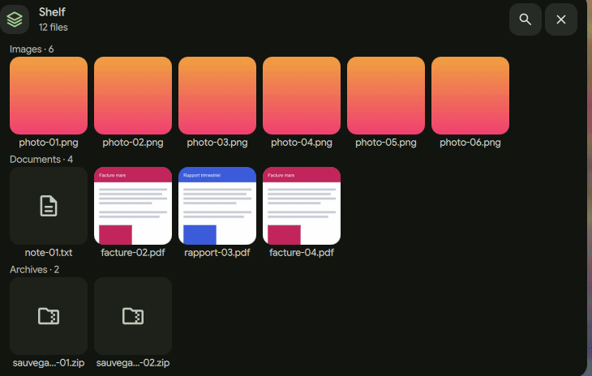
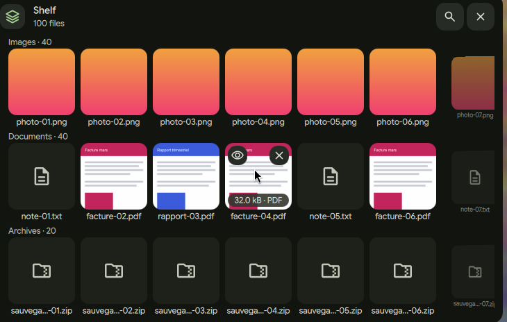
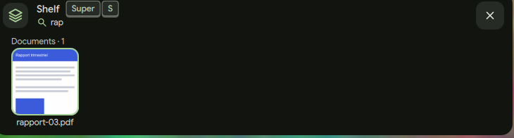
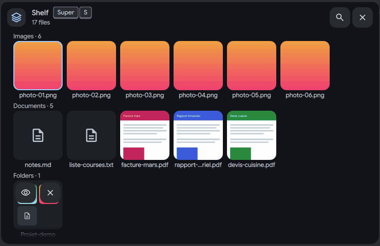
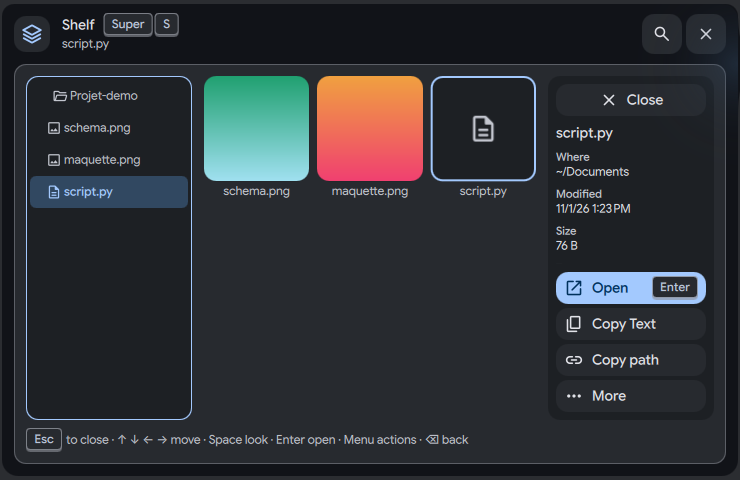

# Shelf: find a file

Status: working prototype

*Open the shelf, type "rap" to find a file, Escape clears the search, Space previews the file*

In one sentence: The shelf sorts its files into rows by kind with real previews, and you find one by just typing its name.

## What it does

- The shelf groups files by kind into rows: Images, Documents, Folders, Archives, Media. A row that is empty is not shown. The newest files come first.
- Each file is a 96 px tile with a real preview (the image itself, page 1 of a PDF, a frame of a video) and its name on one line. If a row has more than five files, the fifth tile is a stack "+N" that opens the row when you click it.
- A magnifier button in the header opens a search field. You can also just start typing. The first match gets the focus ring, and Enter opens it. Escape clears the search and closes the field.
- The mouse wheel moves one page of whole tiles per notch. A touchpad follows the finger with no animation.
- A shelf folder (a group of links you made) opens inside the card. Two tiles with the same name show their parent folder, so you can tell them apart.
- Space on a folder shows its contents in a three-pane view: a tree on the left (25 %), the files in the middle (50 %), and a details sheet on the right (25 %). Big folders show "N more" and a button that opens the folder in the file manager. Empty folders and empty files are named: "Empty folder", "Empty file".

## Try it

- Check out `island-prototype`, use a bar in the Island layout, and put a few files on the shelf (see [the drop page](etagere-drop-and-keep.md)).
- Press Super+S (or run `dms ipc call island shelf toggle`) and start typing part of a name: the first match gets the focus ring, Enter opens it.
- Click a folder and press Space for the three-pane view.

## Why

- The owner found the first shelf design too busy: "it does not breathe enough". He asked for automatic sorting that is very easy to use and very visual, so the shelf groups files by kind with big previews.
- The goal for every path was the smallest number of clicks and keys. Finding a file by search takes 4 key presses (open the shelf, two letters, Enter).

## How it is built

- The rows are built by `shelves` in [`IslandShelf.js`](https://github.com/lung595/DankMaterialShell/blob/island-prototype/quickshell/Common/IslandShelf.js). Wheel paging is `rowSlide`, search text is cleaned by `cleanQuery`, keys inside folders use `leap` and `typeAhead`. Tests: [`island-shelf-retrouver.test.mjs`](https://github.com/lung595/DankMaterialShell/blob/island-prototype/quickshell/tests/island-shelf-retrouver.test.mjs).
- The previews are made by [`IslandShelfPreviews.qml`](https://github.com/lung595/DankMaterialShell/blob/island-prototype/quickshell/Modules/DIsland/IslandShelfPreviews.qml) with the `thumb` verb of [`island-shelf.sh`](https://github.com/lung595/DankMaterialShell/blob/island-prototype/quickshell/scripts/island-shelf.sh). It uses `pdftoppm` for PDFs and `ffmpeg` for videos when they are installed. Without them the tile shows the type icon.
- The tile is [`IslandShelfThumb.qml`](https://github.com/lung595/DankMaterialShell/blob/island-prototype/quickshell/Modules/DIsland/Kit/IslandShelfThumb.qml). The card, the search field and the three-pane view are in [`BubbleCardShelf.qml`](https://github.com/lung595/DankMaterialShell/blob/island-prototype/quickshell/Modules/DIsland/Cards/BubbleCardShelf.qml).
- The setting `islandShelfGroup` (`kind`, `day`, `app`) exists. Only `kind` really groups: the shelf keeps no date and no source app, so the other two give one row "All".

## Known limits

- The card is capped at 480 px high, on purpose, and scrolls beyond that.
- A folder of 2000 entries is slow to open on the test bench: 50 % CPU and a 59 ms worst frame, above the island's target. A planned fix (a `ListView` for the tree) was not done and no number was measured after the small fix that was made.
- The wheel with fractions of a notch and a real touchpad were tested by a unit test and simulated input only.
- Search inside an open shelf folder was not replayed after the last changes.

## Images

Open the shelf, type "rap" to find a file, Escape clears the search, Space previews the file.

Open the shelf, type "rap", press Space on the match.

A shelf of 100 files grouped in rows, with hover buttons on a tile.

Typing "rap" keeps one match, with the focus ring on it.

Click a folder, Space opens the three-pane explorer, arrows walk the files.

The explorer: tree on the left, files in the middle, details sheet on the right.

