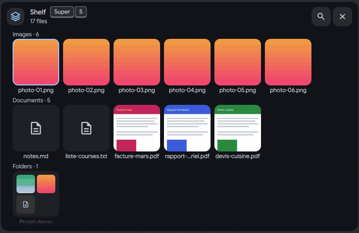
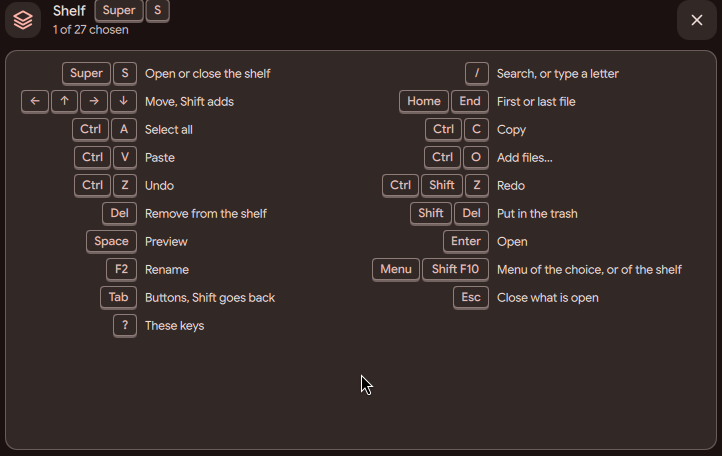
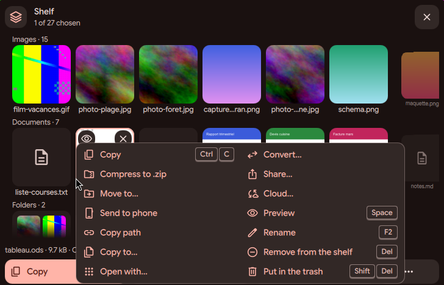
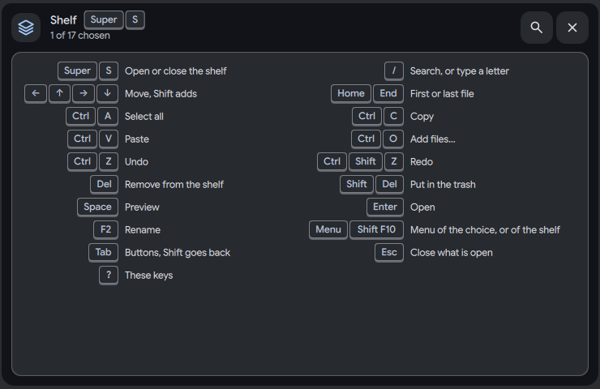
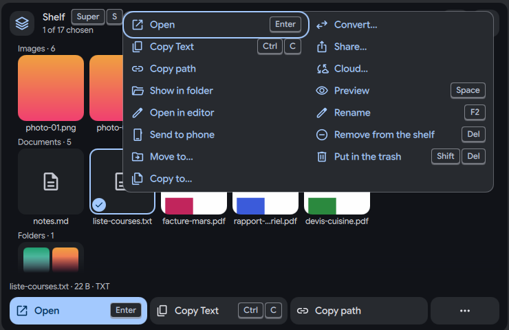

# Shelf: shortcut, keyboard and launcher

Status: working prototype

*Arrow keys move the ring, ? shows the keys sheet, the Menu key opens the tile menu*

In one sentence: Super+S opens the shelf and the whole shelf works from the keyboard; press ? for the list of keys.

## What it does

- **Super+S** opens the shelf card in the island of the focused screen, and closes it where it shows. A click on the card or outside it does not close a card that you opened on purpose. Only its close button or Super+S does.
- When the card is opened with Super+S, the keys work at once, and the focus ring is on the tile that Enter would open.
- Keys on the shelf: arrows move between tiles, Space previews, Enter opens in the app, Ctrl+C copies, Ctrl+V pastes, Ctrl+O adds files, Delete removes, F2 renames, Menu or Shift+F10 opens the menu, Escape goes back one level (it never closes the card), and "?" shows a sheet with all the keys. Tab and Shift+Tab go round inside the card: tiles, the row buttons, the more button and the close button. They never leave to the bar.
- Super+Space stays the DMS launcher. If the launcher opens while the shelf card is open, the card folds into its bubble next to the island and keeps its files. If the shelf is already a bubble, nothing happens.
- After a click outside, a file picker, or an opened app, the card gives the keyboard away and says "Click or press Super S to type here". Super+S on a visible card takes the keyboard back instead of closing it.
- The shelf bubble has the name "Shelf, N files" for screen readers. Its page dot opens the shelf from the Keep Awake bubble page.

## Try it

- Check out `island-prototype`, use a bar in the Island layout under niri, and press Super+S (or run `dms ipc call island shelf toggle`).
- Move with the arrows, press ? for the keys sheet, the Menu key for a tile's menu, Escape to go back one level.
- Press Super+Space with the card open: it folds into its bubble and the launcher opens.

## Why

- The owner asked that every path works with the keyboard alone, and with the fewest keys. Space only previews. Enter opens.
- Super+Space was kept for the launcher on purpose, so the shelf folds away instead of fighting it.

## How it is built

- The same action is available from a terminal: `dms ipc call island shelf toggle`. It answers `ISLAND_SHELF_OPEN` or `ISLAND_SHELF_CLOSED`. Any other action gives `ISLAND_SHELF_UNKNOWN_ACTION`. With no island on the screen, a toast says "No island on this screen to show the shelf" and the answer is `ISLAND_UNAVAILABLE`.
- The IPC function `shelf(action)` is in [`DIsland.qml`](https://github.com/lung595/DankMaterialShell/blob/island-prototype/quickshell/Modules/DIsland/DIsland.qml). The default niri bind `Mod+S` is in [`niri-binds.kdl`](https://github.com/lung595/DankMaterialShell/blob/island-prototype/core/internal/config/embedded/niri-binds.kdl). The shortcut picker entry "DankIsland: Toggle Shelf" is in [`KeybindActions.js`](https://github.com/lung595/DankMaterialShell/blob/island-prototype/quickshell/Common/KeybindActions.js).
- The keys, the Tab ring and the menu keys are in [`BubbleCardShelf.qml`](https://github.com/lung595/DankMaterialShell/blob/island-prototype/quickshell/Modules/DIsland/Cards/BubbleCardShelf.qml); helpers such as `wrap`, `leap` and `typeAhead` are in [`IslandShelf.js`](https://github.com/lung595/DankMaterialShell/blob/island-prototype/quickshell/Common/IslandShelf.js) with tests in [`island-shelf-keys.test.mjs`](https://github.com/lung595/DankMaterialShell/blob/island-prototype/quickshell/tests/island-shelf-keys.test.mjs).
- The launcher rule is `launcherUp` and `foldsForLauncher` ([`IslandShelfSource.qml`](https://github.com/lung595/DankMaterialShell/blob/island-prototype/quickshell/Modules/DIsland/IslandShelfSource.qml), `IslandShelf.js`). Giving the keyboard away and taking it back (`keyboardYielded`) is in the source and in [`IslandController.qml`](https://github.com/lung595/DankMaterialShell/blob/island-prototype/quickshell/Modules/DIsland/IslandController.qml).
- Only niri has a default bind. Hyprland and MangoWC have none, because Super+S is already used there.

## Known limits

- The physical Super+S key was not pressed in tests. The bench calls the IPC command that the bind runs.
- The text "Super S" on the card is fixed. It is right only for the default niri bind.
- If you already bound Mod+S yourself, there is a conflict.
- The first drag after opening the card with the keyboard is lost (see the drop page).
- Hover help on the bubble is missing, because the island kit has no tooltip. The page dot is 6 px, and the mouse wheel does nothing on it.
- A bubble on the right of the island and a vertical island were not tested. Screen readers were not tried.
- One reported blocking bug (no keyboard on a card opened by Super+S) could not be reproduced in four tries. A guard was added at the same place as in the Dash tab.

## Images

Arrow keys move the ring, ? shows the keys sheet, the Menu key opens the tile menu.

The keys sheet, opened with ?

The tile menu shows the key next to each action.

The keys sheet, opened with ?

The tile menu with the key next to each action.

