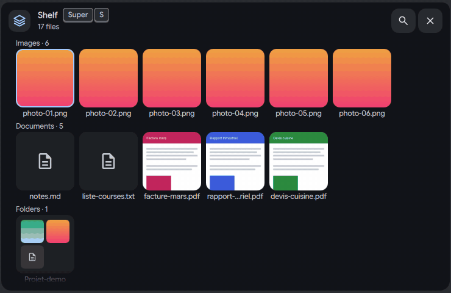
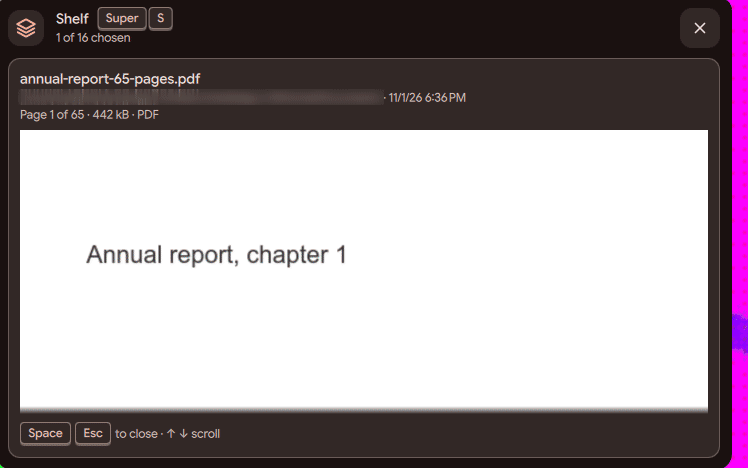
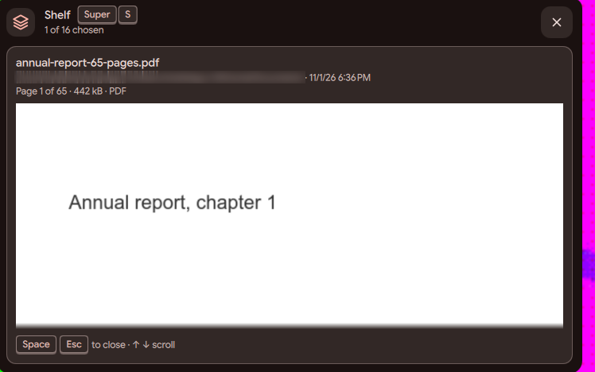
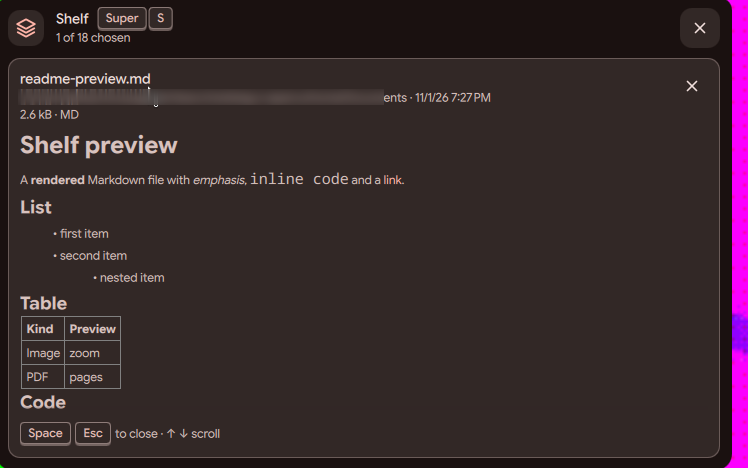
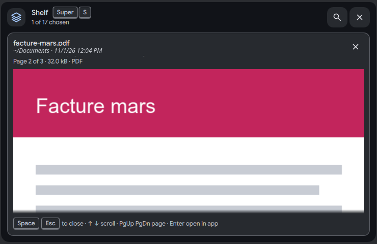

# Shelf: open and preview a file

Status: working prototype

*Space previews a Markdown note, then page 1 and page 2 of a PDF*

In one sentence: Space on a file of the shelf previews it inside the card (images, video, sound, PDF, Office, Markdown, code, archives, folders), and Enter opens it in its app.

## What it does

- Enter, or a double click on a tile, opens the file in its default app. This is the same for every type: audio, archives and disk images too. Inside the folder view, Enter opens the app and a double click enters the folder or previews the file. If a file type has no default app, "Open with..." asks which app to use. The shelf no longer hands the file to the browser.
- Space, or the eye button that shows when you hover a tile, gives a quick look at the file. Space again or the close button (x) ends it, and the card stays open.
- The quick look handles: images (with details and zoom), GIFs, videos (silent, played in a loop), sounds, PDF and Office documents (page by page), text, Markdown and code (with coloured links), archives, and folders.
- Right and left arrows go to the next or previous file without closing the look. For a video they step through the files too. Zoom is one step per wheel notch (x1.25, from 1 to 8), or follows the touchpad. Page Up and Page Down turn the pages of a document.
- Short words explain the odd cases: "Too large to preview", "No preview", "Binary file", "Empty file", "File not found". The footer of the look lists its keys, for example "Enter open in app".
- The shelf hides a convert button that would give the format the files already have (no "Convert to MP3" on an MP3).

## Try it

- Check out `island-prototype`, use a bar in the Island layout, put a PDF and a Markdown file on the shelf, and press Super+S.
- Pick a file with the arrows and press Space. Right and left arrows go to the next file, Page Down turns a page, Space again closes the look.

## Why

- The owner wanted "Enter or double click" to open a file in its app everywhere, and "Space" to be only the quick look.
- The quick look had to close with the mouse too, and the next file had to take one key, not three.

## How it is built

- The keys and the open action are in [`IslandShelfSource.qml`](https://github.com/lung595/DankMaterialShell/blob/island-prototype/quickshell/Modules/DIsland/IslandShelfSource.qml) (`handOff` gives the keyboard to the opened app) and [`IslandShelf.js`](https://github.com/lung595/DankMaterialShell/blob/island-prototype/quickshell/Common/IslandShelf.js) (`keyed`, `plan`, `zoomBy`, `textWord`, `tooBig`, `markdownLinks`). Tests: [`island-shelf.test.mjs`](https://github.com/lung595/DankMaterialShell/blob/island-prototype/quickshell/tests/island-shelf.test.mjs).
- The look itself, the eye, the zoom and the page keys are in [`BubbleCardShelf.qml`](https://github.com/lung595/DankMaterialShell/blob/island-prototype/quickshell/Modules/DIsland/Cards/BubbleCardShelf.qml). Page images and details come from the `thumb`, `page`, `tags` and `info` verbs of [`island-shelf.sh`](https://github.com/lung595/DankMaterialShell/blob/island-prototype/quickshell/scripts/island-shelf.sh). Optional tools are `pdftoppm`, `ffmpeg`/`ffprobe` and `soffice`.
- The default app is found by the DMS Go server. It also tries the alias of a MIME type, so an ISO with the older name still finds its app: [`aliases.go`](https://github.com/lung595/DankMaterialShell/blob/island-prototype/core/internal/server/mime/aliases.go).
- Listening to a sound uses `mpv`, `ffplay` or `pw-play`, whichever is installed. A player that fails shows a failure icon on the button.

## Known limits

- The video look costs about 33 % CPU on the test bench, which decodes in software. It was not measured on a GPU.
- The preview is cut off at "Too large" for an image above 256 MB (the Qt limit).
- The eye button is 40 px high, not 44 px.
- The shelf forgets a file that is gone instead of showing a "missing" tile.
- "Open with..." was tested on an unknown type, not on an ISO without any app. `mpv` was not on the test bench.

## Images

Space previews a Markdown note, then page 1 and page 2 of a PDF.

Preview of a PDF, a Markdown file, code, a song and a video.

Space on a PDF shows its first page inside the card.

A Markdown file drawn with its list, table and link.

A PDF previewed inside the card, page 2 of 3.

