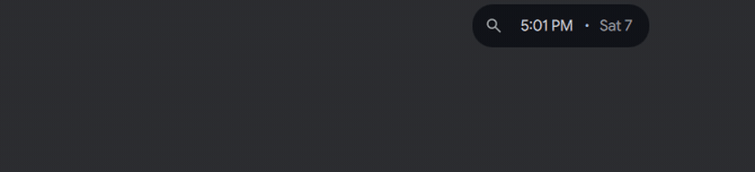
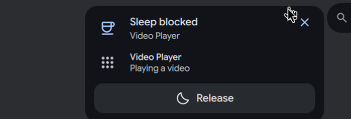

# Island keep awake bubble

Status: working prototype

*An app blocks sleep: a bubble stays, and its card releases the lock*

In one sentence: While an app keeps the session awake, a bubble shows a cup with an infinity sign, and its card lists the apps with a Release button for each.

## What it does

- Shows a bubble on the left of the island while something keeps the session awake: an app (a browser or a player, through the freedesktop ScreenSaver inhibitors that DMS serves), or DMS's own idle inhibitor toggle.
- The bubble draws a cup with an infinity symbol. When the cause is DMS's own timed toggle, it shows the countdown instead (one tick per second, one per minute when more than an hour is left).
- Click the bubble to open a card with one row per app that keeps the session awake, and a "Release" button for a row ("Release all" for all). An app that holds several locks (for example a browser with two videos) is one row, and releasing it lets go of all its locks.
- Right click hides the bubble until another app starts to block.
- A new blocker plays first in the free island, then stays as the bubble.
- The bubble shows under any passing machine bubble and comes back when that one leaves.

## Try it

- Check out `island-prototype`, use a bar in the Island layout, and play a video in a browser, or turn on DMS's idle inhibitor.
- The bubble shows on the left. Click it for the card and press "Release" to let the lock go.

## Why

- The author wanted to see why the screen does not go to sleep, and to release it, without opening settings. The notes list "sleep blocked" as a lasting state in the table of bubbles.
- The notes record the decision (25 October) that this bubble goes through the same permanent-bubble mechanism as plugins (`setPermanent`), so that the mechanism is one clean documented API and later plugins can use it too.
- The infinity means "no known end". The light that runs along it is made to stop, so it does not redraw the windows all day.

## How it is built

- [`quickshell/Common/IslandKeepAwake.js`](https://github.com/lung595/DankMaterialShell/blob/island-prototype/quickshell/Common/IslandKeepAwake.js): plain JavaScript. It builds one row per app from the inhibitors (DMS's own toggle comes last), makes the keys, detects an arrival, and counts how many sources are alive (`join` and `leave`).
- [`quickshell/Modules/DIsland/IslandKeepAwakeSource.qml`](https://github.com/lung595/DankMaterialShell/blob/island-prototype/quickshell/Modules/DIsland/IslandKeepAwakeSource.qml): the source (kind `keepawake`). It reacts to `DMSService` screensaver state and `SessionService` toggle only. It publishes the shell's permanent entry `dms:keepawake` through `IslandActivityService.setPermanent`; when the last source is gone (a screen unplugged, a reload), the entry is cleared. This needs the activity API from the island API work.
- [`quickshell/Modules/DIsland/IslandInfinity.qml`](https://github.com/lung595/DankMaterialShell/blob/island-prototype/quickshell/Modules/DIsland/IslandInfinity.qml): the infinity, drawn once. The light is three dashes sliding on it with `dashOffset` animations, no JavaScript per frame. It runs a few turns each time it is shown, brakes, then lights the whole loop and stops. With reduced motion it shows the lit loop at once.
- [`quickshell/Modules/DIsland/Cards/BubbleCardKeepAwake.qml`](https://github.com/lung595/DankMaterialShell/blob/island-prototype/quickshell/Modules/DIsland/Cards/BubbleCardKeepAwake.qml) and [`quickshell/Modules/DIsland/Cards/BubbleKeepAwakeGlyph.qml`](https://github.com/lung595/DankMaterialShell/blob/island-prototype/quickshell/Modules/DIsland/Cards/BubbleKeepAwakeGlyph.qml): the card and the cup glyph. Release uses the UnInhibit call.
- Tests: [`island-keepawake.test.mjs`](https://github.com/lung595/DankMaterialShell/blob/island-prototype/quickshell/tests/island-keepawake.test.mjs) and [`island-infinity.test.mjs`](https://github.com/lung595/DankMaterialShell/blob/island-prototype/quickshell/tests/island-infinity.test.mjs).

## Known limits

- On a test bench, only the bubble was captured (cup and infinity, with the inhibitor turned on by command). The card, the countdown, the per-app rows and the animated arrival were not captured.
- Only the pure JavaScript is unit tested. The source, the card and the host are not.
- No CPU or frame measurement was made for the infinity animation.

## Images

An app blocks sleep: a bubble stays, and its card releases the lock.

The keep-awake card with its Release button.

