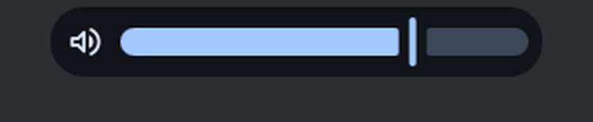

# Island system faces and level bubbles

Status: working prototype

*Volume, Do Not Disturb, audio output change and the idle inhibitor as faces of the free island*

In one sentence: Volume, brightness, microphone, Caps Lock, power profile, battery, network, Do Not Disturb and audio output changes each get a face in the island, or a bubble when it is busy.

## What it does

- System events get a face in the island: volume, brightness, microphone, Caps Lock, power profile, idle inhibitor (keep awake), plugging in, battery, network, Do Not Disturb and audio output change. Volume, brightness and microphone are "levels" with a track; the others are states.
- When the island is free, the event plays inside the island (a compact face, or a larger "level" face with DMS's own level row). When the island is busy, it goes to a bubble on the left.
- Two switches in the "Bubbles" card of the island settings move these events out of the island for good. "Always show levels in a bubble" covers volume, brightness and microphone. "Always show brief info in a bubble" covers Caps Lock, power profile, idle inhibitor, charged, unplugged, battery, network, Do Not Disturb, audio output, reopen, copy, trash, display and peripherals. Both are off by default.
- Each bubble has a card:
  - Volume: the output name (and the battery of a Bluetooth headset), the volume slider, the other outputs as chips, the volume of each playing app, and a mute toggle.
  - Brightness, microphone, power profile and Do Not Disturb have their own small cards.
  - Battery: the battery drawing, with the charge glyph.
  - Network: the link (Wi-Fi name and signal, or Ethernet), the VPN state, and a link to DMS's network settings.
  - Audio output: the output before the switch and an Undo button, for a short time.
- Critical or alert faces use the error color. A critical battery rings once as it arrives.

## Try it

- Check out `island-prototype`, use a bar in the Island layout, then change the volume, press Caps Lock, turn on Do Not Disturb, or switch the audio output.
- With the island free, the change plays inside it. Open the launcher first and it goes to a bubble on the left; hover the bubble for its card.
- Turn on "Always show levels in a bubble" or "Always show brief info in a bubble" (settings card "Bubbles") to keep them out of the island.

## Why

- The author's rule for all bubbles: an event first plays in the whole island when it is free, and only goes to a bubble beside the island when the island is busy. The two switches let the user pick bubbles always.
- Level changes (volume, brightness) are noisy, so they can be moved out of the island.
- The cards reuse the same services and rules as DMS's Control Center (for example the audio slider rules) so the island does not invent new behavior.

## How it is built

- [`quickshell/Modules/DIsland/IslandSystemSource.qml`](https://github.com/lung595/DankMaterialShell/blob/island-prototype/quickshell/Modules/DIsland/IslandSystemSource.qml): holds what a face shows (icon, title, value, track, accent) and listens to DMS services. Faces owned by other sources (copy, trash, disk, display, peripheral, progress, frozen, vpn, ssh) are described here by kind.
- [`quickshell/Modules/DIsland/Activities/SystemStateCompact.qml`](https://github.com/lung595/DankMaterialShell/blob/island-prototype/quickshell/Modules/DIsland/Activities/SystemStateCompact.qml) (compact face) and [`quickshell/Modules/DIsland/Activities/SystemLevelExpanded.qml`](https://github.com/lung595/DankMaterialShell/blob/island-prototype/quickshell/Modules/DIsland/Activities/SystemLevelExpanded.qml) (level face on the notification popup grid).
- Cards in `quickshell/Modules/DIsland/Cards/`: [`BubbleCardVolume.qml`](https://github.com/lung595/DankMaterialShell/blob/island-prototype/quickshell/Modules/DIsland/Cards/BubbleCardVolume.qml), [`BubbleCardBrightness.qml`](https://github.com/lung595/DankMaterialShell/blob/island-prototype/quickshell/Modules/DIsland/Cards/BubbleCardBrightness.qml), [`BubbleCardMicro.qml`](https://github.com/lung595/DankMaterialShell/blob/island-prototype/quickshell/Modules/DIsland/Cards/BubbleCardMicro.qml), [`BubbleCardBattery.qml`](https://github.com/lung595/DankMaterialShell/blob/island-prototype/quickshell/Modules/DIsland/Cards/BubbleCardBattery.qml), [`BubbleCardPower.qml`](https://github.com/lung595/DankMaterialShell/blob/island-prototype/quickshell/Modules/DIsland/Cards/BubbleCardPower.qml), [`BubbleCardDnd.qml`](https://github.com/lung595/DankMaterialShell/blob/island-prototype/quickshell/Modules/DIsland/Cards/BubbleCardDnd.qml), [`BubbleCardNetwork.qml`](https://github.com/lung595/DankMaterialShell/blob/island-prototype/quickshell/Modules/DIsland/Cards/BubbleCardNetwork.qml), [`BubbleCardOutput.qml`](https://github.com/lung595/DankMaterialShell/blob/island-prototype/quickshell/Modules/DIsland/Cards/BubbleCardOutput.qml).
- [`quickshell/Modules/DIsland/IslandOutputSource.qml`](https://github.com/lung595/DankMaterialShell/blob/island-prototype/quickshell/Modules/DIsland/IslandOutputSource.qml): remembers the previous audio output so the card can switch back. It reacts to `AudioService.sink` only, no timer.
- [`quickshell/Common/IslandActivities.js`](https://github.com/lung595/DankMaterialShell/blob/island-prototype/quickshell/Common/IslandActivities.js): the lists of which kinds are levels, which are brief, which have an Undo.
- Settings `islandLevelBubbles` and `islandBriefBubbles` (both false by default) in [`quickshell/Common/settings/SettingsSpec.js`](https://github.com/lung595/DankMaterialShell/blob/island-prototype/quickshell/Common/settings/SettingsSpec.js); the switches are in [`quickshell/Modules/Settings/Widgets/IslandBubblesCard.qml`](https://github.com/lung595/DankMaterialShell/blob/island-prototype/quickshell/Modules/Settings/Widgets/IslandBubblesCard.qml). A third setting, `islandSystemFaces`, stores for a kind the id of a plugin chosen to draw that face (empty by default).
- Related pages: the open Wi-Fi, VPN and SSH bubbles are described in [the network page](faces-a-network.md).

## Known limits

- Only one face was captured on a test bench (the compact Do Not Disturb face). The others could not be triggered there: the bench has no PipeWire, no backlight and no system bus, and there is no island command that opens these faces.
- A test exists only for the Wi-Fi logic. The cards and faces have no QML tests.
- In the first branch of this work, `IslandBubbles.qml` went over the project's file size limit (2352 lines).
- No animation measurement was made.

## Images

Volume, Do Not Disturb, audio output change and the idle inhibitor as faces of the free island.

The volume level face.

