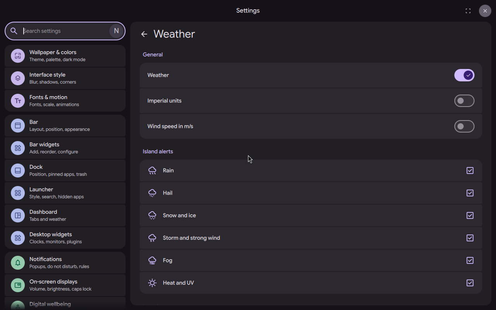

# Island weather alert

Status: working prototype

*The Weather settings with one switch per island alert, as the settings mock-up shows them*

In one sentence: The island warns 15 minutes before rain, hail, snow, storm, fog or heat starts, with the weather drawn over it and a small chart of the next two hours.

## What it does

- Warns before bad weather starts: 15 minutes before it, or "Now" if it is already there.
- Six kinds of event: rain, hail, snow and ice, storm and strong wind, fog, heat and UV. The worst ticked kind wins when several happen in the same quarter of an hour.
- Each episode is announced once. Rain has four levels (a few drops, light, heavy, very heavy); the other kinds have their own levels.
- If the island is free, the alert plays in the whole island first, with the weather drawn over it (rain, snow and so on, stronger when the level is higher). Then it stays as a bubble on the left of the island for a few seconds, frozen while hovered.
- Hover the bubble or the island to see a key phrase ("Heavy rain until 10:45"), the peak ("max 6 mm/h around 10:15") and one small chart of eight bars of 15 minutes (two hours), with marks for now and the end.
- Settings > Weather has an "Island alerts" section with one switch per event. All six are on by default. An event the forecast cannot give is marked "Not in your forecast", or "Needs the weather on".

## Try it

- Check out `island-prototype`, use a bar in the Island layout, and turn the weather on in Settings, Weather. The "Island alerts" section has one switch per event, all on.
- The alert comes by itself when the forecast shows an event in the next quarter of an hour. Hover the bubble or the island for the phrase, the peak and the chart.

## Why

- The author wanted an early warning, 15 minutes ahead, for events with a known time, shown in the island like other short infos.
- The author chose one switch per event, all on by default (decision of 25 October in the notes).
- The weather should fall on the whole bubble, flat or upright, not only inside its small shape.
- The alert must not add network traffic of its own.

## How it is built

- [`quickshell/Common/IslandWeather.js`](https://github.com/lung595/DankMaterialShell/blob/island-prototype/quickshell/Common/IslandWeather.js): plain JavaScript logic. It reads the 15-minute forecast, sets the levels per event (rain in mm/h, snow in cm/h, gusts in km/h, visibility in m, feels-like in degrees C, UV index), picks the next episode and builds the eight bars.
- [`quickshell/Services/WeatherService.qml`](https://github.com/lung595/DankMaterialShell/blob/island-prototype/quickshell/Services/WeatherService.qml): the existing weather service. It asks Open-Meteo for `minutely_15` (and UV) in the request it already makes, and keeps the rows as `minutely15`.
- [`quickshell/Modules/DIsland/IslandWeatherSource.qml`](https://github.com/lung595/DankMaterialShell/blob/island-prototype/quickshell/Modules/DIsland/IslandWeatherSource.qml): the source (kind `weatheralert`). One timer, armed for the next due time only. It makes no request of its own and takes no reference on the service, so nothing runs when no weather widget keeps the service fetching. It emits `arrived` for the island host.
- [`quickshell/Modules/DIsland/Cards/BubbleCardWeather.qml`](https://github.com/lung595/DankMaterialShell/blob/island-prototype/quickshell/Modules/DIsland/Cards/BubbleCardWeather.qml): the card with the phrase and the bars.
- [`quickshell/Modules/DIsland/IslandWeatherLayer.qml`](https://github.com/lung595/DankMaterialShell/blob/island-prototype/quickshell/Modules/DIsland/IslandWeatherLayer.qml), [`quickshell/Modules/DIsland/Kit/IslandWeatherFx.qml`](https://github.com/lung595/DankMaterialShell/blob/island-prototype/quickshell/Modules/DIsland/Kit/IslandWeatherFx.qml) and [`quickshell/Shaders/frag/weather.frag`](https://github.com/lung595/DankMaterialShell/blob/island-prototype/quickshell/Shaders/frag/weather.frag): the weather drawing in one shader. The particles are plain functions of a clock, the clock runs only while the alert shows, and nothing is drawn with reduced motion.
- [`quickshell/Modules/Settings/WeatherSettingsTab.qml`](https://github.com/lung595/DankMaterialShell/blob/island-prototype/quickshell/Modules/Settings/WeatherSettingsTab.qml): the "Island alerts" section. The setting is `islandWeatherAlerts` (a list of event names) in [`quickshell/Common/settings/SettingsSpec.js`](https://github.com/lung595/DankMaterialShell/blob/island-prototype/quickshell/Common/settings/SettingsSpec.js).
- Tests: [`quickshell/tests/island-weather.test.mjs`](https://github.com/lung595/DankMaterialShell/blob/island-prototype/quickshell/tests/island-weather.test.mjs) covers the JavaScript logic.

## Known limits

- The forecast comes only from Open-Meteo through the weather service. If the weather is off, there is no alert.
- On the test bench the alert itself was not captured, because the bench has no network. The bubble, the island face and the shader were checked only by the unit tests and by a mock-up, not by a full run.
- Only the pure JavaScript is unit tested. The QML source, card and shader are not.
- Two small points were noted in review of the first branch and were not rechecked on the prototype: the "now" time moves only when the forecast is read again (every 15 minutes at most), and an alert can come late if the island host is recreated while the weather is already loaded.

## Images

The Weather settings with one switch per island alert, as the settings mock-up shows them.

