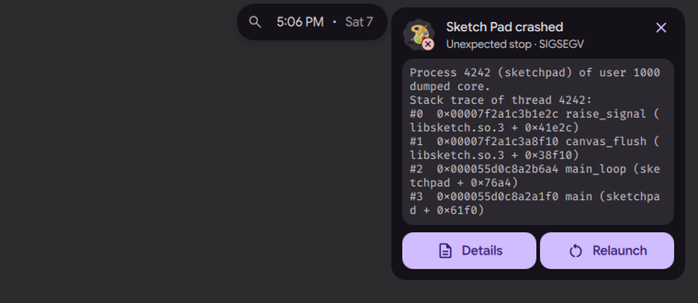

# App events: crash, reopen and urgent window

Status: working prototype

*An app crashes: a red bubble opens a card with Details and Relaunch, Details shows the end of the log*

In one sentence: The island tells you when a desktop app crashes (with the end of its log and Relaunch), offers to reopen a background app whose last window you closed, and shows urgent windows.

## What it does

- Crash: when a desktop app crashes, a card shows the app, its crash mark, the end of its log, and the buttons Details and Relaunch. Only apps that map to a desktop entry count (no command-line tools, no daemons).
- Reopen: when the last window of an app that keeps running in the background is closed (chat, game launcher, music), a bubble offers to show it again for a few seconds. A click launches its desktop entry, which a single-instance app answers by raising its window.
- Urgent: when a window turns urgent in niri, the island shows its icon and title for 5 seconds. A click goes to the window.
- For reopen and urgent, the free island shows the event itself first; a busy island leaves it to a bubble.
- A setting "reopen apps" (`islandReopenApps`) in the Bubbles settings card lists the apps. Its default is `signal, discord, steam, telegram, element, slack`, so reopen is on by default.

## Try it

- Check out `island-prototype` and use a bar in the Island layout.
- Reopen: close the last window of an app in the "reopen apps" list (by default signal, discord, steam, telegram, element, slack). A bubble offers to show it again.
- Crash: when a desktop app crashes, a red bubble opens a card with Details and Relaunch.

## Why

- Per the owner's decisions, a "frozen app" bubble was removed and the "crashed app" bubble was kept.
- Reopen exists because closing the window of such an app leaves it running (comment in `IslandReopen.js`).

## How it is built

- Crash: [`Services/AppCrashService.qml`](https://github.com/lung595/DankMaterialShell/blob/island-prototype/quickshell/Services/AppCrashService.qml) runs `journalctl --user -f` on systemd-coredump entries (no polling, only while a reader holds a reference). [`Common/AppCrash.js`](https://github.com/lung595/DankMaterialShell/blob/island-prototype/quickshell/Common/AppCrash.js) turns an entry into pid, name, signal, desktop-entry candidates and the log. Card: [`Cards/BubbleCardCrash.qml`](https://github.com/lung595/DankMaterialShell/blob/island-prototype/quickshell/Modules/DIsland/Cards/BubbleCardCrash.qml).
- Reopen: [`Common/IslandReopen.js`](https://github.com/lung595/DankMaterialShell/blob/island-prototype/quickshell/Common/IslandReopen.js) matches app ids against the setting and finds the app whose last window went away between two niri window lists. Source: [`IslandReopenSource.qml`](https://github.com/lung595/DankMaterialShell/blob/island-prototype/quickshell/Modules/DIsland/IslandReopenSource.qml). Glyph: [`Cards/BubbleReopenGlyph.qml`](https://github.com/lung595/DankMaterialShell/blob/island-prototype/quickshell/Modules/DIsland/Cards/BubbleReopenGlyph.qml). Setting UI: [`Modules/Settings/Widgets/IslandBubblesCard.qml`](https://github.com/lung595/DankMaterialShell/blob/island-prototype/quickshell/Modules/Settings/Widgets/IslandBubblesCard.qml).
- Urgent: [`Common/IslandUrgent.js`](https://github.com/lung595/DankMaterialShell/blob/island-prototype/quickshell/Common/IslandUrgent.js), [`IslandUrgentSource.qml`](https://github.com/lung595/DankMaterialShell/blob/island-prototype/quickshell/Modules/DIsland/IslandUrgentSource.qml) and [`IslandUrgentActivity.qml`](https://github.com/lung595/DankMaterialShell/blob/island-prototype/quickshell/Modules/DIsland/IslandUrgentActivity.qml) (activity id `dms:urgent`). They react to `NiriService`'s window list only.
- Tests (pure logic): [`tests/island-crash.test.mjs`](https://github.com/lung595/DankMaterialShell/blob/island-prototype/quickshell/tests/island-crash.test.mjs), [`tests/island-reopen.test.mjs`](https://github.com/lung595/DankMaterialShell/blob/island-prototype/quickshell/tests/island-reopen.test.mjs), [`tests/island-urgent.test.mjs`](https://github.com/lung595/DankMaterialShell/blob/island-prototype/quickshell/tests/island-urgent.test.mjs).

## Known limits

- None of the three was seen on the test bench. They need a real systemd-coredump entry, a real background app window, and a real urgent niri window.
- Reopen is active by default for six apps. A review note flags this and a copy of `playApp` without a screen filter.
- Urgent and reopen need niri.
- The QML files have no automated test.

## Images

An app crashes: a red bubble opens a card with Details and Relaunch, Details shows the end of the log.

The last window of a background app is closed: the island offers to reopen it.

The "closed, Reopen" face of an app that was closed.

The crash card with the end of the log, Details and Relaunch.

