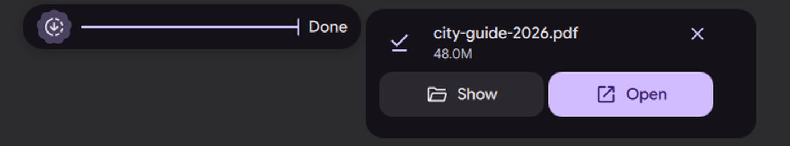

# Downloads, received files and progress

Status: working prototype

*A browser download grows on the island, then a card with Show and Open appears*

In one sentence: A finished browser download, a file received from another device, or any notification with a progress value shows in the island, with Show and Open.

## What it does

- When a browser finishes a download, the island shows the file name and size. The card has Show (opens the folder) and Open.
- The icon on the card can be dragged out: the file is dropped as a file anywhere (`text/uri-list`).
- A file sent by another device (LocalSend, Warpinator) gets its own card with the thumbnail for an image, the sender and Folder / Open.
- Any notification that carries the freedesktop `value` hint (0 to 100) becomes a progress bubble, updated in place when the app replaces the notification. A ring fills and turns into a check at the end.
- The progress card shows files done / total, time left and speed, each only when it is known.
- When the island is free, a finished download is shown on the island itself for a short time; when it is busy, or "brief info always in a bubble" is on, it is a brief bubble held while hovered.

## Try it

- Check out `island-prototype`, use a bar in the Island layout, and download a file in a browser.
- When it ends, the island shows the name and size. The card has Show and Open, and its icon can be dragged into any app.
- Any app can show progress: `notify-send -h int:value:40 "Export" "Rendering"`, then send it again with a higher value.

## Why

- A finished download or a received file is a short event, so the island shows it briefly (comment in `DownloadService.qml`).
- No polling: it reacts to folder changes and notifications only.

## How it is built

- Finished downloads: [`Services/DownloadService.qml`](https://github.com/lung595/DankMaterialShell/blob/island-prototype/quickshell/Services/DownloadService.qml) watches the XDG downloads folder with Qt's folder model (inotify). [`Common/IslandDownload.js`](https://github.com/lung595/DankMaterialShell/blob/island-prototype/quickshell/Common/IslandDownload.js) decides which files just finished: a file is finished when no temporary sibling (`.part`, `.crdownload`) is left. The first listing only seeds, so nothing already there is announced.
- Island face: [`Modules/DIsland/IslandDownloadActivity.qml`](https://github.com/lung595/DankMaterialShell/blob/island-prototype/quickshell/Modules/DIsland/IslandDownloadActivity.qml), activity id `dms:download`. Card: [`Cards/BubbleCardDownload.qml`](https://github.com/lung595/DankMaterialShell/blob/island-prototype/quickshell/Modules/DIsland/Cards/BubbleCardDownload.qml). Glyph: [`Cards/BubbleDownloadGlyph.qml`](https://github.com/lung595/DankMaterialShell/blob/island-prototype/quickshell/Modules/DIsland/Cards/BubbleDownloadGlyph.qml).
- Received file: [`Common/IslandReceived.js`](https://github.com/lung595/DankMaterialShell/blob/island-prototype/quickshell/Common/IslandReceived.js) reads the sender's notification. Card: [`Cards/BubbleCardReceived.qml`](https://github.com/lung595/DankMaterialShell/blob/island-prototype/quickshell/Modules/DIsland/Cards/BubbleCardReceived.qml). Without a path in the notification, it uses the user's Downloads folder. The drag image is loaded only for an image file.
- Progress: [`Common/IslandProgress.js`](https://github.com/lung595/DankMaterialShell/blob/island-prototype/quickshell/Common/IslandProgress.js), [`Modules/DIsland/IslandProgressSource.qml`](https://github.com/lung595/DankMaterialShell/blob/island-prototype/quickshell/Modules/DIsland/IslandProgressSource.qml), [`Cards/BubbleCardProgress.qml`](https://github.com/lung595/DankMaterialShell/blob/island-prototype/quickshell/Modules/DIsland/Cards/BubbleCardProgress.qml). Files and speed are read from the notification body ("3 of 12", "4.2 MB/s"); time left comes from the pace since the job was first seen.
- Tests (pure logic only): [`tests/island-download.test.mjs`](https://github.com/lung595/DankMaterialShell/blob/island-prototype/quickshell/tests/island-download.test.mjs), [`tests/island-progress.test.mjs`](https://github.com/lung595/DankMaterialShell/blob/island-prototype/quickshell/tests/island-progress.test.mjs), [`tests/island-received.test.mjs`](https://github.com/lung595/DankMaterialShell/blob/island-prototype/quickshell/tests/island-received.test.mjs).

## Known limits

- Every notification with a `value` hint becomes a progress bubble. This is a design choice in the notes, not a filter by app.
- It was not tried with a real browser. On the test bench only the received-file bubble and a progress bubble at 35 % were captured. The open progress card, the final check, the island face and drag and drop were not captured.
- Browser downloads still in progress are also read by the transfers feature (see the transfers page).
- The QML files have no automated test.

## Images

A browser download grows on the island, then a card with Show and Open appears.

The finished download card: file name, size, Show and Open.

