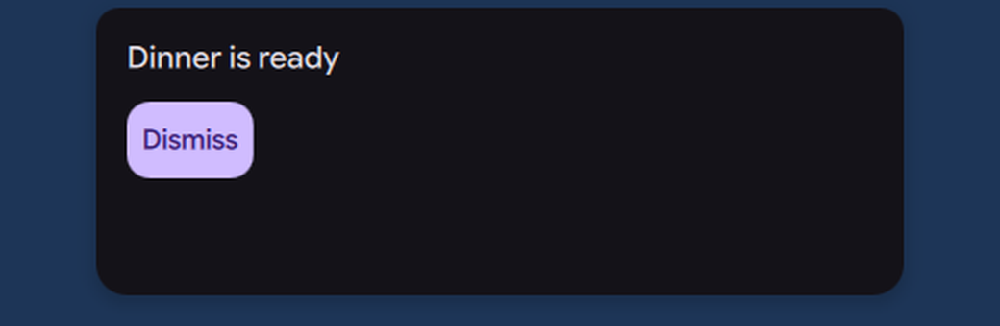

# Island over fullscreen windows

Status: working prototype

*A fullscreen window, then a request lifts the island over it until it is dismissed*

In one sentence: When a request needs an answer, the island lifts itself over fullscreen windows, then goes back to its layer when the request ends.

## What it does

- When a request needs an answer, the island moves to the overlay layer so it is visible over a fullscreen window. It goes back to its normal layer when the request ends.
- This applies to requests that ask for it with `showInFullscreen` (the polkit request and plugins that set it).
- A new setting, "Show requests over fullscreen" (`islandOverlayOnRequest`), turns this on or off. It is on by default.
- The existing setting `islandUseOverlayLayer` still keeps the island on the overlay layer all the time.

## Try it

- Check out `island-prototype`, use a bar in the Island layout, and put a window in fullscreen.
- Raise a request that asks for it, for example a polkit request (`pkexec true`): the island shows over the fullscreen window.
- Turn off "Show requests over fullscreen" to keep the island under fullscreen windows.

## Why

- The owner decided: for polkit and for plugins with `showInFullscreen`, the island goes to the overlay layer during the request, with an option in Settings and the default on.
- The island stays lifted over fullscreen windows only until the request goes away (comment in `IslandLayer.js`).

## How it is built

- Rule: [`Common/IslandLayer.js`](https://github.com/lung595/DankMaterialShell/blob/island-prototype/quickshell/Common/IslandLayer.js). `wantsOverlay(always, onRequest, entry)` is true when `islandUseOverlayLayer` is true, or when `islandOverlayOnRequest` is true and the shown activity has `showInFullscreen === true`.
- Default: [`Common/settings/BarWidgetDefaults.js`](https://github.com/lung595/DankMaterialShell/blob/island-prototype/quickshell/Common/settings/BarWidgetDefaults.js).
- Host: [`Modules/DIsland/IslandBarHost.qml`](https://github.com/lung595/DankMaterialShell/blob/island-prototype/quickshell/Modules/DIsland/IslandBarHost.qml) uses `wantsOverlay` for the free island window. [`Modules/DBar/DBarWindow.qml`](https://github.com/lung595/DankMaterialShell/blob/island-prototype/quickshell/Modules/DBar/DBarWindow.qml) uses `islandHost?.wantsOverlay` when the island lives in a bar.
- Setting UI: [`Modules/Settings/Widgets/IslandBehaviorCard.qml`](https://github.com/lung595/DankMaterialShell/blob/island-prototype/quickshell/Modules/Settings/Widgets/IslandBehaviorCard.qml). The toggle is hidden when the island is hosted in a bar, is a dot, or is already always on the overlay layer.
- Tests (pure logic only): [`tests/island-layer.test.mjs`](https://github.com/lung595/DankMaterialShell/blob/island-prototype/quickshell/tests/island-layer.test.mjs).

## Known limits

- It was never tried over a real fullscreen window. The QML wiring has no automated test.
- No screenshot exists.

## Images

A fullscreen window, then a request lifts the island over it until it is dismissed.

The island card of a request, shown over a fullscreen window.

