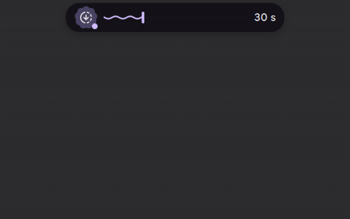
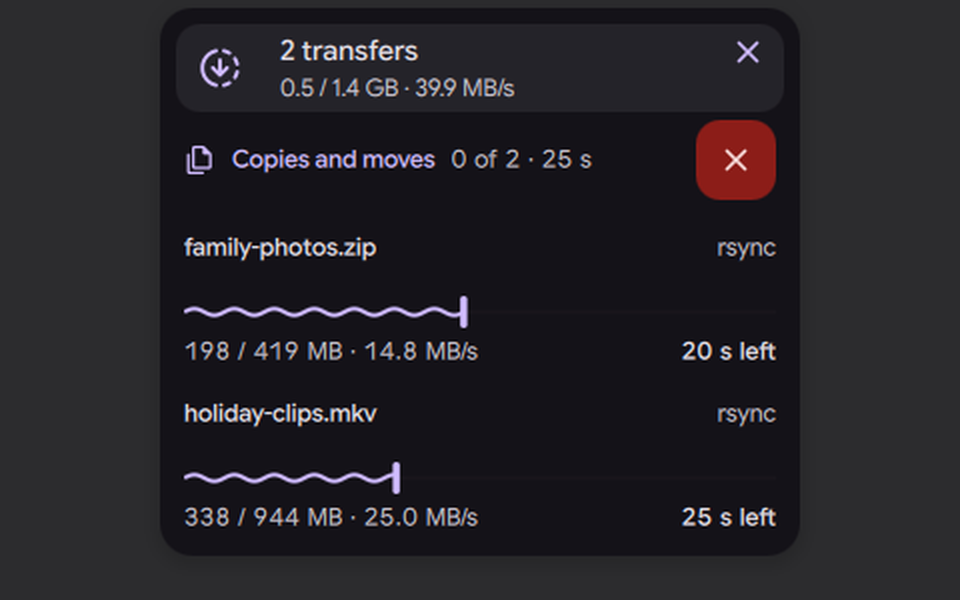

# Transfers (copies, archives, torrents, downloads)

Status: working prototype

*Two file copies in progress: the island shows the total, hovering opens the transfers card*

In one sentence: One bubble shows every file transfer at once (copies, archives, torrents, downloads), with the total progress, the time left, and a card to pause or cancel each one.

## What it does

- One bubble shows everything that is moving files: file copies, archive extractions, downloaders, senders, image writers, qBittorrent torrents, and browser downloads still in progress.
- Its liquid shows the total progress and its value shows the time left. A "more" dot says there are several transfers.
- When the speed changes suddenly, the liquid is kicked (a surge); a steady flow stays calm.
- When the island is free, the transfer is shown on the island itself: the app icon, a wave progress bar and the time left. The island shows "Done" at the end.
- The card has one section per category (download, copy, archive, send, disk) with Pause all and Cancel all. Each row can Pause or Resume (only when the app allows it), Cancel (held for 2 seconds), Open folder and, when finished, Open.
- A browser download that disappears without a finished file is treated as cancelled or failed, never as "Done".

## Try it

- Check out `island-prototype`, use a bar in the Island layout, and start a long copy in a file manager or a download.
- With the island free, the transfer shows on it. Hover the bubble for the card: Pause, Resume, Cancel (held for 2 seconds), Open folder.

## Why

- One bubble for everything that downloads or moves files (comment in `IslandTransferSource.qml`).
- A user process gets no event when another one starts, and the event interfaces need privileges. So the core scans `/proc` for the user's own processes, and only while the shell listens (comment in `manager.go`).

## How it is built

- Core (Go): the `transfers` IPC service, API version 39. Methods `transfers.getState`, `transfers.pause`, `transfers.resume`, `transfers.cancel` in [`handlers.go`](https://github.com/lung595/DankMaterialShell/blob/island-prototype/core/internal/server/transfers/handlers.go). The manager is in [`manager.go`](https://github.com/lung595/DankMaterialShell/blob/island-prototype/core/internal/server/transfers/manager.go): it scans every second while something moves and every five seconds otherwise, and only while someone subscribes.
- Process scan: [`proc.go`](https://github.com/lung595/DankMaterialShell/blob/island-prototype/core/internal/server/transfers/proc.go) reads `/proc` for known programs only (copies, moves, archives, file managers, downloaders, senders, image writers). Progress is the read position in `/proc/<pid>/fdinfo` over the file size. [`files.go`](https://github.com/lung595/DankMaterialShell/blob/island-prototype/core/internal/server/transfers/files.go) lists a process's open files.
- Cancel: only the user's own processes (never root); `Cancel` checks the process again before sending SIGTERM through a pidfd ([`proc_linux.go`](https://github.com/lung595/DankMaterialShell/blob/island-prototype/core/internal/server/transfers/proc_linux.go); other systems return "unsupported").
- qBittorrent: [`qbittorrent.go`](https://github.com/lung595/DankMaterialShell/blob/island-prototype/core/internal/server/transfers/qbittorrent.go) talks to the local Web UI on 127.0.0.1 only, and only when the Web UI does not need a local login.
- Tests: [`manager_test.go`](https://github.com/lung595/DankMaterialShell/blob/island-prototype/core/internal/server/transfers/manager_test.go) with fake `/proc` trees.
- Shell: [`Services/TransferService.qml`](https://github.com/lung595/DankMaterialShell/blob/island-prototype/quickshell/Services/TransferService.qml) subscribes to the core only while a source wants it. [`Modules/DIsland/IslandTransferSource.qml`](https://github.com/lung595/DankMaterialShell/blob/island-prototype/quickshell/Modules/DIsland/IslandTransferSource.qml) merges the core's list with `DownloadService.live`. [`Common/IslandTransfer.js`](https://github.com/lung595/DankMaterialShell/blob/island-prototype/quickshell/Common/IslandTransfer.js) takes one sample per second to smooth speed and time left, and detects surges.
- UI: [`IslandTransferActivity.qml`](https://github.com/lung595/DankMaterialShell/blob/island-prototype/quickshell/Modules/DIsland/IslandTransferActivity.qml) (activity id `dms:transfer`), [`Cards/BubbleCardTransfers.qml`](https://github.com/lung595/DankMaterialShell/blob/island-prototype/quickshell/Modules/DIsland/Cards/BubbleCardTransfers.qml), [`IslandTransferActions.qml`](https://github.com/lung595/DankMaterialShell/blob/island-prototype/quickshell/Modules/DIsland/IslandTransferActions.qml), [`Cards/BubbleTransferGlyph.qml`](https://github.com/lung595/DankMaterialShell/blob/island-prototype/quickshell/Modules/DIsland/Cards/BubbleTransferGlyph.qml).
- Tests (pure logic): [`tests/island-transfer.test.mjs`](https://github.com/lung595/DankMaterialShell/blob/island-prototype/quickshell/tests/island-transfer.test.mjs).

## Known limits

- The core was tested only on fake `/proc` trees. Real copies, real torrents and real cancels were not tried.
- On the test bench, only one big `dd` copy was captured (island face with the wave and "Done"). The card, pause, cancel, torrents, browser downloads and failures were not captured.
- The scan polls `/proc` while subscribed, because a user process gets no event when another starts (comment in `manager.go`).
- With reduced motion, or when the bubble is hardly visible, the surge is ignored.
- A review note says that `transfers.getState` without a subscriber returns a frozen state.

## Images

Two file copies in progress: the island shows the total, hovering opens the transfers card.

The transfers card: a row per copy with its progress, speed and time left.

