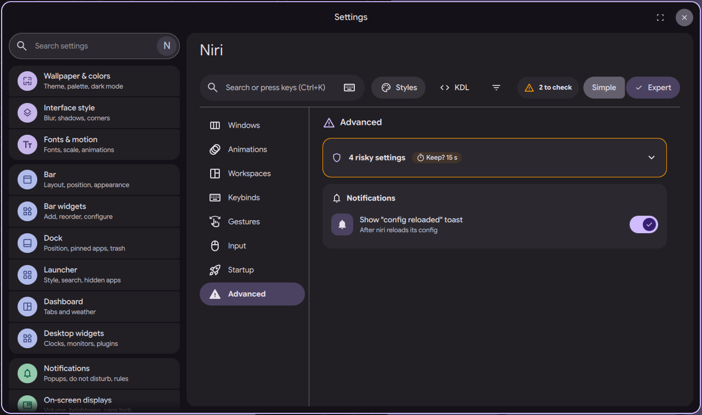

# niri settings page: Advanced section

Status: in open [PR #4063](https://github.com/duxlabs-dev/dux-shell/pull/4063)

*The Advanced section: 4 risky settings with the Keep timer*

In one sentence: An Expert-only section for four risky settings (the Mod key, the power button, X11 apps and debug options), each guarded by a 15 second "Keep this change?" timer.

## What it does

- An Advanced section, shown in Expert mode only, groups four risky settings: the Mod key, "DMS handles the power button", X11 apps (xwayland-satellite) and debug options.
- Mod key: every Mod shortcut moves to the new key. "DMS handles the power button": niri stops sending the power key to the system.
- X11 apps can be turned off; the tip says they then stop opening. Debug options are a few switches for niri's `debug` block, with no compatibility promise from niri.
- A line "4 risky settings" warns first. Any change to one of the four starts the "Keep this change?" banner: after 15 seconds it goes back unless the user keeps it. Reset does the same.
- A Notifications row shows or hides DMS's own toast after niri reloads its config.

## Try it

- Check out `page-niri-pr`, run DMS under niri, switch the niri page to Expert and run `dms ipc call settings openNiri advanced`.
- Change the Mod key: the banner counts down 15 seconds and goes back unless you press Keep.

## Why

- The author put the settings that can cut the keyboard or the screen behind Expert mode, with a warning and a "keep?" timer.
- Custom screen mode and the old "Outputs" section were left out; they belong to the Displays page.

## How it is built

- [AdvancedSection.qml](https://github.com/lung595/DankMaterialShell/blob/page-niri-pr/quickshell/Modules/Settings/Niri/Sections/AdvancedSection.qml).
- [advanced.js](https://github.com/lung595/DankMaterialShell/blob/page-niri-pr/quickshell/Common/niri/sections/advanced.js) keeps `advanced.modKey` (default Super), `advanced.powerKey`, `advanced.xwayland` and `advanced.debug`. It writes `mod-key` and `disable-power-key-handling` in `input`, `off` in `xwayland-satellite`, and the chosen flags in `debug`. All four keys are in its `risky` list.
- The countdown is the shared one: [NiriKeep.qml](https://github.com/lung595/DankMaterialShell/blob/page-niri-pr/quickshell/Modules/Settings/Niri/Components/NiriKeep.qml) and [keep.js](https://github.com/lung595/DankMaterialShell/blob/page-niri-pr/quickshell/Common/niri/keep.js).

## Known limits

- The maintainers asked to pause PR #4063 and to talk with the team first, before more work on it.
- Debug flags that need values are not on the page. They go through the KDL drawer.
- The reload toast is a DMS setting and is not written to niri.

## Images

The Advanced section: 4 risky settings with the Keep timer.

