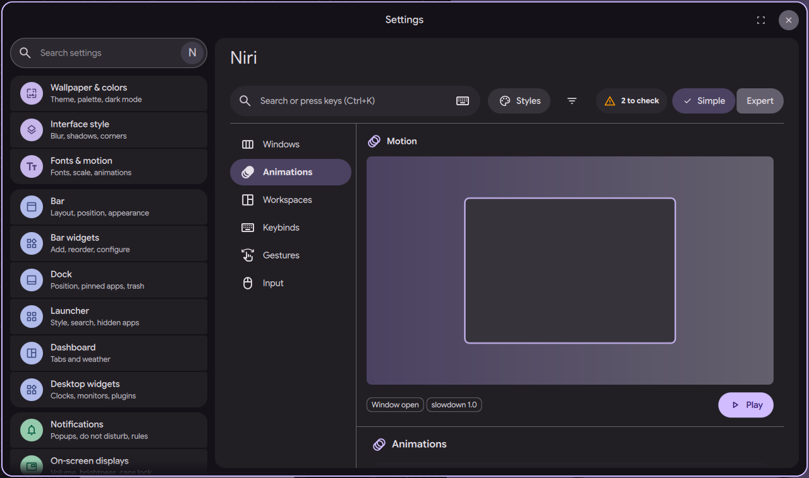
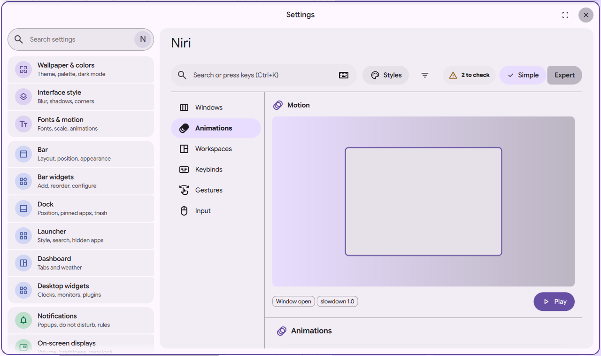

# niri settings page: animations

Status: in open [PR #4063](https://github.com/duxlabs-dev/dux-shell/pull/4063)

*The Animations section with its preview box and Play button*

In one sentence: Turn niri's animations on or off, slow them down, give them one style, or fine tune each of the 11 with a live preview.

## What it does

- A "Window animations" switch turns every niri animation on or off. A "Slowdown" slider (0.2 to 4, 1.0 is normal) makes all of them longer or shorter.
- A style row sets all 11 animations at once: Snappy, niri default or Bouncy.
- A gallery shows one tile for each of the 11 animations (workspace switch, window open, window close, view scroll, window move, window resize, config notice, exit dialog, screenshot, overview, Alt-Tab close). A tile plays its motion on hover and a click picks it.
- A "Fine tune" card edits the picked animation. Type Spring: damping ratio (below 1 bounces), stiffness, epsilon. Type Curve: duration in ms and a curve (Quad, Cubic, Expo, Linear). A Play button runs a preview.
- A motion pane in the side column draws the animation on a sample window. It follows the slowdown and shows when animations are off.

## Try it

- Check out `page-niri-pr`, run DMS under niri and run `dms ipc call settings openNiri animations`.
- Hover a tile of the gallery to play it, set the style to Bouncy, then press Play in Fine tune.

## Why

- The author listed animations with a preview as a top priority, with the gallery of animated thumbnails.
- In Simple mode the fine settings of an animation are hidden.

## How it is built

- [AnimationsSection.qml](https://github.com/lung595/DankMaterialShell/blob/page-niri-pr/quickshell/Modules/Settings/Niri/Sections/AnimationsSection.qml) with [AnimStyleRow.qml](https://github.com/lung595/DankMaterialShell/blob/page-niri-pr/quickshell/Modules/Settings/Niri/Sections/Animations/AnimStyleRow.qml), [AnimTile.qml](https://github.com/lung595/DankMaterialShell/blob/page-niri-pr/quickshell/Modules/Settings/Niri/Sections/Animations/AnimTile.qml), [AnimFineCard.qml](https://github.com/lung595/DankMaterialShell/blob/page-niri-pr/quickshell/Modules/Settings/Niri/Sections/Animations/AnimFineCard.qml), [AnimMotionPane.qml](https://github.com/lung595/DankMaterialShell/blob/page-niri-pr/quickshell/Modules/Settings/Niri/Sections/Animations/AnimMotionPane.qml), [AnimStage.qml](https://github.com/lung595/DankMaterialShell/blob/page-niri-pr/quickshell/Modules/Settings/Niri/Sections/Animations/AnimStage.qml) and [AnimCurve.qml](https://github.com/lung595/DankMaterialShell/blob/page-niri-pr/quickshell/Modules/Settings/Niri/Sections/Animations/AnimCurve.qml).
- [anim.js](https://github.com/lung595/DankMaterialShell/blob/page-niri-pr/quickshell/Common/niri/anim.js) holds the 11 animations with niri's defaults and the motion math copied from niri (spring oscillation, spring duration, easing curves, samples for the preview).
- [animations.js](https://github.com/lung595/DankMaterialShell/blob/page-niri-pr/quickshell/Common/niri/sections/animations.js) keeps the state under keys `animations.<name>.<field>`. Niri replaces each animation block whole, so a changed animation is written with all its values and an unchanged one is not written.
- The "Window animations" row has a battery cost icon ("draws extra frames each time a window moves").

## Known limits

- The maintainers asked to pause PR #4063 and to talk with the team first, before more work on it.
- Previews stop after a limit, because a very soft spring would run for seconds.
- When the kind (spring or curve) is not in use, it keeps niri's fallback values.

## Images

The Animations section with its preview box and Play button.

The same section in the light theme.

