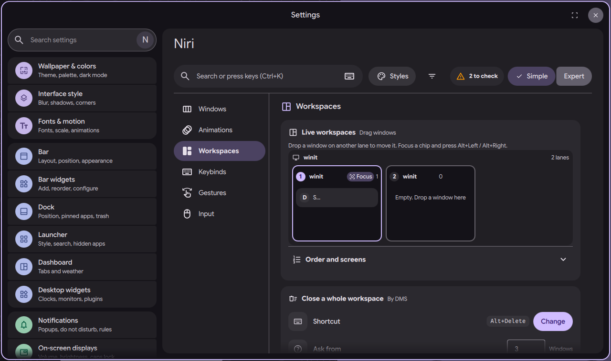

# niri settings page: close a whole workspace

Status: in open [PR #4063](https://github.com/duxlabs-dev/dux-shell/pull/4063)

*The Close a whole workspace card with its shortcut*

In one sentence: A new shortcut, Super+Delete, closes every window of the focused workspace, and asks first when there are many.

## What it does

- A new shortcut, Mod+Delete (Super+Delete by default), closes every window on the focused workspace.
- niri has no such action, so DMS does it: it lists the windows of the focused workspace and closes each one by id.
- A confirmation asks first when the workspace has a number of windows at or above a limit. The limit is set on the page: "Ask from" N windows (default 3, 0 means always ask), or "Never ask" (closes at once, no undo).
- The card "Close a whole workspace" shows the shortcut, a Change button, the two settings and how many windows the focused workspace has.
- An empty workspace does nothing and the call says so.

## Try it

- Check out `page-niri-pr`, run DMS under niri with its default binds, open three windows on one workspace and press Super+Delete.
- The same action from a terminal: `dms ipc call workspace closeAll`. Set "Ask from" in the "Close a whole workspace" card of the Workspaces section.

## Why

- The author asked to close a whole workspace with a shortcut.
- The confirmation limit is his choice: confirm from N windows, 0 for always, and a way to never confirm.
- Super+Delete was free. Only Ctrl+Alt+Delete (Task Manager) used that key.

## How it is built

- [NiriWorkspaceActions.qml](https://github.com/lung595/DankMaterialShell/blob/page-niri-pr/quickshell/Services/NiriWorkspaceActions.qml) is a singleton with `closeFocusedWorkspace()`. It returns WORKSPACE_CLOSED, WORKSPACE_EMPTY or WORKSPACE_UNSUPPORTED_COMPOSITOR, and shows a `ConfirmModal` when needed.
- The default bind is in [niri-binds.kdl](https://github.com/lung595/DankMaterialShell/blob/page-niri-pr/core/internal/config/embedded/niri-binds.kdl): `spawn "dms" "ipc" "call" "workspace" "closeAll"`.
- [close.js](https://github.com/lung595/DankMaterialShell/blob/page-niri-pr/quickshell/Common/niri/sections/close.js) holds `close.askFrom` and `close.neverAsk` and `needsConfirm` ("never ask" wins over the limit). These keys are read by DMS only; niri never sees them.
- The UI is [CloseCard.qml](https://github.com/lung595/DankMaterialShell/blob/page-niri-pr/quickshell/Modules/Settings/Niri/Sections/Workspaces/CloseCard.qml).

## Known limits

- The maintainers asked to pause PR #4063 and to talk with the team first, before more work on it.
- The bind is only added to a config that does not bind the key yet (see the page about default binds).
- Closing is not undoable, and the dialog says so.
- The action is niri only.

## Images

The Close a whole workspace card with its shortcut.

