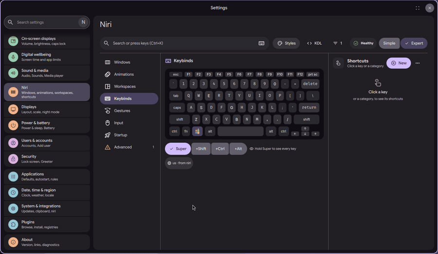
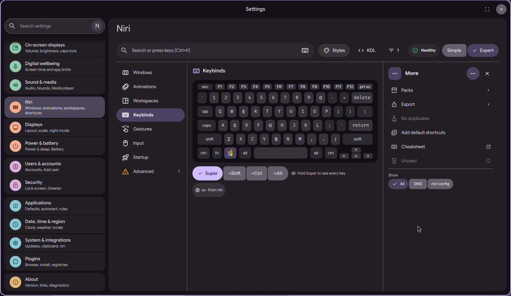
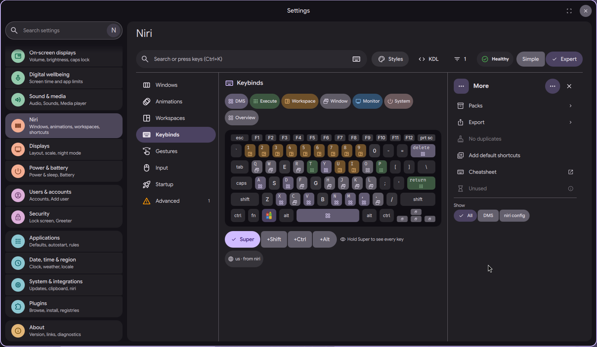

# niri settings page: add the missing default binds

Status: in open [PR #4063](https://github.com/duxlabs-dev/dux-shell/pull/4063)

*An empty keyboard, the More menu, then the default shortcuts in place*

In one sentence: Add the DMS default shortcuts that are still free to your niri config in one action, checked by niri first and with Undo.

## What it does

- A new command, `dms keybinds add-defaults niri`, adds the DMS default binds that are still free to `dms/binds.kdl` in the niri config folder.
- A bind counts as free when its key is bound nowhere: not in `dms/binds.kdl`, not in `config.kdl`, not in its includes. Every existing line is kept.
- The merged file is checked with niri before it is written. The old file is kept beside it as a backup.
- `dms keybinds undo-defaults niri` puts the file back as it was. It refuses once the file changed after the add.
- The Keybinds page offers the same action as "Add default shortcuts" in its More menu, shows how many were added, and gives an Undo.
- The embedded default binds have one new entry: Mod+Delete, "Close Workspace Windows".

## Try it

- Check out `page-niri-pr` and run `dms keybinds add-defaults niri`, then `dms keybinds undo-defaults niri` to put the file back.
- Or, on the Keybinds section of the niri page, open the More menu and pick "Add default shortcuts".

## Why

- At first the defaults were merged at boot. On 1/11 the author changed this: nothing is written at startup, and the user runs the command or the menu entry.
- The page must not touch the user's own lines.

## How it is built

- [niri_defaults.go](https://github.com/lung595/DankMaterialShell/blob/page-niri-pr/core/internal/keybinds/providers/niri_defaults.go) has `MergeMissingDefaults` and `UndoMergeDefaults`. The undo check compares binds, not bytes, because the KDL library writes properties in map order.
- [niri.go](https://github.com/lung595/DankMaterialShell/blob/page-niri-pr/core/internal/keybinds/providers/niri.go) gains `bindsFromDoc` and `bindsFromData`. The notes say the provider refuses to merge when `config.kdl` cannot be parsed.
- The commands are in [commands_keybinds.go](https://github.com/lung595/DankMaterialShell/blob/page-niri-pr/core/cmd/dms/commands_keybinds.go). The default binds file is [niri-binds.kdl](https://github.com/lung595/DankMaterialShell/blob/page-niri-pr/core/internal/config/embedded/niri-binds.kdl).
- The menu entry is in [BindsMenu.qml](https://github.com/lung595/DankMaterialShell/blob/page-niri-pr/quickshell/Modules/Settings/Niri/Sections/Keybinds/BindsMenu.qml) and the call in `BindsPane.qml`.

## Known limits

- The maintainers asked to pause PR #4063 and to talk with the team first, before more work on it.
- Only one backup is kept (`binds.kdl.dms-bak`), overwritten at each add.
- The commands take a provider name. This work covers niri only.

## Images

An empty keyboard, the More menu, then the default shortcuts in place.

The More menu of the Keybinds page, with "Add default shortcuts".

After adding the default shortcuts, the keyboard shows them in color by category.

