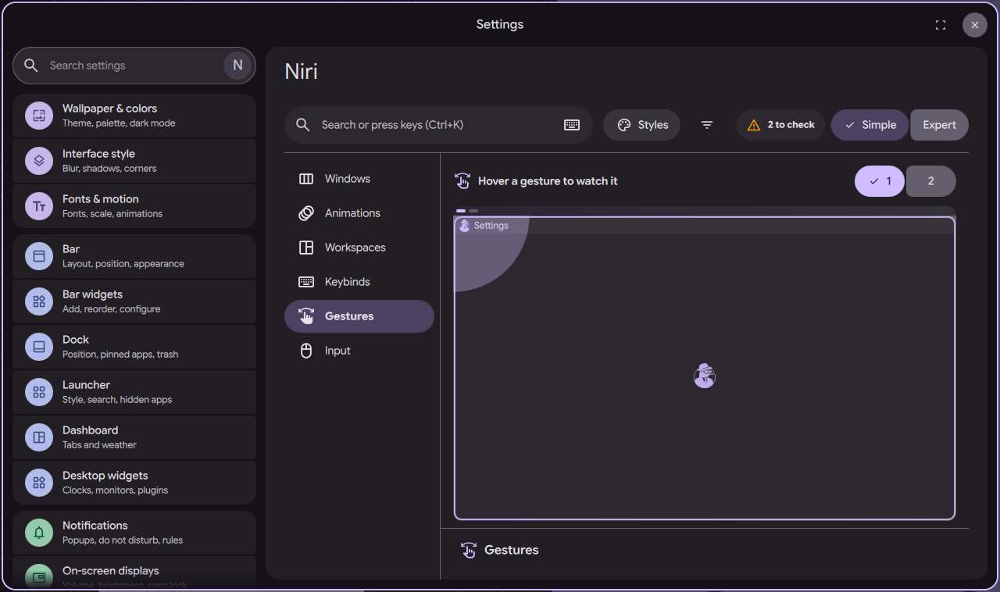

# niri settings page: gestures

Status: in open [PR #4063](https://github.com/duxlabs-dev/dux-shell/pull/4063)

*The Gestures section: hover a gesture to watch it*

In one sentence: The Gestures section lists niri's touchpad, mouse and touchscreen gestures and plays each one on a drawn desktop when you hover it.

## What it does

- The Gestures section shows the gestures niri has today, with a short phrase for each.
- Touchpad: 3 fingers up or down (workspaces), 3 fingers left or right (columns), 4 fingers up or down (overview).
- Mouse: hold Super and drag with the left button to move, with the right button to resize, wheel or middle drag to scroll the view.
- Touchscreen: drag a finger with Super held to move, and tap a second finger while moving to float or tile.
- Hovering a gesture plays it on a drawn desktop with an animated hand, in the side pane.
- A "While dragging" card sets the edge size that scrolls the view while something is dragged, and the edge size that switches workspace in the overview. 0 turns each off.

## Try it

- Check out `page-niri-pr`, run DMS under niri and run `dms ipc call settings openNiri gestures`.
- Hover a gesture: the side pane plays it with an animated hand.

## Why

- The author wanted only the gestures that niri has today, drawn on a diagram. They should be understood and tested by hovering, without reading much.
- Configurable touch gestures are a separate project.

## How it is built

- [GesturesSection.qml](https://github.com/lung595/DankMaterialShell/blob/page-niri-pr/quickshell/Modules/Settings/Niri/Sections/GesturesSection.qml), [GesturesCard.qml](https://github.com/lung595/DankMaterialShell/blob/page-niri-pr/quickshell/Modules/Settings/Niri/Sections/Gestures/GesturesCard.qml), [GestTile.qml](https://github.com/lung595/DankMaterialShell/blob/page-niri-pr/quickshell/Modules/Settings/Niri/Sections/Gestures/GestTile.qml), [GestStage.qml](https://github.com/lung595/DankMaterialShell/blob/page-niri-pr/quickshell/Modules/Settings/Niri/Sections/Gestures/GestStage.qml), [GestDesk.qml](https://github.com/lung595/DankMaterialShell/blob/page-niri-pr/quickshell/Modules/Settings/Niri/Sections/Gestures/GestDesk.qml), [GestHand.qml](https://github.com/lung595/DankMaterialShell/blob/page-niri-pr/quickshell/Modules/Settings/Niri/Sections/Gestures/GestHand.qml), [GestModKey.qml](https://github.com/lung595/DankMaterialShell/blob/page-niri-pr/quickshell/Modules/Settings/Niri/Sections/Gestures/GestModKey.qml) and [GestDragCard.qml](https://github.com/lung595/DankMaterialShell/blob/page-niri-pr/quickshell/Modules/Settings/Niri/Sections/Gestures/GestDragCard.qml).
- The drawn desktop uses [NiriDeskView.qml](https://github.com/lung595/DankMaterialShell/blob/page-niri-pr/quickshell/Modules/Settings/Niri/Desk/NiriDeskView.qml), [NiriDeskModel.qml](https://github.com/lung595/DankMaterialShell/blob/page-niri-pr/quickshell/Modules/Settings/Niri/Desk/NiriDeskModel.qml) and [NiriDeskTile.qml](https://github.com/lung595/DankMaterialShell/blob/page-niri-pr/quickshell/Modules/Settings/Niri/Desk/NiriDeskTile.qml), which draw the live windows of the focused workspace on the user's wallpaper. [desk.js](https://github.com/lung595/DankMaterialShell/blob/page-niri-pr/quickshell/Common/niri/desk.js) holds the layout math.
- [gestures.js](https://github.com/lung595/DankMaterialShell/blob/page-niri-pr/quickshell/Common/niri/sections/gestures.js) keeps `gestures.dndViewWidth` (default 30) and `gestures.dndWorkspaceHeight` (default 50) and writes `trigger-width` and `trigger-height` in the `gestures` blocks, only when changed.

## Known limits

- The maintainers asked to pause PR #4063 and to talk with the team first, before more work on it.
- The only editable gesture settings are the two drag edges (hot corners have their own page). The rest is a schematic, because niri has no other gesture options.
- The notes record the accessibility finding that arrow keys select by default in the stage and the result message has no live region (vague C, round 2).

## Images

The Gestures section: hover a gesture to watch it.

