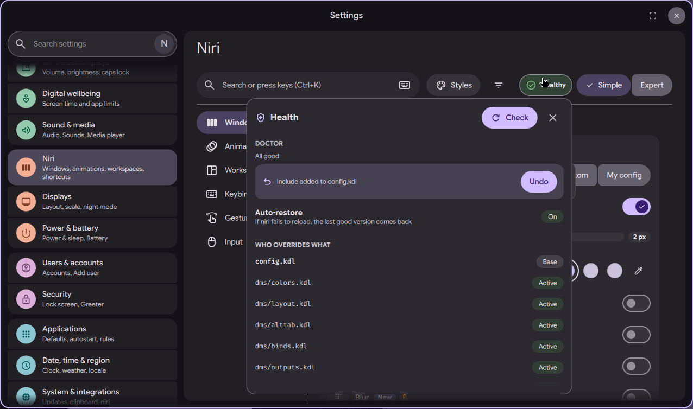

# niri settings page: health popover and config doctor

Status: in open [PR #4063](https://github.com/duxlabs-dev/dux-shell/pull/4063)

*The Health popover: doctor result, include banner with Undo, auto-restore, and which file overrides what*

In one sentence: A "Health" pill on the niri page checks the config files niri reads and lists what is wrong, such as a key bound twice or a missing include, with a fix and Undo where one exists.

## What it does

- A "Health" pill in the header shows the state: Checking, Healthy, "N to check", errors, or "Reload failed".
- It opens a popover with the files niri reads (base, active, missing, not included, unreadable) and how many settings each one replaces.
- It lists findings: a key bound twice, a setting set twice, a later file that hides the user's setting, a missing include, a file that is not included, a window rule that matches no app, an obsolete option, a program started twice (Autostart and the page), and an unreadable file.
- One finding has a fix: "Add include" for a DMS file that niri never reads. DMS adds the include itself, with a backup, and a banner offers Undo.
- The popover shows the saved versions of the page config and marks a failed reload and the automatic restore.

## Try it

- Check out `page-niri-pr`, run DMS under niri, open the niri page and click the Health pill in the header.
- Bind one key twice in your config: the popover lists it.

## Why

- The author wanted to see "who overrides what" and to repair a broken setup without opening files.
- Only the include fix is applied by DMS. The other findings are in files that the user or other DMS code owns, so they are only reported.

## How it is built

- Go: [doctor.go](https://github.com/lung595/DankMaterialShell/blob/page-niri-pr/core/internal/niriconf/doctor.go) reads `config.kdl` and every included file, without running niri. [doctor_checks.go](https://github.com/lung595/DankMaterialShell/blob/page-niri-pr/core/internal/niriconf/doctor_checks.go) holds the bind, override, rule and obsolete checks. [autostart.go](https://github.com/lung595/DankMaterialShell/blob/page-niri-pr/core/internal/niriconf/autostart.go) finds duplicate startup programs.
- Socket method `niri.config.doctor` in [niriconf_handler.go](https://github.com/lung595/DankMaterialShell/blob/page-niri-pr/core/internal/server/niriconf_handler.go). The report has `files`, `findings` and `undo`.
- QML: [NiriHealthPill.qml](https://github.com/lung595/DankMaterialShell/blob/page-niri-pr/quickshell/Modules/Settings/Niri/Shell/NiriHealthPill.qml), [NiriHealthPopover.qml](https://github.com/lung595/DankMaterialShell/blob/page-niri-pr/quickshell/Modules/Settings/Niri/Shell/NiriHealthPopover.qml), [NiriHealthFinding.qml](https://github.com/lung595/DankMaterialShell/blob/page-niri-pr/quickshell/Modules/Settings/Niri/Shell/NiriHealthFinding.qml) and [NiriHealthVersions.qml](https://github.com/lung595/DankMaterialShell/blob/page-niri-pr/quickshell/Modules/Settings/Niri/Shell/NiriHealthVersions.qml).
- [NiriIncludeBanner.qml](https://github.com/lung595/DankMaterialShell/blob/page-niri-pr/quickshell/Modules/Settings/Niri/Shell/NiriIncludeBanner.qml) announces an include the doctor added. [health.js](https://github.com/lung595/DankMaterialShell/blob/page-niri-pr/quickshell/Common/niri/health.js) finds the dormant fragment.

## Known limits

- The maintainers asked to pause PR #4063 and to talk with the team first, before more work on it.
- Rules are judged against installed apps and open windows. An app installed in a way DMS cannot see (for example a Flatpak that is not exported) reads as unknown.
- The doctor does not run niri; it reads the files only.

## Images

The Health popover: doctor result, include banner with Undo, auto-restore, and which file overrides what.

