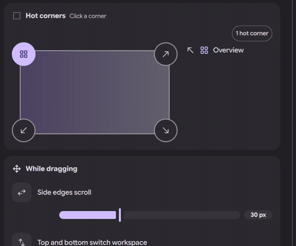
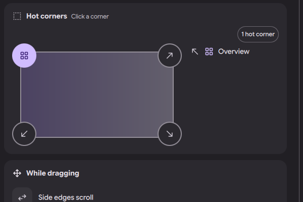
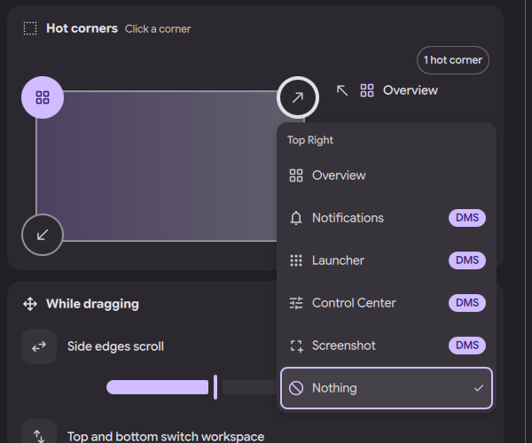

# niri settings page: hot corners

Status: in open [PR #4063](https://github.com/duxlabs-dev/dux-shell/pull/4063)

*Pick a corner, choose an action, the legend lists the active corners*

In one sentence: Pick what each screen corner does (Overview, Notifications, Launcher, Control Center, Screenshot or nothing) by clicking it on a drawn screen.

## What it does

- A "Hot corners" card in the Gestures section lets the user choose what each screen corner does: Overview, Notifications, Launcher, Control Center, Screenshot, or Nothing.
- The user clicks a corner on a drawn screen and picks an action from a menu. A legend lists the active corners and marks the ones that DMS runs.
- By default the top left corner opens the overview, as in niri.
- A corner can differ per screen. The global setting is the default; a screen that has its own corners uses them instead.

## Try it

- Check out `page-niri-pr`, run DMS under niri and run `dms ipc call settings openNiri gestures`, then go to Hot corners.
- Click the top right corner, pick Notifications, then push the pointer into that corner.

## Why

- The author wanted an action of his choice for each corner.
- niri can only run the overview from a corner. DMS runs the other actions itself with a 1 pixel invisible surface in the corner. No change in niri is needed.
- On 18/10 he decided that per-screen settings stay in the Displays page. The niri page keeps the global part.

## How it is built

- [CornersCard.qml](https://github.com/lung595/DankMaterialShell/blob/page-niri-pr/quickshell/Modules/Settings/Niri/Sections/Gestures/CornersCard.qml), [CornersPad.qml](https://github.com/lung595/DankMaterialShell/blob/page-niri-pr/quickshell/Modules/Settings/Niri/Sections/Gestures/CornersPad.qml), [CornersMenu.qml](https://github.com/lung595/DankMaterialShell/blob/page-niri-pr/quickshell/Modules/Settings/Niri/Sections/Gestures/CornersMenu.qml) and [CornersLegend.qml](https://github.com/lung595/DankMaterialShell/blob/page-niri-pr/quickshell/Modules/Settings/Niri/Sections/Gestures/CornersLegend.qml).
- [corners.js](https://github.com/lung595/DankMaterialShell/blob/page-niri-pr/quickshell/Common/niri/sections/corners.js) maps each action to a DMS command (the same commands as the default binds, for example `dms ipc call notifications toggle`). Only Overview corners go to niri's `gestures.hot-corners`; a list without any corner is written as off, because niri lights the top left when none is listed.
- [HotCorners.qml](https://github.com/lung595/DankMaterialShell/blob/page-niri-pr/quickshell/Modules/HotCorners/HotCorners.qml) creates a layer-shell surface of 1 by 1 pixel per active corner (namespace `dms:hot-corner`, no keyboard focus). It is loaded in `DMSShell.qml`.
- [HotCornerService.qml](https://github.com/lung595/DankMaterialShell/blob/page-niri-pr/quickshell/Services/HotCornerService.qml) gives the corners and zones of a screen and runs the action. The per-screen choices follow the Displays settings key.

## Known limits

- The maintainers asked to pause PR #4063 and to talk with the team first, before more work on it.
- `HotCornerService` still reads `NiriPageService.state`. The notes say a patch to remove that coupling exists, and it needs a change to an upstream test.
- The surfaces exist only for corners that run a DMS action.

## Images

Pick a corner, choose an action, the legend lists the active corners.

The Hot corners card: a drawn screen with the top left corner set to Overview.

Clicking a corner opens a menu: Overview, Notifications, Launcher, Control Center, Screenshot, Nothing.

