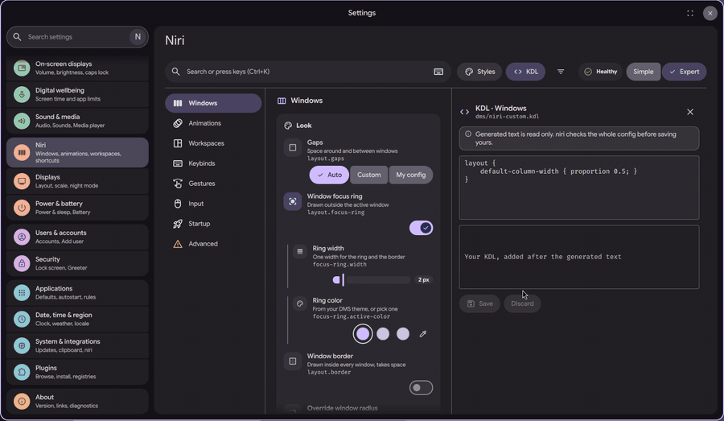
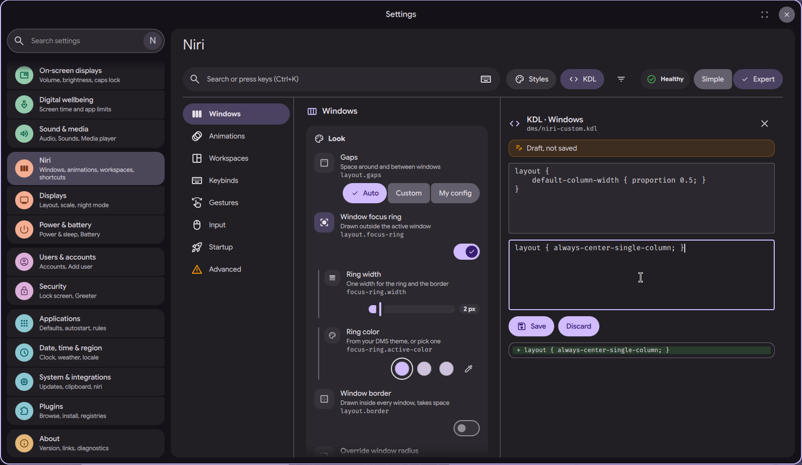
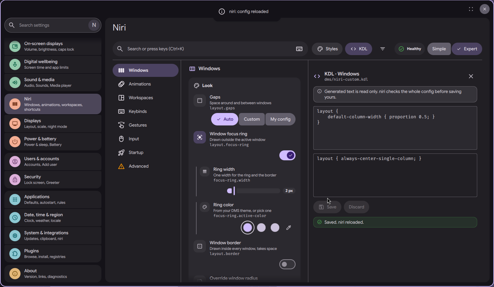

# niri settings page: KDL drawer

Status: in open [PR #4063](https://github.com/duxlabs-dev/dux-shell/pull/4063)

*Open the drawer, write a line of KDL, see the diff, save*

In one sentence: In Expert mode, a drawer shows the KDL the page writes for the current section and lets you add your own lines, with a diff and a check by niri before saving.

## What it does

- In Expert mode, a drawer opens in the right column (button in the header or Ctrl+E).
- It shows the KDL that the page generated for the current section. This part is read only.
- Under it, the user can write their own KDL for that section. It is added after the generated text, so it wins.
- Before saving, a diff shows what changes. Niri checks the whole config; if it refuses, nothing is saved and its message is shown.
- If the text contains a `spawn` line, the first click on Save shows a warning and the lines. A second click, "Save and run programs", saves it.
- An unsaved text is marked "Draft, not saved". Changes made elsewhere (undo, restore) are followed while the user has no pending draft.

## Try it

- Check out `page-niri-pr`, run DMS under niri, open the niri page, switch to Expert and press Ctrl+E.
- Type a line of KDL under the generated text, look at the diff, then Save. A line niri refuses is not saved and its message is shown.

## Why

- The author wanted a plain text escape hatch for anything the page does not cover, with the same safety as the other options.
- A text that runs programs needs an explicit second click. This was the author's decision.

## How it is built

- [NiriKdlDrawer.qml](https://github.com/lung595/DankMaterialShell/blob/page-niri-pr/quickshell/Modules/Settings/Niri/Drawer/NiriKdlDrawer.qml) is the drawer. [NiriKdlDiff.qml](https://github.com/lung595/DankMaterialShell/blob/page-niri-pr/quickshell/Modules/Settings/Niri/Drawer/NiriKdlDiff.qml) draws the diff.
- [diff.js](https://github.com/lung595/DankMaterialShell/blob/page-niri-pr/quickshell/Common/niri/diff.js) computes the line diff. [kdlspawn.js](https://github.com/lung595/DankMaterialShell/blob/page-niri-pr/quickshell/Common/niri/kdlspawn.js) finds the lines that spawn programs.
- Saving calls `NiriPageService.setCustom(sectionId, text)`. The service writes the text to `dms/niri-custom.kdl` through the safe write path (see the page "niri settings page: safe config writing"). `NiriPageService.sectionKdl(id)` gives the generated text.
- The drawer is created on first use, because a closed drawer would rebuild the section KDL on every change.

## Known limits

- The maintainers asked to pause PR #4063 and to talk with the team first, before more work on it.
- The `spawn` check looks at the lines of the draft; the notes do not list other kinds of risky KDL.
- The drawer is hidden in Simple mode.

## Images

Open the drawer, write a line of KDL, see the diff, save.

The KDL drawer: generated text on top, a draft below marked "Draft, not saved", and the diff under the buttons.

After Save: niri checked the config and reloaded, the drawer says "Saved. niri reloaded.".

