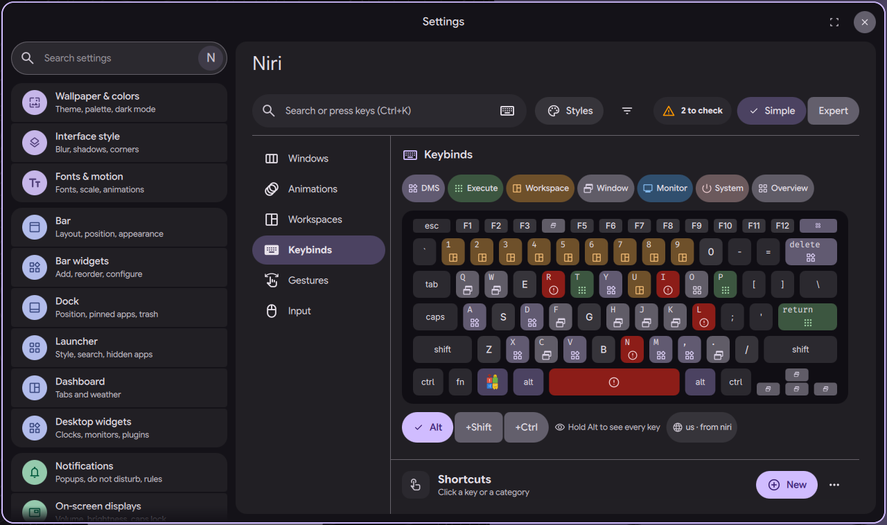
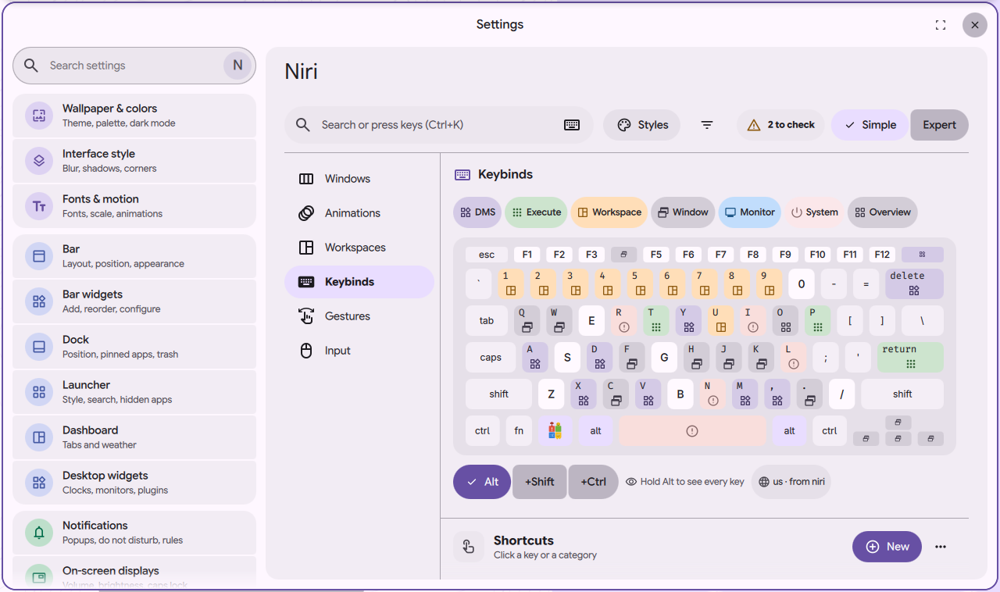
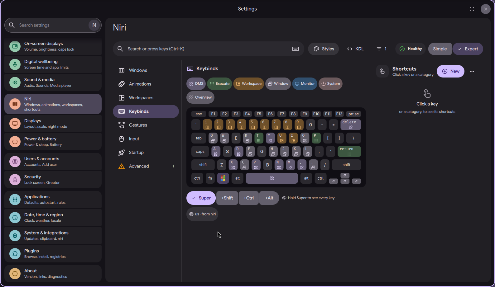
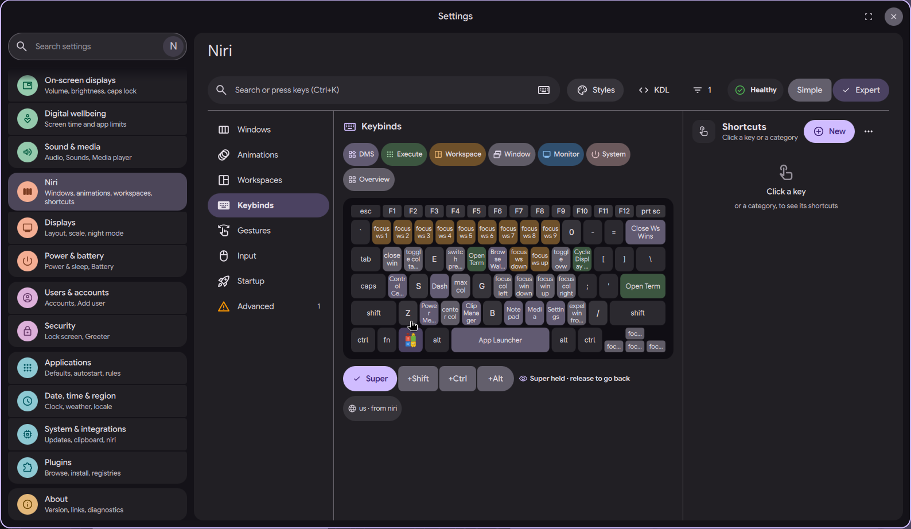

# niri settings page: drawn keyboard for shortcuts

Status: in open [PR #4063](https://github.com/duxlabs-dev/dux-shell/pull/4063)

*Tour of the keyboard: hold Super, click a key, then pick a category*

In one sentence: Shortcuts are shown on a drawn keyboard in your layout, coloured by category; hold Super to see what each key does.

## What it does

- The Keybinds section shows a laptop keyboard drawn from the layout niri uses now. Layouts known today: US, French (AZERTY) and German. Any other layout is drawn as US.
- Keys that have a shortcut are colored by category and carry an icon. Free keys are marked. The name shows on hover.
- Clicking a key or a category chip fills the side pane with its shortcuts.
- Holding the Mod key (the real key, Super or Alt depending on the config) shows the Mod layer and lights the keys it makes. Releasing goes back. Names under the keys are short in this mode.
- A combination found by the search bar lights its keys, and the board switches to the right layer.
- A footer tells the layout and where it comes from ("Layout ..., from niri. Change it in Input").

## Try it

- Check out `page-niri-pr`, run DMS under niri and run `dms ipc call settings openNiri keybinds`.
- Hold Super: the Mod layer lights up. Click a key or a category chip to list its shortcuts.

## Why

- The author wanted to see which keys are free and which are taken, on a keyboard that looks modern, in one screen without scrolling (mock-up v4).
- A shortcut names a key symbol, not a physical key. On AZERTY, Super+Q sits where QWERTY prints A, so the board must follow the live layout.

## How it is built

- [KeyboardCard.qml](https://github.com/lung595/DankMaterialShell/blob/page-niri-pr/quickshell/Modules/Settings/Niri/Sections/Keybinds/KeyboardCard.qml), [KeyboardKey.qml](https://github.com/lung595/DankMaterialShell/blob/page-niri-pr/quickshell/Modules/Settings/Niri/Sections/Keybinds/KeyboardKey.qml), [KeyboardChips.qml](https://github.com/lung595/DankMaterialShell/blob/page-niri-pr/quickshell/Modules/Settings/Niri/Sections/Keybinds/KeyboardChips.qml) and [KeyboardFooter.qml](https://github.com/lung595/DankMaterialShell/blob/page-niri-pr/quickshell/Modules/Settings/Niri/Sections/Keybinds/KeyboardFooter.qml). The section is [KeybindsSection.qml](https://github.com/lung595/DankMaterialShell/blob/page-niri-pr/quickshell/Modules/Settings/Niri/Sections/KeybindsSection.qml).
- [keymaps.js](https://github.com/lung595/DankMaterialShell/blob/page-niri-pr/quickshell/Common/niri/keymaps.js) has the key tables per layout, `layoutOf` (matches the niri layout name), `rows`, `chordId` and `layerOf`. [chord.js](https://github.com/lung595/DankMaterialShell/blob/page-niri-pr/quickshell/Common/niri/chord.js) parses a free combination.
- A picked key goes to `SettingsUiState.niriKeyPick`; the side pane reads it (see the page about the shortcut list).
- The layout comes from niri (`niri msg -j keyboard-layouts` through `NiriService`).
- The drawn Super key can show a logo (see the page about the Super key logo).

## Known limits

- The maintainers asked to pause PR #4063 and to talk with the team first, before more work on it.
- Three key tables only. The code marks it as a shortcut: add a table when someone needs another layout.
- Only Super, Alt and Ctrl are known as Mod keys. Another mod key reads as Super.
- The notes accept that some key names are cut at 1280 px (words of 7 letters).
- `KeyboardCard.qml` is 385 lines, over the author's own 300 line rule.

## Images

Tour of the keyboard: hold Super, click a key, then pick a category.

The drawn keyboard with keys coloured by category.

The same keyboard in the light theme.

The drawn keyboard with DMS and niri shortcuts colored by category.

Holding Super shows the name of every shortcut on its key.

