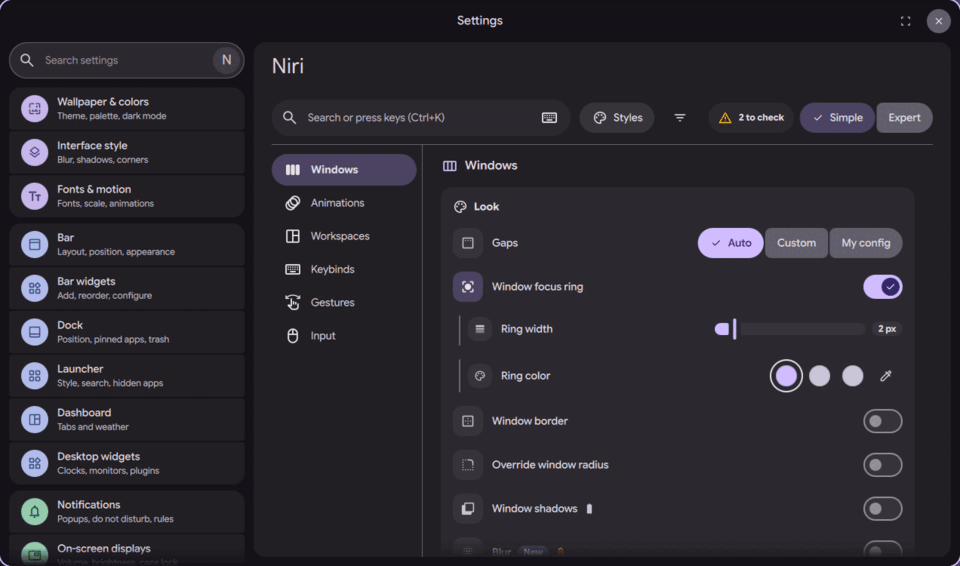
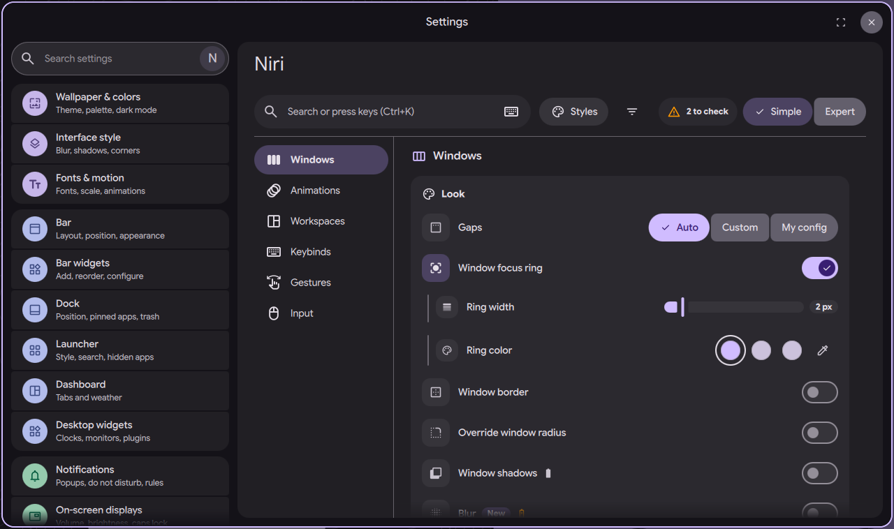
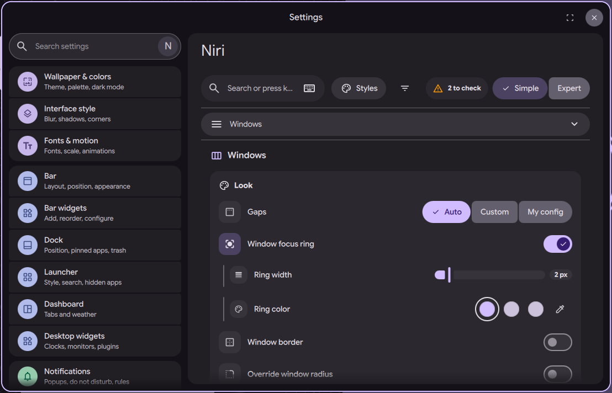

# niri settings page: shell and layout

Status: in open [PR #4063](https://github.com/duxlabs-dev/dux-shell/pull/4063)

*Tour of the Niri tab: windows, workspaces, keybinds, input, animations*

In one sentence: A "Niri" tab in DMS Settings that sets niri's windows, animations, workspaces, shortcuts, gestures and input from one page, with search, presets and a Simple or Expert mode.

## What it does

- Adds a "Niri" tab to DMS Settings. The tab only shows when the compositor is niri.
- A left menu lists the sections: Windows, Animations, Workspaces, Keybinds, Gestures, Input, Startup and Advanced. One section is shown at a time.
- A header holds the search bar, a Styles button, a "Changed only" filter and a Simple / Expert switch. The KDL button shows in Expert mode only.
- Simple mode hides the Startup and Advanced sections. The choice is saved.
- Some sections add a side pane (workspaces per screen, the shortcut list, the gesture stage, the animation preview). On a wide page it sits in a right column. On a narrow page it moves below or inside the section.
- Ctrl+K moves the focus to the search bar. Ctrl+E opens the KDL drawer in Expert mode. The menu shows how many settings were changed in each section.

## Try it

- Check out `page-niri-pr` and run DMS under niri. Open Settings and pick the "Niri" tab, or run `dms ipc call settings openNiri windows`.
- Switch Simple and Expert in the header. Press Ctrl+K to search, Ctrl+E in Expert mode for the KDL drawer.

## Why

- The author wanted one page for everything niri, visual and easy to use without looking things up.
- The page should work in a narrow window as well as a wide one.
- Simple mode keeps the first view short. Expert mode shows KDL keys and risky options.

## How it is built

- [NiriTab.qml](https://github.com/lung595/DankMaterialShell/blob/page-niri-pr/quickshell/Modules/Settings/NiriTab.qml) is the tab. It holds the shell and caps its width.
- [NiriShell.qml](https://github.com/lung595/DankMaterialShell/blob/page-niri-pr/quickshell/Modules/Settings/Niri/NiriShell.qml) loads one section at a time, places the side pane and defines the two shortcuts.
- [shell.js](https://github.com/lung595/DankMaterialShell/blob/page-niri-pr/quickshell/Common/niri/shell.js) holds the pure rules: breakpoints (narrow at 860 px, compact at 480 px), where a pane goes, and the changed counts per section.
- The section list is in [NiriSections.qml](https://github.com/lung595/DankMaterialShell/blob/page-niri-pr/quickshell/Modules/Settings/Niri/Shell/NiriSections.qml). The header is [NiriHeader.qml](https://github.com/lung595/DankMaterialShell/blob/page-niri-pr/quickshell/Modules/Settings/Niri/Shell/NiriHeader.qml).
- [NiriSideStack.qml](https://github.com/lung595/DankMaterialShell/blob/page-niri-pr/quickshell/Modules/Settings/Niri/Shell/NiriSideStack.qml) stacks the section pane above the KDL drawer.
- The tab entry is in [SettingsTabs.qml](https://github.com/lung595/DankMaterialShell/blob/page-niri-pr/quickshell/Common/SettingsTabs.qml) with the flag `niriOnly`. The selected section is `SettingsUiState.niriSection`. The Expert choice is the setting `niriPageExpert`.

## Known limits

- The maintainers asked to pause PR #4063 and to talk with the team first, before more work on it.
- The page only exists under niri. Other compositors are not changed.
- A comment in `KeybindsSection.qml` still names a `NiriDeskStack` file that is not in the branch.
- The notes list several files over the 300 line limit that the author uses for his own work (not an upstream rule).

## Images

Tour of the Niri tab: windows, workspaces, keybinds, input, animations.

The Niri tab at full width.

The same tab in a narrow window.

