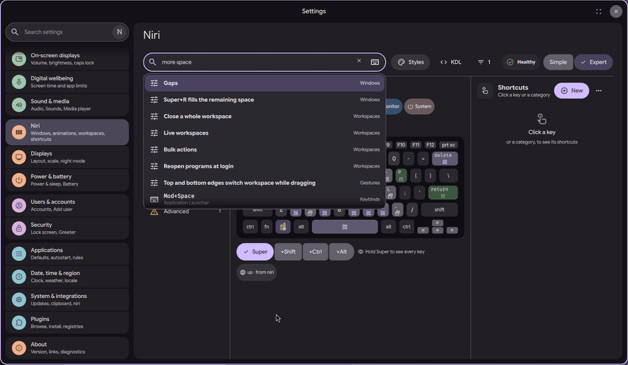
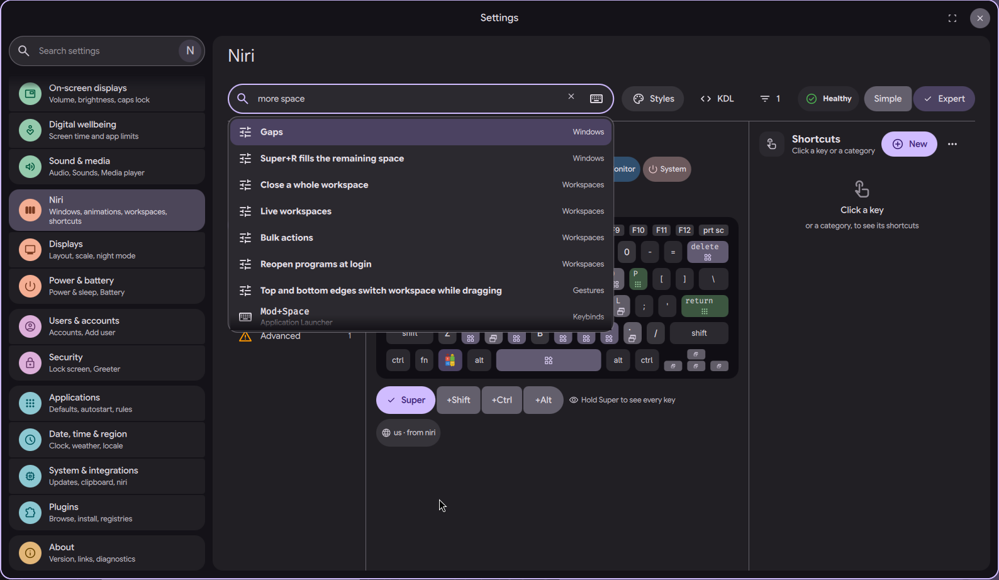
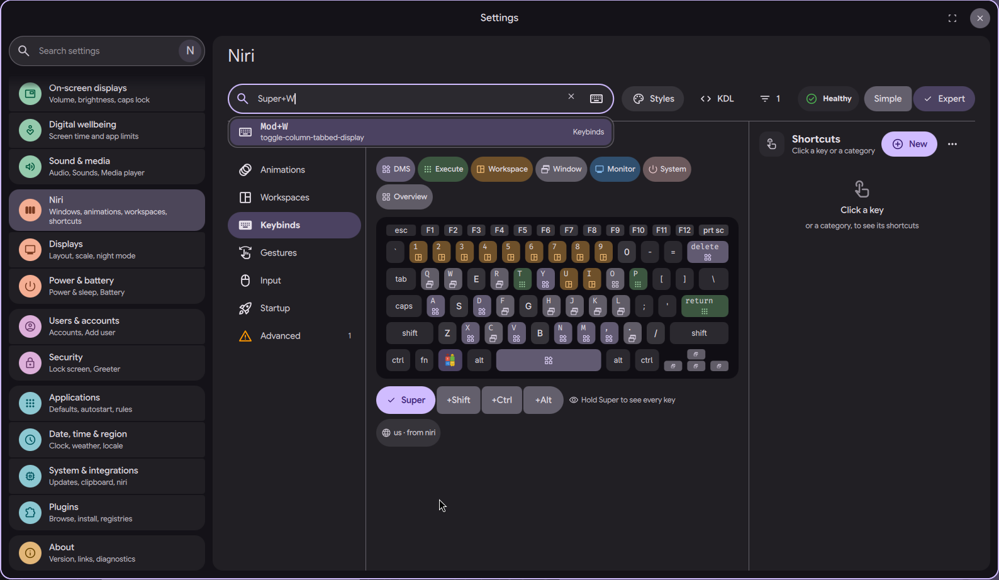

# niri settings page: search by words or by keys

Status: in open [PR #4063](https://github.com/duxlabs-dev/dux-shell/pull/4063)

*Search by words, then record a key combination and get the matching shortcut*

In one sentence: One search bar finds niri settings by plain words ("more space" finds Gaps) and shortcuts by pressing the keys themselves.

## What it does

- One search bar in the page header finds settings and shortcuts.
- Plain words work: a phrase like "more space" ranks on "space" and finds Gaps. Small typos are tolerated.
- A key button records a key combination. Pressing Super+B (for example) finds the shortcut bound to it.
- A typed combination such as "supr + space" is also understood.
- Results show settings (with their section) and shortcuts (with their keys). Ctrl+K moves the focus to the bar.
- Titles are matched in English and in the translated text.

## Try it

- Check out `page-niri-pr`, run DMS under niri, open the niri page and press Ctrl+K.
- Type "more space". Then press the key button and press Super+W: the shortcut bound to it shows.

## Why

- The author wanted a single bar for text search, key combination search and Ctrl+K.
- Searching a shortcut by pressing it already existed in the old Keybinds tab, hidden. He wanted it to be easy to find.

## How it is built

- [search.js](https://github.com/lung595/DankMaterialShell/blob/page-niri-pr/quickshell/Common/niri/search.js) is a pure module: filler words, aliases (`super`, `mod`, `win`, `meta`...), typo distance, scoring, and `find(text, modules, options)`. It returns settings and bind results, best first (at most 8 settings and 3 binds).
- Each section module exports a `search` list of `{key, title, words}`.
- [chord.js](https://github.com/lung595/DankMaterialShell/blob/page-niri-pr/quickshell/Common/niri/chord.js) parses a combination for the keyboard highlight. [actionwords.js](https://github.com/lung595/DankMaterialShell/blob/page-niri-pr/quickshell/Common/niri/actionwords.js) adds extra words per action.
- UI: [NiriSearchBar.qml](https://github.com/lung595/DankMaterialShell/blob/page-niri-pr/quickshell/Modules/Settings/Niri/Shell/NiriSearchBar.qml), [NiriSearchResults.qml](https://github.com/lung595/DankMaterialShell/blob/page-niri-pr/quickshell/Modules/Settings/Niri/Shell/NiriSearchResults.qml) and [NiriSearchTerms.qml](https://github.com/lung595/DankMaterialShell/blob/page-niri-pr/quickshell/Modules/Settings/Niri/Shell/NiriSearchTerms.qml) (search titles that live only in JS, so the translation tool can list them).

## Known limits

- The maintainers asked to pause PR #4063 and to talk with the team first, before more work on it.
- The search words are English. The notes record that only English words and translated titles are used.
- The notes (31/10) plan "one search entry per action" as a small follow-up.

## Images

Search by words, then record a key combination and get the matching shortcut.

Typing "more space" finds Gaps and other settings, with their section.

Pressing Super+W in the key box finds the shortcut bound to it.

