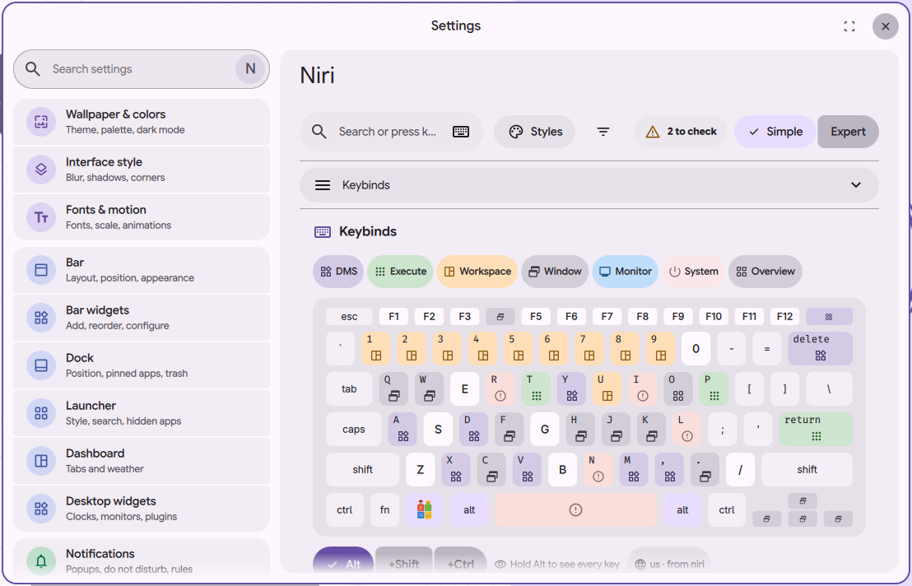

# niri settings page: logo on the Super key

Status: in open [PR #4063](https://github.com/duxlabs-dev/dux-shell/pull/4063)

*The drawn keyboard with the logo on the Super key*

In one sentence: On the drawn keyboard, the Super key shows a small logo: a gear on a Framework laptop, a parody four-tile logo elsewhere.

## What it does

- On the drawn keyboard of the Keybinds section, the Super key shows a small logo instead of a plain label.
- If the computer vendor is Framework (read from `/sys/class/dmi/id/sys_vendor`), the key shows a gear drawn by the author. The gear takes the DMS theme color.
- For any other vendor, the key shows a parody of a four-tile logo, also drawn by the author.
- The key tip still says "Super. Press and hold to see every key".

## Try it

- Check out `page-niri-pr`, run DMS under niri and run `dms ipc call settings openNiri keybinds`. Look at the Super key.

## Why

- The author wanted the Super key to show the maker's logo, and a joke logo when the maker is not known.
- Both are simplified, hand drawn vector files (not the official logos). He was aware that a trademark owner or the DMS maintainers could refuse them. On 1/11 he chose to keep them in the pull request, with this reserve stated in the description.
- Earlier notes said the logos would never go upstream. The 1/11 decision replaced that.

## How it is built

- [SuperKeyLogo.qml](https://github.com/lung595/DankMaterialShell/blob/page-niri-pr/quickshell/Modules/Settings/Niri/Keys/SuperKeyLogo.qml) loads the SVG from the shell folder.
- [vendor.js](https://github.com/lung595/DankMaterialShell/blob/page-niri-pr/quickshell/Common/niri/vendor.js) has `vendorKind` (starts with "framework" gives `framework`, else `other`) and `logoFor`.
- Images: [framework.svg](https://github.com/lung595/DankMaterialShell/blob/page-niri-pr/quickshell/assets/niri-page/framework.svg) and [microslop.svg](https://github.com/lung595/DankMaterialShell/blob/page-niri-pr/quickshell/assets/niri-page/microslop.svg). A node test covers the vendor check.

## Known limits

- The maintainers asked to pause PR #4063 and to talk with the team first, before more work on it.
- Only two cases exist. Other vendors (HP, Lenovo, Dell) were removed on purpose.
- The parody imitates a trademark. The DMS maintainers may refuse it.
- The gear is drawn black and lifted to white so the theme color applies fully.

## Images

The drawn keyboard with the logo on the Super key.

