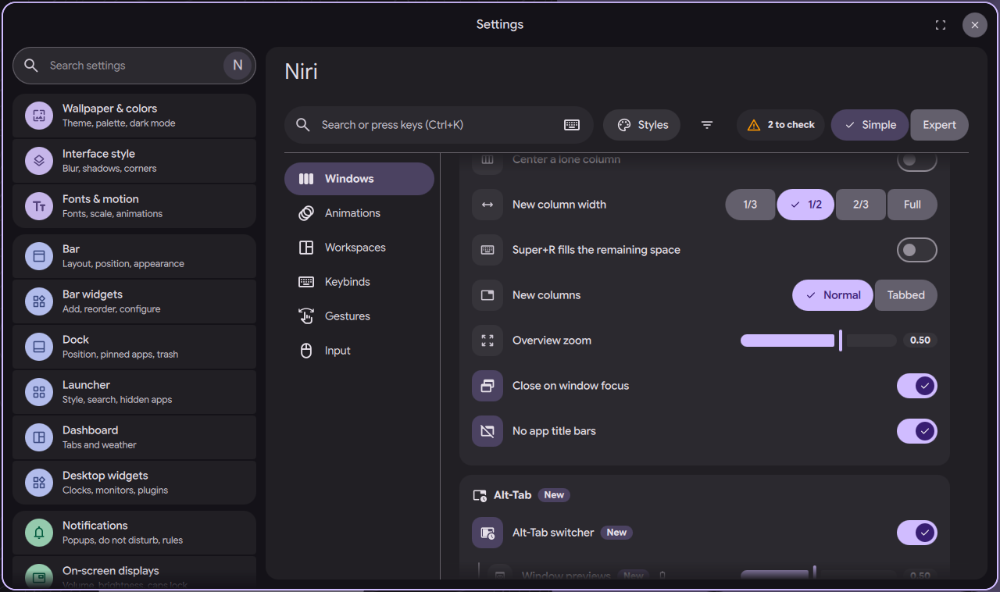

# niri settings page: Super+R fills the remaining space

Status: in open [PR #4063](https://github.com/duxlabs-dev/dux-shell/pull/4063)

*The Columns card, where the Super+R option sits*

In one sentence: An option makes Super+R first stretch the focused column over the remaining width, then go back, then walk the preset widths.

## What it does

- An option on the Columns card: "Super+R fills the remaining space". It is off by default.
- Off: Mod+R keeps niri's own preset cycle (`switch-preset-column-width`).
- On: Mod+R becomes a longer cycle. The first press makes the focused column fill the remaining width. The next press goes back to the width before. Then the preset widths go up one by one. Past the largest preset, it fills again.
- Example from the notes: two windows at 1/3, Super+R on the first gives it the remaining 2/3.
- If the focused window is floating, or no tiled window has focus, the key uses niri's own switch, so it always does something.
- If the user has their own shortcut on that key, it is kept and the page tells it.

## Try it

- Check out `page-niri-pr`, run DMS under niri, and turn on "Super+R fills the remaining space" in the Columns card of the Windows section.
- Open two windows at 1/3 and press Super+R on the first: it takes the remaining 2/3. Press it again to go back.

## Why

- The author wanted a cycle that can use the space left on screen and return to the earlier width. He wrote the exact press sequence in the notes (31/10).
- In the first version this was always on. On 1/11 it became an option, off by default, so the native key still works.

## How it is built

- [NiriColumnCycle.qml](https://github.com/lung595/DankMaterialShell/blob/page-niri-pr/quickshell/Services/NiriColumnCycle.qml) is a singleton. It sends niri actions and answers the IPC call with CYCLED, NATIVE or FAILED. `NiriService` calls `observe()` on each windows change.
- [colwidth.js](https://github.com/lung595/DankMaterialShell/blob/page-niri-pr/quickshell/Common/niri/colwidth.js) holds the state machine (`press`, `observe`, `target`) and `rebinds`, which swaps the binds of Mod+R and Mod+Shift+R between the DMS cycle and niri's native actions. The setting is `columns.cycleWidth` in [columns.js](https://github.com/lung595/DankMaterialShell/blob/page-niri-pr/quickshell/Common/niri/sections/columns.js).
- The IPC function `cycleColumnWidth` is in [NiriService.qml](https://github.com/lung595/DankMaterialShell/blob/page-niri-pr/quickshell/Services/NiriService.qml). The action is also listed in [KeybindActions.js](https://github.com/lung595/DankMaterialShell/blob/page-niri-pr/quickshell/Common/KeybindActions.js).

## Known limits

- The maintainers asked to pause PR #4063 and to talk with the team first, before more work on it.
- Preset widths are compared with the output width, not niri's working area, so a midpoint between the two largest presets absorbs the difference. The code marks this as a shortcut.
- A fill next to a neighbour can gain one pixel (846 instead of 847); the code treats that as unchanged.
- If niri sends no event after a press, the pending flag stays until the next event. The code notes a timeout would be the fix if this is ever seen.

## Images

The Columns card, where the Super+R option sits.

