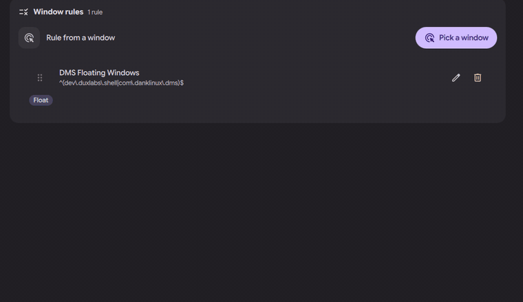
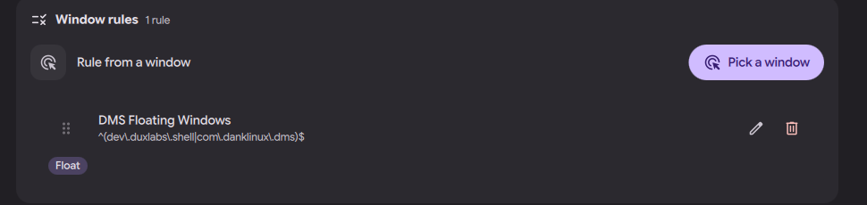
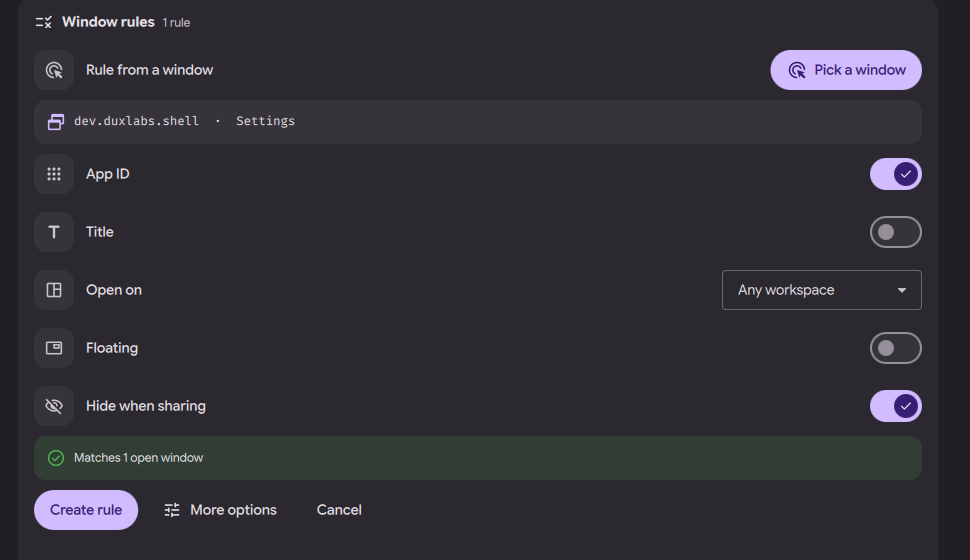

# niri settings page: window rules

Status: in open [PR #4063](https://github.com/duxlabs-dev/dux-shell/pull/4063)

*Rule from a window: click Pick a window, click a window, the form fills itself*

In one sentence: Make a niri window rule by clicking a window: its app ID and title are filled in, and a live count says how many open windows the rule matches.

## What it does

- A "Window rules" card in the Windows section lists the user's DMS window rules and shows how many there are.
- "Rule from a window": the user clicks "Pick a window" and then any open window. DMS fills in its app ID and title.
- The form sets: open on a workspace (named ones only), open floating, and hide while sharing the screen (shown as a black box in screencasts).
- It shows a live count: "No match: every window would get it", or "Matches N open windows". More options are behind "More options".
- Rules found in the user's own compositor config are listed read only, with a "Convert to DMS" button that makes an editable copy.
- The list shows each rule's options (opacity, float, maximize, fullscreen, output, workspace, size limits, blur, radius and others).

## Try it

- Check out `page-niri-pr`, run DMS under niri and run `dms ipc call settings openNiri windows`, then go to Window rules.
- Click "Pick a window", then click any window: the form fills in its app ID and title and says how many open windows the rule matches.

## Why

- The author wanted to make a rule from a real window and to hide an app during screen sharing.
- The page reuses the old Window rules tab; there is no second writer.

## How it is built

- [RulesCard.qml](https://github.com/lung595/DankMaterialShell/blob/page-niri-pr/quickshell/Modules/Settings/Niri/Sections/Windows/RulesCard.qml), [RulesList.qml](https://github.com/lung595/DankMaterialShell/blob/page-niri-pr/quickshell/Modules/Settings/Niri/Sections/Windows/RulesList.qml), [RulesExternal.qml](https://github.com/lung595/DankMaterialShell/blob/page-niri-pr/quickshell/Modules/Settings/Niri/Sections/Windows/RulesExternal.qml) and [RulesNote.qml](https://github.com/lung595/DankMaterialShell/blob/page-niri-pr/quickshell/Modules/Settings/Niri/Sections/Windows/RulesNote.qml).
- [rules.js](https://github.com/lung595/DankMaterialShell/blob/page-niri-pr/quickshell/Common/niri/sections/rules.js) has no state of its own. It reads the result of `niri msg --json pick-window`, cuts a title to its stable start (`titleStem`), builds the rule, and counts matches (`matchCount`).
- Rules are written by the DMS window rules provider (`dms config windowrules`), not by the page.

## Known limits

- The maintainers asked to pause PR #4063 and to talk with the team first, before more work on it.
- A rule with no app ID and no title would match every window; the form warns and does not create it.
- The old Window rules tab is hidden under niri and has a link to this card.

## Images

Rule from a window: click Pick a window, click a window, the form fills itself.

The Window rules card: one rule listed, with its options and a Pick a window button.

A window was picked: app ID, title, workspace, floating, hide when sharing, and "Matches 1 open window".

