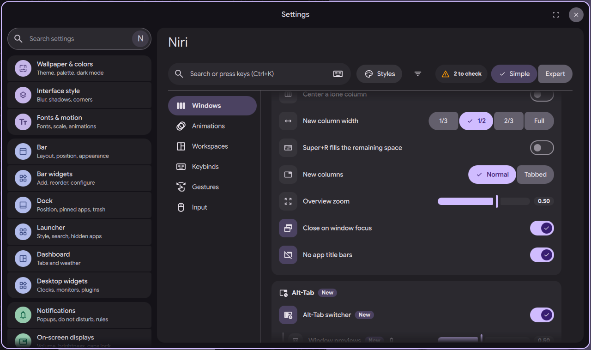

# niri settings page: columns, overview and Alt-Tab

Status: in open [PR #4063](https://github.com/duxlabs-dev/dux-shell/pull/4063)

*The Columns card: width, overview zoom, Alt-Tab*

In one sentence: The Columns card sets how niri lays out columns (centering, new column width, preset widths), the overview zoom and the Alt-Tab switcher.

## What it does

- A "Columns" card in the Windows section sets how niri lays out columns.
- Center the focused column: Never, Overflow (when the view scrolls to it) or Always. Center a lone column: on or off.
- New column width: 1/3, 1/2, 2/3 or Full. The default is 1/2.
- Preset widths: an editable list that replaces the list in `config.kdl` (Expert mode). New columns open Normal or Tabbed.
- Overview zoom, and "Close on window focus" (the overview closes when DMS launches an app or focuses a window). "No app title bars" (`prefer-no-csd`).
- Alt-Tab switcher (niri 25.11 recent windows): on or off, delay before it shows, and the size of the window previews.

## Try it

- Check out `page-niri-pr`, run DMS under niri and run `dms ipc call settings openNiri windows`, then scroll to Columns.
- Set the new column width to 1/3 and open a window.

## Why

- Column width and layout were hard to find in the old tabs. The author wanted them in one card.
- Choice groups use the plain DMS button group (his decision on 1/11).
- The reset button sits just before the control, and choices sit on the right of the label line (31/10).

## How it is built

- [ColumnsCard.qml](https://github.com/lung595/DankMaterialShell/blob/page-niri-pr/quickshell/Modules/Settings/Niri/Sections/Windows/ColumnsCard.qml) and [ColumnsPresets.qml](https://github.com/lung595/DankMaterialShell/blob/page-niri-pr/quickshell/Modules/Settings/Niri/Sections/Windows/ColumnsPresets.qml).
- [columns.js](https://github.com/lung595/DankMaterialShell/blob/page-niri-pr/quickshell/Common/niri/sections/columns.js) holds the defaults and `toKdl`. It writes `layout` (center-focused-column, always-center-single-column, default-column-width, preset-column-widths, default-column-display), `overview` (zoom), `recent-windows` (off, open-delay-ms) and `recent-windows.previews` (max-scale), and `prefer-no-csd` at the top.
- "Close on window focus" is an existing DMS setting, `closeNiriOverviewOnWindowFocus`.

## Known limits

- The maintainers asked to pause PR #4063 and to talk with the team first, before more work on it.
- Niri has no switch for Alt-Tab previews, only their size. The setting that turns the highlight off stays in DMS `alttab.kdl`.
- The Alt-Tab rows have "New" pills for niri 25.11.
- The new column width is always written, because `config.kdl` from `dms setup` still says 0.5 and the page value must win.

## Images

The Columns card: width, overview zoom, Alt-Tab.

