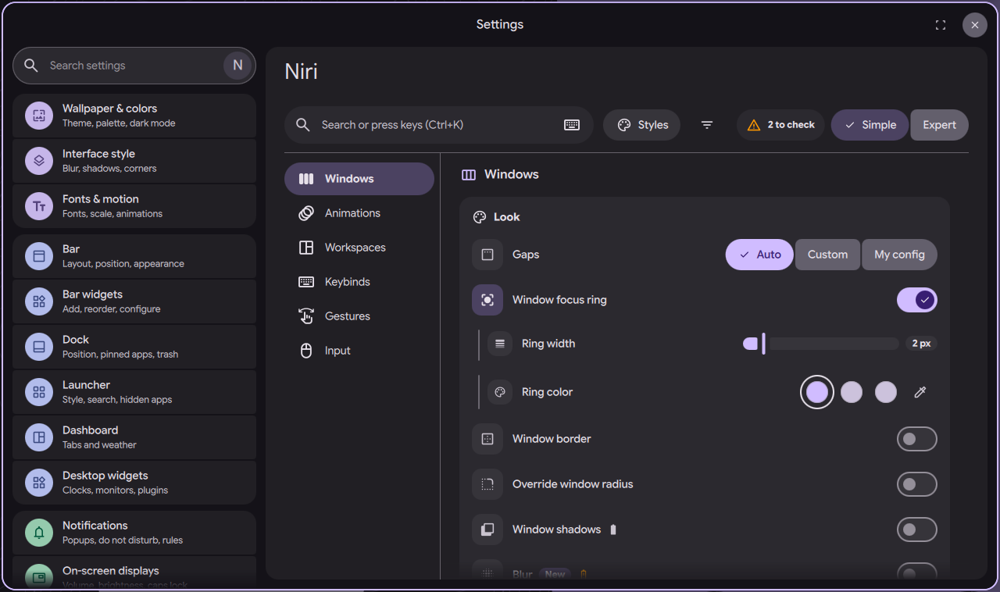
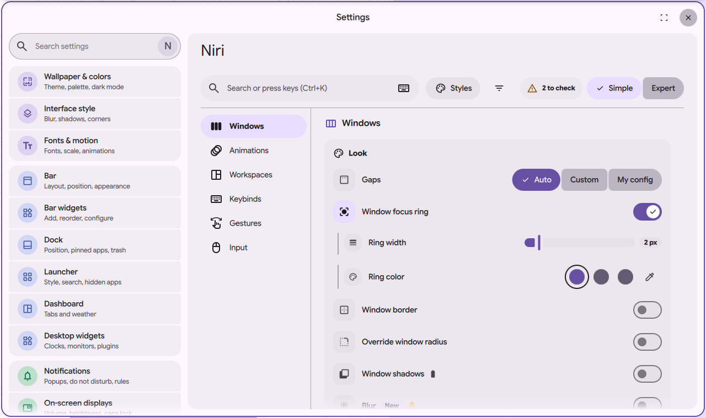

# niri settings page: window look (gaps, ring, border, corners, shadow, blur)

Status: in open [PR #4063](https://github.com/duxlabs-dev/dux-shell/pull/4063)

*The Look card: gaps, focus ring, border, corners, shadow*

In one sentence: The Look card sets how niri draws windows: gaps, focus ring, border, corners, shadows and blur, with colours from the DMS theme.

## What it does

- A "Look" card in the Windows section sets how windows are drawn.
- Gaps: Auto (follows the bar spacing), a custom size from 0 to 64, or "My config" (DMS leaves the gaps to the user's niri config).
- Focus ring: on or off, width, and color. Border: on or off, width, and color. The ring and the border share one width.
- Colors come from the DMS theme (Primary, Secondary, Tertiary) or a picked color.
- Corner radius: an override of the window radius, applied with a DMS window rule. Off means it follows the DMS theme. Window shadows are on or off.
- Blur (niri 26.04): on or off, strength, and two xray options (blurred surfaces show the wallpaper, not the windows below; one for frames and one for the bar).

## Try it

- Check out `page-niri-pr`, run DMS under niri and run `dms ipc call settings openNiri windows`.
- Move the gaps slider or turn on the border: niri reloads and the windows change at once.

## Why

- The author wanted the look of windows in one place, with the DMS look.
- The page should not write a niri key that DMS already writes. Gaps, ring and border width, radius and blur strength stay in their existing DMS settings.
- Some of these options were duplicates of the Compositor layout tab. Under niri the page owns them and the old place has a link.

## How it is built

- [LookCard.qml](https://github.com/lung595/DankMaterialShell/blob/page-niri-pr/quickshell/Modules/Settings/Niri/Sections/Windows/LookCard.qml), [LookGapsRow.qml](https://github.com/lung595/DankMaterialShell/blob/page-niri-pr/quickshell/Modules/Settings/Niri/Sections/Windows/LookGapsRow.qml) and [LookRadiusRow.qml](https://github.com/lung595/DankMaterialShell/blob/page-niri-pr/quickshell/Modules/Settings/Niri/Sections/Windows/LookRadiusRow.qml).
- [look.js](https://github.com/lung595/DankMaterialShell/blob/page-niri-pr/quickshell/Common/niri/sections/look.js) lists the keys and where each is stored. Gaps, border size and radius map to `niriLayoutGapsOverride`, `niriLayoutBorderSize` and `niriLayoutRadiusOverride`; blur strength to `blurStrength`; the two xray switches go through `NiriService`. Ring on or off, colors, border on or off, shadow and blur on or off live in the page state.
- `toKdl` writes blocks `layout.focus-ring`, `layout.border`, `layout.shadow`, and a `window-rule` with `background-effect { blur true }`. Only opaque `#rrggbb` colors are written. The color "primary" is not written because DMS `colors.kdl` already does it.

## Known limits

- The maintainers asked to pause PR #4063 and to talk with the team first, before more work on it.
- Blur needs niri 26.04. The row carries a "New" pill until the version has been seen.
- A radius of 0 would square every DMS surface, so "off" writes the value -1, never 0.

## Images

The Look card: gaps, focus ring, border, corners, shadow.

The same card in the light theme.

