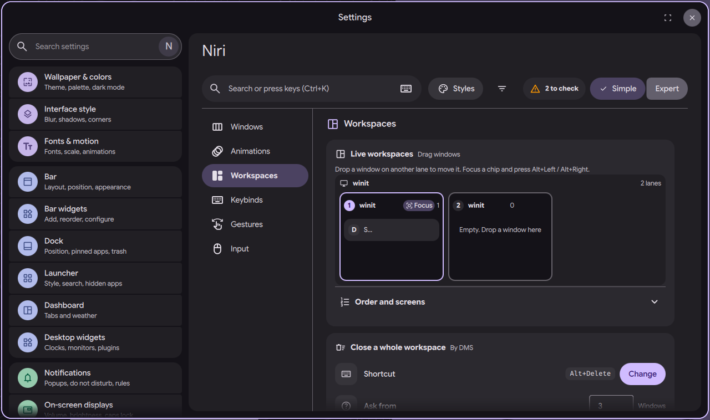
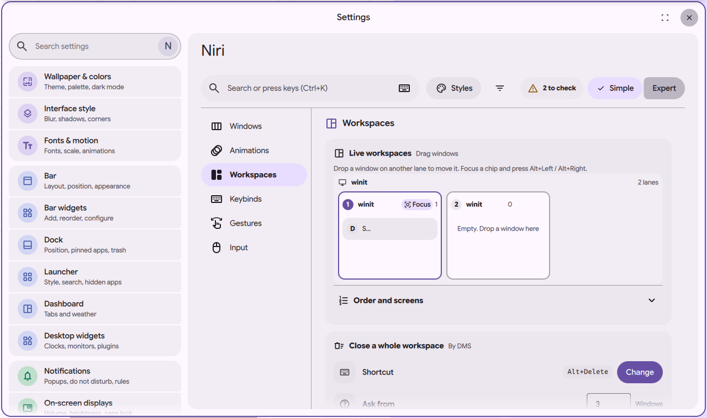

# niri settings page: workspaces board, names and bulk actions

Status: in open [PR #4063](https://github.com/duxlabs-dev/dux-shell/pull/4063)

*Live workspaces: one lane per workspace, a chip per window*

In one sentence: A live board of niri's workspaces, one lane each with a chip per window: drag a chip to move the window, name workspaces, and move or close many windows at once.

## What it does

- A "Live workspaces" card draws one lane for each workspace niri reports, screen by screen, with a chip for each window.
- The user can drag a window chip to another lane to move it. With the keyboard, focus a chip and press Alt+Left or Alt+Right. A lane can be renamed or focused.
- "Order and screens" lists named workspaces. The user can add a name, pick a screen for it (or "Any screen"), move it up, and remove it. Two workspaces cannot share a name (compared without case). Without names, niri uses numbered workspaces.
- "Bulk actions": Group an app (every window of the app goes to one workspace), Move a workspace (all windows of one go to another), and Close an app (all its windows, on every workspace, after a confirmation that says there is no undo).
- A side pane "Workspaces per screen" shows each screen with its workspaces and window thumbnails.

## Try it

- Check out `page-niri-pr`, run DMS under niri with a few windows open, and run `dms ipc call settings openNiri workspaces`.
- Drag a window chip to another lane, or focus a chip and press Alt+Right.

## Why

- The author wanted live workspaces where windows can be dragged, and bulk actions, as part of the page.
- A right click on the workspace widget in the bar opens this section (see the page about entry points).

## How it is built

- [BoardCard.qml](https://github.com/lung595/DankMaterialShell/blob/page-niri-pr/quickshell/Modules/Settings/Niri/Sections/Workspaces/BoardCard.qml), [BoardLane.qml](https://github.com/lung595/DankMaterialShell/blob/page-niri-pr/quickshell/Modules/Settings/Niri/Sections/Workspaces/BoardLane.qml), [BoardChip.qml](https://github.com/lung595/DankMaterialShell/blob/page-niri-pr/quickshell/Modules/Settings/Niri/Sections/Workspaces/BoardChip.qml), [BoardNamed.qml](https://github.com/lung595/DankMaterialShell/blob/page-niri-pr/quickshell/Modules/Settings/Niri/Sections/Workspaces/BoardNamed.qml) and [BoardBulk.qml](https://github.com/lung595/DankMaterialShell/blob/page-niri-pr/quickshell/Modules/Settings/Niri/Sections/Workspaces/BoardBulk.qml). The section is [WorkspacesSection.qml](https://github.com/lung595/DankMaterialShell/blob/page-niri-pr/quickshell/Modules/Settings/Niri/Sections/WorkspacesSection.qml).
- [workspaces.js](https://github.com/lung595/DankMaterialShell/blob/page-niri-pr/quickshell/Common/niri/sections/workspaces.js) keeps the named list (`workspaces.named`, written as `workspace` nodes) and builds the lanes. [bulk.js](https://github.com/lung595/DankMaterialShell/blob/page-niri-pr/quickshell/Common/niri/bulk.js) plans the bulk actions.
- The side pane is [NiriSideScreens.qml](https://github.com/lung595/DankMaterialShell/blob/page-niri-pr/quickshell/Modules/Settings/Niri/Shell/NiriSideScreens.qml). Live data comes from `NiriService`.

## Known limits

- The maintainers asked to pause PR #4063 and to talk with the team first, before more work on it.
- On a narrow page the side pane is not shown, because the Live card already draws the lanes.
- The notes (reprise, 1/11) say the Move button stays active when Group has nothing to move.

## Images

Live workspaces: one lane per workspace, a chip per window.

The same board in the light theme.

