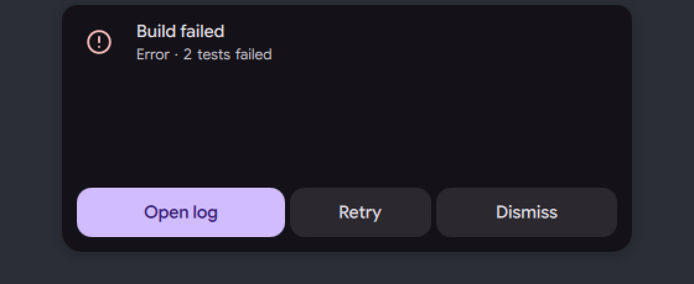
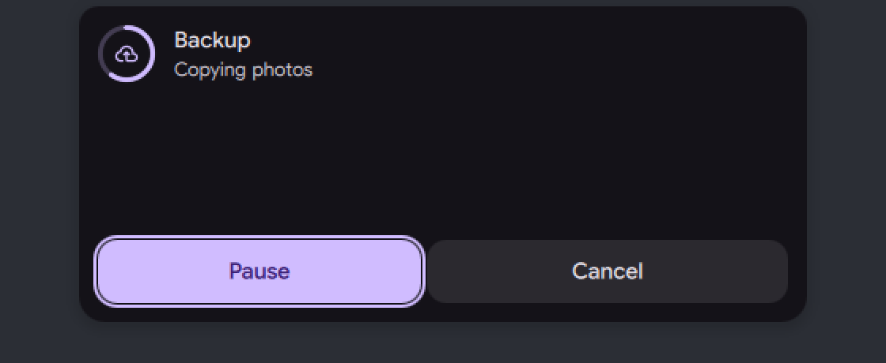
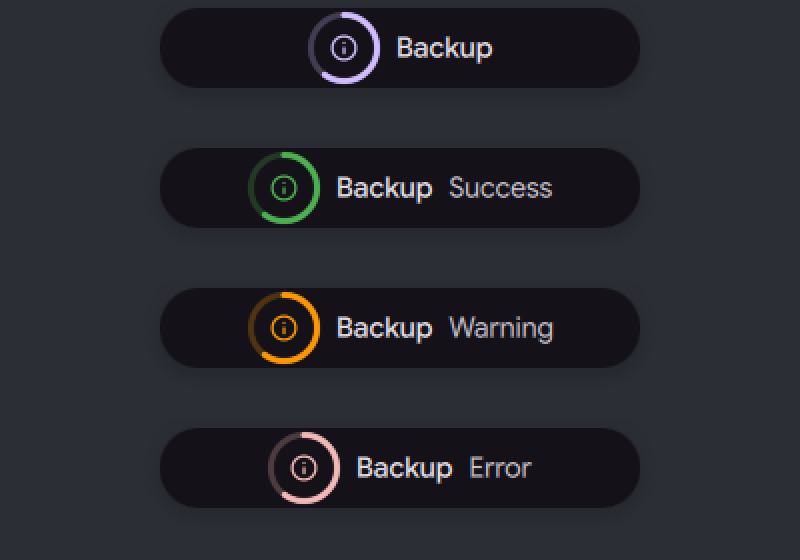

# Island activities API for plugins

Status: in [PR #4181](https://github.com/duxlabs-dev/dux-shell/pull/4181) (closed)

## What it does

- A plugin can show an activity on the island, update it and end it. Before this, a plugin had no surface in the island.
- An activity has a kind. `alert` opens as a sheet at once if it has a text or buttons, and has the highest rank of the three. `live` is a compact bubble that stays until its source ends it; an unknown kind is treated as `live`. `glance` is a short bubble that goes away after 5 seconds if no timeout is given.
- With the manifest surface `islandSystem`, a plugin can draw one of the shell's own faces (for example `volume` or `charging`) once the user picks that plugin for it.
- A plugin that is blocked in the settings gets an empty token, and its activities are dropped.
- One activity per source: a new call from the same source replaces the old one. The highest rank goes first, the oldest on a tie. An activity takes the island only if its rank is strictly above what the island shows now. These rules are the same for plugins and scripts.
- Do Not Disturb holds every activity except the sources the user lets through, as for notifications. Nothing starts while the session is locked. An alert opens its sheet without the keyboard, so it does not take the keyboard from the window the user is typing in.

## Why

- A long job (a backup, a build, a download) can only send a notification today. The island can show its progress, which a notification cannot.
- One small API for scripts and plugins means one fixed order for who takes the island, so activities do not fight with the island's own faces.

## How it is built

- The activity can use the plugin's own island component, or the shell's face, which is drawn from data: `icon`, `title`, `text`, `progress` (a ring, 0 to 1), `actions` (up to 3 buttons with an `id` and a `label`) and `accent` (`primary`, `secondary`, `tertiary`, `error`, `warning`, `info`, `success`). Other keys are `timeoutMs` (1 second to 10 minutes), `expanded` and `notifyApp` (an app name for the Do Not Disturb rules, 128 characters at most).
- The plugin gets the steps as signals: shown, interrupted, resumed, dropped, action.
- A timeout counts down only while the activity holds the island, with the pointer away and its sheet closed.
- A click elsewhere does not fold an alert. `island close` folds it; a click on the island or `island open activity` brings the keyboard in.
- When the bar hides itself, an activity with a timeout keeps it out until the timeout. One without a timeout keeps it out for its first 5 seconds only.
- Pure rules (kinds, ranks, queue, options): [`IslandActivities.js`](https://github.com/lung595/DankMaterialShell/blob/island/2-api/quickshell/Common/IslandActivities.js). The ranks are home 0, glance 1, live 2, notification 3, system 4, sheet 5, alert 6, critical 7.
- The service: [`IslandActivityService.qml`](https://github.com/lung595/DankMaterialShell/blob/island/2-api/quickshell/Services/IslandActivityService.qml). A plugin calls `IslandActivityService.request(pluginId, options)` and gets a token, or an empty string if refused; the log says why. It keeps one entry per source, with the token `source:seq`.
- Each island picks the next activity in [`IslandBarHost.qml`](https://github.com/lung595/DankMaterialShell/blob/island/2-api/quickshell/Modules/DIsland/IslandBarHost.qml) and runs it in [`IslandPluginActivity.qml`](https://github.com/lung595/DankMaterialShell/blob/island/2-api/quickshell/Modules/DIsland/IslandPluginActivity.qml).
- The shell's face: [`ReadyActivityCompact.qml`](https://github.com/lung595/DankMaterialShell/blob/island/2-api/quickshell/Modules/DIsland/Activities/ReadyActivityCompact.qml), [`ReadyActivityExpanded.qml`](https://github.com/lung595/DankMaterialShell/blob/island/2-api/quickshell/Modules/DIsland/Activities/ReadyActivityExpanded.qml) and [`ReadyActivityRing.qml`](https://github.com/lung595/DankMaterialShell/blob/island/2-api/quickshell/Modules/DIsland/Activities/ReadyActivityRing.qml). They use the buttons and rings of the island kit.
- Manifest: [`PluginService.qml`](https://github.com/lung595/DankMaterialShell/blob/island/2-api/quickshell/Services/PluginService.qml) adds the surfaces `island` and `islandSystem`. The manifest block `island` has `notifyApp` and `systemFaces`, described in [`plugin-manifest-reference.md`](https://github.com/lung595/DankMaterialShell/blob/island/2-api/.agents/skills/dms-plugin-dev/references/plugin-manifest-reference.md).
- Settings (no settings page yet), in [`SettingsSpec.js`](https://github.com/lung595/DankMaterialShell/blob/island/2-api/quickshell/Common/settings/SettingsSpec.js): `islandPluginsBlocked` is a list of plugin ids, empty by default. `islandSystemFaces` maps a shell face to the plugin that draws it, empty by default.
- Tests: [`island-activities.test.mjs`](https://github.com/lung595/DankMaterialShell/blob/island/2-api/quickshell/tests/island-activities.test.mjs) and [`island-activity-service.test.mjs`](https://github.com/lung595/DankMaterialShell/blob/island/2-api/quickshell/tests/island-activity-service.test.mjs).

## Known limits

- `activityOn` with `*` reaches only the islands that exist at the time of the call.
- A plugin that knows a token can update or end another plugin's activity. Plugins already run with the full rights of the shell, so no boundary was added.
- The answers of the IPC calls are in a code comment and in the PR text. They are not in the plugin docs yet.
- A small gap in the alert sheet: the top margin is 15 px and the bottom one 12 px at 1x, because an icon without a progress ring keeps the space of the ring.
- In the 240 px bubble the value is cut as soon as a state word is said. In a vertical bar the bubble shows the state by colour only.
- Not proven: Escape and a real click on a button of the sheet, several real screens, a system face on a real screen. Node tests cover the logic.
- The free island (idle, and its reaction to an activity) was not measured.
- The island host files were already very long and grow with this change (for example `IslandController.qml` from 1136 to 1186 lines).

## Images

A live activity as a compact bubble, dark theme.

An alert sheet with a title, a text and three buttons, dark theme.

A live activity opened as a sheet with two buttons, dark theme.

The four accents, from top to bottom: primary, success, warning, error.

