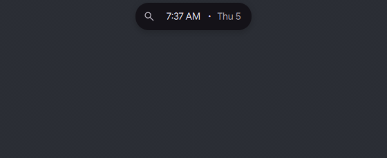

# Scripts on the island over IPC

Status: in [PR #4181](https://github.com/duxlabs-dev/dux-shell/pull/4181) (closed)

## What it does

- A shell script can show an activity on the island with `dms ipc call island activity ...`. On master this call prints `Function not found.` and the island stays on its clock.
- The script gets a token back, for example `script:backup:1`, and uses it to update or end the activity.
- The activity shows an icon, a title, a text, a progress ring and up to 3 buttons. The script can read which button the user picked.
- A call that is refused prints an answer. It is never silent.
- `island status` also says which activity the island of the focused screen holds: its source, kind and state.

## Why

- A backup, a build or a download has no place to show its progress except a notification.
- Scripts and plugins use the same rules for who takes the island, so a script cannot fight with the island's own faces. See the activities API page.

## How it is built

- The `island` IPC target is in [`DIsland.qml`](https://github.com/lung595/DankMaterialShell/blob/island/2-api/quickshell/Modules/DIsland/DIsland.qml): the functions `activity`, `activityOn`, `activityUpdate`, `activityEnd` and `activityStatus`.

| Call | What it does |
|---|---|
| `activity NAME KIND JSON` | Shows an activity on the focused screen and prints a token. |
| `activityOn NAME KIND SCREEN JSON` | The same on a named screen. `*` means every island. |
| `activityUpdate TOKEN JSON` | Replaces the data. Prints `ISLAND_ACTIVITY_UPDATED`. |
| `activityEnd TOKEN` | Ends the activity. Prints `ISLAND_ACTIVITY_ENDED`. |
| `activityStatus TOKEN` | Prints the state and the picked button, like `{"state":"shown","action":"retry"}`. |

- `island open activity` opens the sheet of the current activity, with the keyboard on the first button. When nothing can open, it answers `DANK_ISLAND_ACTIVITY_UNAVAILABLE: activity`.
- Answers for a refused call: `ISLAND_ACTIVITY_BAD_DATA` (the data is not a JSON object of 16384 characters at most), `ISLAND_ACTIVITY_NO_CONTENT` (no title and no icon; an update that would empty the face is refused too), `ISLAND_ACTIVITY_BAD_NAME` (the name is empty, longer than 64 characters, has a colon or an ASCII control character), `ISLAND_ACTIVITY_BAD_NOTIFY_APP`, `ISLAND_ACTIVITY_TOO_MANY` (a ninth script), `ISLAND_ACTIVITY_NO_ISLAND`, `ISLAND_ACTIVITY_UNKNOWN`.
- Checks and answers are pure functions in [`IslandActivityInput.js`](https://github.com/lung595/DankMaterialShell/blob/island/2-api/quickshell/Common/IslandActivityInput.js): the data limit (16384), at most 8 scripts at once, a name of at most 64 characters.
- A script goes to `requestScript` in [`IslandActivityService.qml`](https://github.com/lung595/DankMaterialShell/blob/island/2-api/quickshell/Services/IslandActivityService.qml). From there it follows the same path as a plugin activity.
- The face is drawn by the shell from the data, in `Activities/ReadyActivity*.qml` (see the activities API page).
- Tests: [`island-activity-input.test.mjs`](https://github.com/lung595/DankMaterialShell/blob/island/2-api/quickshell/tests/island-activity-input.test.mjs) and [`island-activity-service.test.mjs`](https://github.com/lung595/DankMaterialShell/blob/island/2-api/quickshell/tests/island-activity-service.test.mjs).
- Try it: you need a bar set to the Island layout. Run `dms ipc call island activity backup live '{"title":"Backup","icon":"backup","progress":0.3}'`, then `activityUpdate` and `activityEnd` with the token.
- A demo script, `demo-ipc.sh`, and the recorded answers, `apres-ipc.txt`, are on the `island-assets` branch under `island/2-api/`.
- There are no new settings for scripts.

## Known limits

- A script cannot be blocked in the settings. Only a plugin can.
- Any local caller of `dms ipc` can address any script token.
- A script name may still hold some invisible Unicode characters (for example zero-width ones). Only ASCII control characters are refused.
- `activityOn` with `*` reaches only the islands present at the time of the call.
- A real click on a button was not tried; the test instance could not inject one. The Do Not Disturb wait and the hidden bar were checked by tests, not live.
- The IPC answers are not in the plugin docs yet.

## Images

A script shows a live activity at 60 %, updates it, then ends it. Dark theme.

A script shows an alert. It opens as a sheet, then closes. Dark theme.

