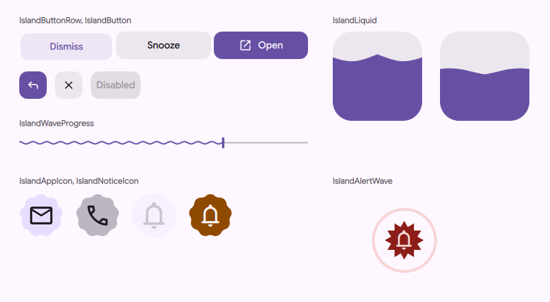
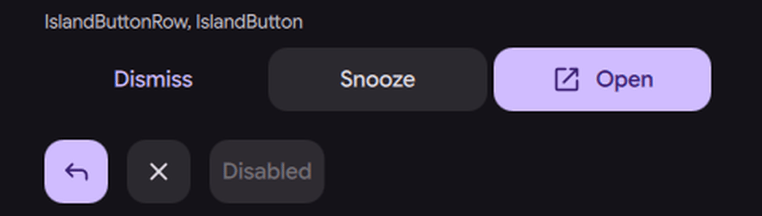
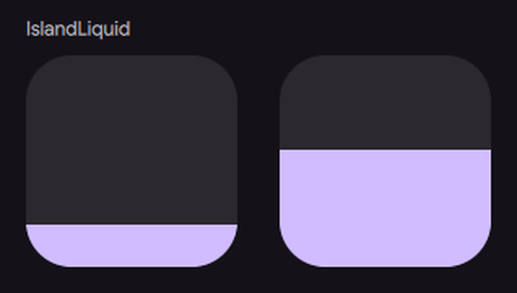
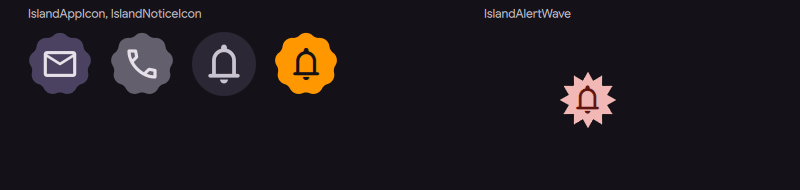

# Island kit: motion rules and widgets

Status: in [PR #4180](https://github.com/duxlabs-dev/dux-shell/pull/4180) (closed)

## What it does

- Adds one file of shared rules, `IslandKit.js`. It is plain arithmetic with no QML, so node can test it. It holds the two springs (CELL and FILL), the alert colours, the split of a row into whole pixels, the pulse of a shape change, the wave of the liquid and the alert rings.
- Adds eight widgets: `IslandButton`, `IslandButtonFace`, `IslandButtonRow`, `IslandAppIcon`, `IslandNoticeIcon`, `IslandLiquid`, `IslandAlertWave` and `IslandDecorClock`.
- The button has three roles: primary (filled), plain and quiet (a text link). It presses on a spring, shows a keyboard focus ring, has a 48 px target, and shows the full label in a tooltip when the label is cut short.
- A button row spreads the actions of a card over the full width and keeps the edges sharp.
- An icon sits on a Material shape. A notice icon shows the sender picture, an icon or an initial, and uses an alert shape when the notice is critical or important.
- The liquid is a meter that rises with a ripple. A settled meter draws nothing new. The alert wave draws rings that go out from the island.

## Why

- The island is built in steps, and every step needs the same buttons, icons and waves. One set of widgets makes them look and move alike.
- Motion has one source: the springs of the kit, slowed or sped up by the DMS animation speed. No widget has its own duration.
- The kit comes first, with tests, so the next steps only use it.
- The author took the spring constants from interior.dev (MIT).

## How it is built

- Rules: [`quickshell/Common/IslandKit.js`](https://github.com/lung595/DankMaterialShell/blob/island/1-kit/quickshell/Common/IslandKit.js). `spring(name)` returns stiffness, damping and mass for CELL or FILL, scaled by the animation speed. `alertTones()` gives alert colours that keep a 3:1 contrast against every island ground. `rowLayout()` splits a width by weights in whole pixels.
- Buttons: [`IslandButton.qml`](https://github.com/lung595/DankMaterialShell/blob/island/1-kit/quickshell/Modules/DIsland/Kit/IslandButton.qml) builds on `StyledButton`. The press uses `SpringMotion` with the CELL spring. The face (icon and label) is [`IslandButtonFace.qml`](https://github.com/lung595/DankMaterialShell/blob/island/1-kit/quickshell/Modules/DIsland/Kit/IslandButtonFace.qml), and the row is [`IslandButtonRow.qml`](https://github.com/lung595/DankMaterialShell/blob/island/1-kit/quickshell/Modules/DIsland/Kit/IslandButtonRow.qml).
- Icons: [`IslandAppIcon.qml`](https://github.com/lung595/DankMaterialShell/blob/island/1-kit/quickshell/Modules/DIsland/Kit/IslandAppIcon.qml) and [`IslandNoticeIcon.qml`](https://github.com/lung595/DankMaterialShell/blob/island/1-kit/quickshell/Modules/DIsland/Kit/IslandNoticeIcon.qml).
- Liquid and rings: [`IslandLiquid.qml`](https://github.com/lung595/DankMaterialShell/blob/island/1-kit/quickshell/Modules/DIsland/Kit/IslandLiquid.qml) uses the FILL spring. [`IslandAlertWave.qml`](https://github.com/lung595/DankMaterialShell/blob/island/1-kit/quickshell/Modules/DIsland/Kit/IslandAlertWave.qml) runs on [`IslandDecorClock.qml`](https://github.com/lung595/DankMaterialShell/blob/island/1-kit/quickshell/Modules/DIsland/Kit/IslandDecorClock.qml) (see the frame cadence page).
- Tests: four node files in `quickshell/tests/` ([`island-kit.test.mjs`](https://github.com/lung595/DankMaterialShell/blob/island/1-kit/quickshell/tests/island-kit.test.mjs), [`island-kit-faces.test.mjs`](https://github.com/lung595/DankMaterialShell/blob/island/1-kit/quickshell/tests/island-kit-faces.test.mjs), [`island-kit-cadence.test.mjs`](https://github.com/lung595/DankMaterialShell/blob/island/1-kit/quickshell/tests/island-kit-cadence.test.mjs), [`spring-cadence.test.mjs`](https://github.com/lung595/DankMaterialShell/blob/island/1-kit/quickshell/tests/spring-cadence.test.mjs)). They read only the `.js` modules and `Theme.qml`, as AGENTS.md asks.
- There are no settings. Two new strings, `Critical` and `Important`, go through `I18n.tr()`.

## Known limits

- The buttons sink by a scale when pressed. They do not change shape as the Material 3 Expressive (M3E) button of DMS does with `Theme.buttonRadius`. `IslandButton` keeps a fixed radius, `min(Theme.cornerRadius, height / 2)`, and presses with `scale` and a small move down. A user pointed this out on PR #4180, and the author judged the remark fair. It was not fixed. Other DMS buttons, such as the media transport, already take their radius from `Theme.buttonRadius`.
- No code uses the widgets in this step. Only the node tests and a bench scene do. The callers are in the later steps.
- The widgets have no Qt Quick test in the repository, because AGENTS.md asks tests not to load anything under `Modules/`. The author ran 112 of 114 such tests outside the PR; the 2 failures test a lively liquid wave that was removed.
- A label of 10,000 characters gives a tooltip of 213 lines. The cap belongs where the labels are made. The tooltip is DMS's own: it does not open by touch and has no Escape.
- The reduced-motion rule is written once in each of four widgets.
- Not tested on a real screen. Frame cost was measured only on a software-rendered bench.

## Images

The widgets on a bench scene, light theme, caught 350 ms into the loop.

Buttons pressed one after the other on the CELL spring.

A liquid rising and falling on the FILL spring, next to a liquid at rest.

App and notification icons, and the alert wave.

