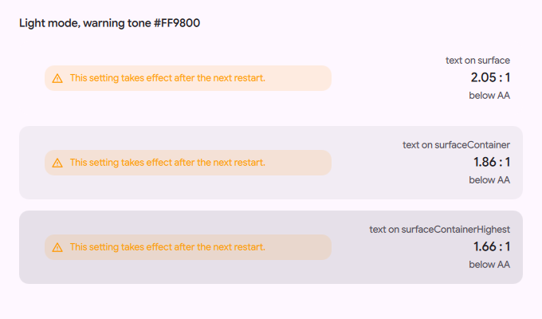
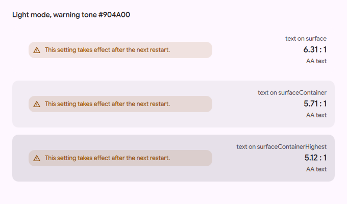

# Readable warning colour in light mode

Status: in [PR #4180](https://github.com/duxlabs-dev/dux-shell/pull/4180) (closed)

## What it does

- In light mode, `Theme.warning` is now dark brown (#904A00) when the theme keeps the stock orange (#FF9800).
- Dark mode does not change. A theme that sets its own warning colour does not change.
- The new property `Theme.warningGround` keeps the theme's own value. The warning toast reads it, so it keeps its orange ground under dark text, as on master.

## Why

- About 40 QML files read `Theme.warning` as a text or icon colour. In light mode the stock orange has a contrast of 1.66:1 to 2.05:1 against the light surfaces. The minimum for text is 4.5:1 (WCAG AA).
- Changing the theme value fixes every reader without editing them: none of the 40 files is changed.

## How it is built

- [`Theme.qml`](https://github.com/lung595/DankMaterialShell/blob/island/1-kit/quickshell/Common/Theme.qml): `stockWarning`, `warningGround`, `lightWarning` and `warning` (around lines 474 to 478). `warning` is `lightWarning` when the mode is light and `warningGround` equals the stock orange.
- [`Toast.qml`](https://github.com/lung595/DankMaterialShell/blob/island/1-kit/quickshell/Modules/Toast.qml) reads `Theme.warningGround` for the warning level (one line, around line 116).
- To see it: switch to light mode with the stock theme, then open Settings, Wallpaper & colors, App theming. The note at the top is drawn in `Theme.warning`.
- No setting is added.

## Known limits

- Text on the bare surfaces now has a contrast of 6.31, 5.71 and 5.12 to 1 (it was 2.05, 1.86 and 1.66). `SettingsNoteRow` puts a 12 % veil of the warning colour under its text. With the veil, the contrast is 5.28, 4.81 and 4.34 to 1, so on the highest surface level it is still under AA.
- Custom themes that set their own warning colour are not changed.
- The warning toast in the dark Monochrome theme is at 1.99 to 1. This is the same on master and is not fixed here.

## Images

Warning note in light mode, master (before).

Warning note in light mode, with this change (after).

