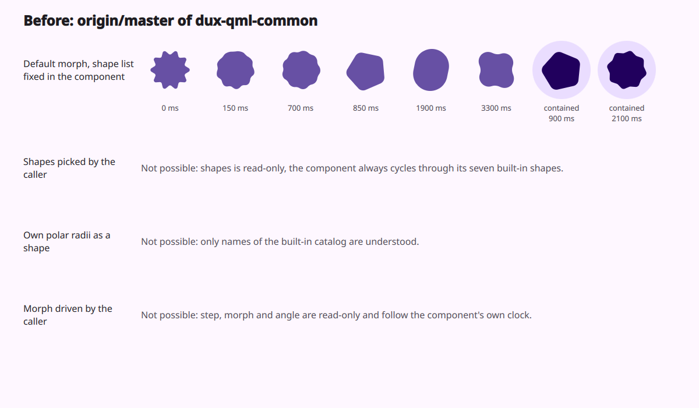
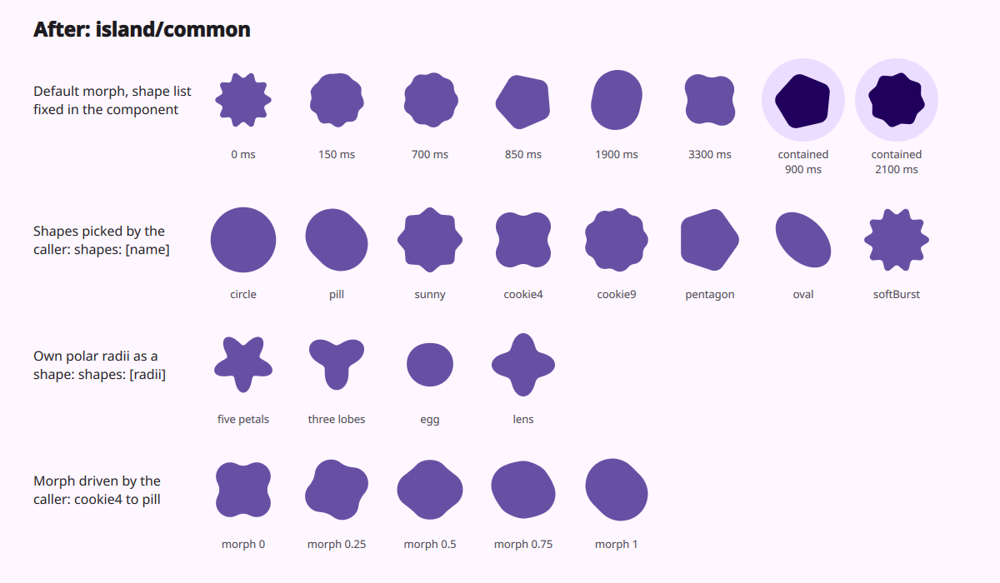
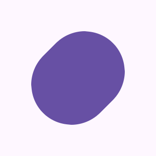

# Loading indicator with your own shapes (dux-qml-common)

Status: in [PR #42](https://github.com/duxlabs-dev/dux-qml-common/pull/42) of dux-qml-common (closed)

## What it does

- `DLoadingIndicator` is the Material 3 Expressive loading indicator. It used to morph between seven built-in shapes on its own clock, and a caller could change none of that. Now a caller can.
- `shapes` is writable. Each entry is a catalog name (`"pill"`, `"cookie4"`, ...) or the shape's own polar radii: 256 numbers between 0 and 1.
- Radii that do not fit, an unknown name, an empty list or no list draw a circle.
- `fromShape` and `toShape` are indexes into `shapes`. They say which two shapes the morph goes between. An index out of range draws the nearest shape.
- `morph` (0 to 1) and `angle` (in degrees) are writable. With `running: false`, the component draws exactly what the caller binds to `fromShape`, `toShape`, `morph` and `angle`.
- The default does not change: the same seven shapes, the same spring and the same spin. Callers that set nothing (the file browser path bar, the text field, the gallery) draw what they drew before.

## Why

- A bubble in the DMS island wants its own shapes and wants to move the morph with its own clock. The island code that uses this indicator is in a later step of the island work.
- A small cleanup comes with it: on each frame of the morph, QML used to build a new `Qt.point` for the shader. Now the shader mixes the two shape centres itself.

## How it is built

- [`DLoadingIndicator.qml`](https://github.com/lung595/dux-qml-common/blob/island/common/DCommon/Widgets/DLoadingIndicator.qml): `shapes` (no longer read-only), `fromShape`, `toShape`, `morph`, `angle`. The shapes become one radius array each, painted into a texture (256 columns, one row per shape) by a hidden Canvas. The texture is repainted only when the shapes change.
- [`MaterialShapes.js`](https://github.com/lung595/dux-qml-common/blob/island/common/DCommon/Widgets/MaterialShapes.js): `profilesOf()` checks the shapes. `polarBounds()` and `morphScale()` use plain loops and build no arrays. `polarPoints()` had one caller and is removed.
- [`loading_indicator.frag`](https://github.com/lung595/dux-qml-common/blob/island/common/DCommon/Shaders/frag/loading_indicator.frag): takes the two shape centres and mixes them by the morph progress. The compiled `.qsb` is rebuilt.
- Test: [`tests/material-shapes.test.mjs`](https://github.com/lung595/dux-qml-common/blob/island/common/tests/material-shapes.test.mjs) covers polar bounds, morph scale and `profilesOf` on valid and invalid radii.
- There are no settings. This is a library widget.

## Known limits

- The default look is the same as master on every offscreen check. In the screenshots, 4 pixels of 133,500 differ, by at most 5 of 255, from float rounding where the centre mix moved to the GPU.
- CPU, frame time and allocations were not measured. The gain from not building a point on each frame is not measured.
- The check on polar radii is loose for inputs outside the contract. A sparse array of 256 slots passes and then draws nothing. An object with only `length: 256` passes and fails when the texture is painted. A lone string such as `shapes: "pill"` is read letter by letter and draws four circles. Use an array.
- One rough timing in node found `polarBounds` slower with plain loops than with arrays (366 ms against 207 ms for 2000 calls). It is not a benchmark, and `polarBounds` runs only when the shapes change.
- The QML behaviour (clamped indexes, repaint, default look) has no test in the repository. It was checked offscreen only, with the indicator alone.
- The screenshots use a software renderer on a plain background. The default GIFs spin a little faster than the real default.

## Images

Before, light theme. The three rows under the default show what could not be done.

After, light theme. Catalog shapes picked by the caller, shapes drawn from polar radii, and a morph driven by the caller.

Four shapes picked by the caller, with the morph and the angle driven by the caller.

